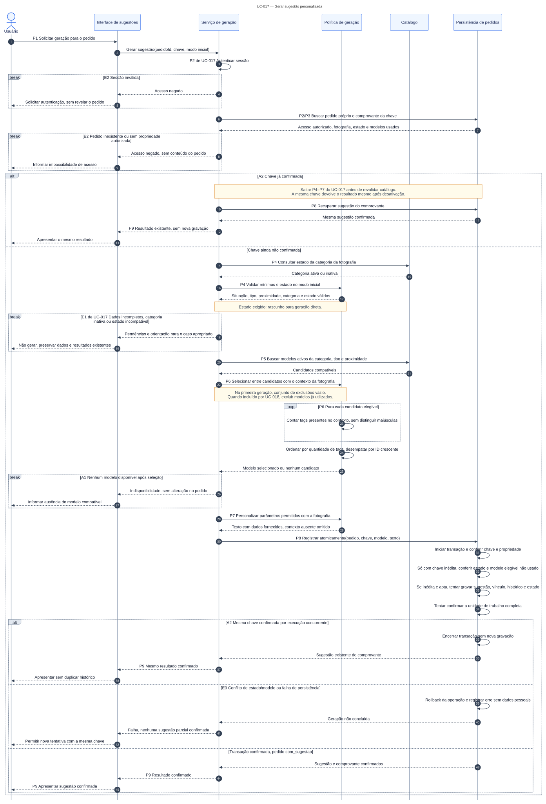

# Exercício 24: Da análise ao projeto

**Projeto:** VazaApp  
**Caso de uso:** UC-017: Gerar sugestão personalizada  
**Ator:** Usuário  
**Situação:** Proposto

[Voltar às respostas](ATIVIDADE04_DIAGRAMA_SEQUENCIA_respostas.MD)

## 1. Regras de negócio e requisitos

Escolhemos a geração porque ela concentra o objetivo principal do VazaApp: oferecer uma sugestão adequada ao pedido, usando o catálogo e os dados fornecidos.

| Regra | Comportamento e rastreabilidade |
|---|---|
| RN-002 e RN-003 | Exigir acesso válido e respeitar a propriedade do pedido. RF-017; RNF-001 e RNF-002; passos 2 e 3. |
| RN-008 e RN-009 | Validar os dados e o estado do pedido; preservar sua fotografia. RF-017; passos 3 e 4. |
| RN-010 e RN-011 | Escolher modelo ativo e compatível e personalizar sem inventar fatos. RF-017; passos 5 a 7. |
| RN-012 | Confirmar sugestão, vínculo, histórico e estado como um resultado consistente. RF-017; RNF-006; passos 8 e 9. |
| RN-024 | Repetir uma operação confirmada devolve o mesmo resultado, sem duplicação. RF-017; RNF-006; alternativa A2. |

**RF-017:** o sistema deve permitir obter uma sugestão personalizada e registrada para um pedido válido. **RNF-003:** informar resultados e pendências com clareza. As metas de qualidade e os critérios completos estão no documento de requisitos do projeto.

## 2. Caso de uso revisado

**Objetivo:** apresentar uma sugestão personalizada e confirmada para o pedido.  
**Gatilho:** o usuário solicita a geração.  
**Pré-condições:** conta ativa e pedido existente. A sessão e a propriedade são verificadas antes de acessar o conteúdo.  
**Entradas:** identificador do pedido e chave da operação. Situação, destinatário e contexto vêm da fotografia do pedido.

### Fluxo principal

1. O usuário solicita a geração para um pedido.
2. O sistema verifica a sessão e a propriedade do pedido.
3. Recupera a fotografia e verifica se a chave já possui resultado confirmado.
4. Valida situação, categoria ativa, tipo e proximidade do destinatário e estado do pedido. Uma primeira geração direta exige rascunho; alternativas usam UC-018.
5. Consulta os modelos ativos e compatíveis com a categoria e o destinatário.
6. Seleciona o modelo pela correspondência das tags de contexto, com desempate pelo menor identificador. Quando chamado por UC-018, exclui os modelos já usados.
7. Personaliza apenas os parâmetros permitidos, sem inventar informações ausentes.
8. Confirma sugestão, vínculo, histórico e estado `com_sugestao` em uma transação, conferindo chave, propriedade e conflitos.
9. Apresenta a sugestão depois da confirmação da gravação.

### Alternativas

- **A1, passo 6:** nenhum modelo compatível. Informa a indisponibilidade e encerra sem alterar o pedido.
- **A2, passo 3 ou 8:** a mesma chave já foi confirmada. Recupera o resultado existente, sem revalidar o catálogo nem gravar outra sugestão, e segue ao passo 9.

### Exceções

- **E1, passo 4:** dados incompletos, categoria inativa ou estado incompatível. Informa as pendências e encerra sem geração. Um rascunho pode ser corrigido em UC-015; um pedido já gerado solicita alternativa por UC-018.
- **E2, passo 2:** sessão inválida ou pedido sem propriedade autorizada. Nega o acesso e encerra sem revelar o conteúdo.
- **E3, passo 8:** falha ou conflito concorrente. Desfaz a operação, preserva os registros anteriores e encerra sem resultado parcial. Uma nova tentativa conserva a chave enquanto não houver confirmação.

**Pós-condição de sucesso:** sugestão, histórico e estado consistentes; na repetição, o usuário recebe o resultado existente. **Em falha:** nenhum resultado parcial é anunciado como concluído.

## 3. Checklist e cuidados incorporados

| Verificação | Resultado |
|---|---|
| Objetivo, ator, entradas e condições | Identificados e coerentes com UC-017. |
| Autorização antes dos dados | A sessão e a propriedade são verificadas antes do conteúdo protegido. |
| Dados de personalização | O contexto é opcional; dados ausentes não viram fatos inventados. |
| Alternativas e exceções | Cada caminho tem passo de origem e retorno ou encerramento. |
| Resultado confirmado | Só aparece após a confirmação conjunta de sugestão, vínculo, histórico e estado. |
| Repetição e concorrência | A chave evita duplicação; falhas e conflitos não confirmam registros parciais. |

Esta é uma revisão documental. Os cenários de teste CT-017.1, CT-017.2 e CT-017.3 continuam propostos, sem execução contra uma implementação.

## 4. Diagrama de sequência

[Ampliar o diagrama completo](../sequencias/UC-017.svg) | [Especificação completa](../README.md#uc-017) | [Editar no Mermaid](https://mermaid.live/edit#pako:eJyNWMuOGzcW_RVC2SRA2e6H-uHGoAFZbQcNpBuaVucxwAADqoolMa4iK2SVpuPAQP5h5gecLIIE8MrIJlv9Sb5kziVZVSxJHU9vbJGX93HuuQ_ph1GqMzG6GFnxXSNUKq4kXxpe_lMx_NWyLgT7cvrk4PCM_fnjf9nnwnDDbLMUtt78rFkljNWKF_INz7h_w5taq6ZcCBM-p7U2bMK4ZV_aZvPOSO0vKm5qmcqKq5rd0_W1qoXJeSpYJlobvwu7Kz0n6bkwa7n5RZPwEm5tfoFDu7JXJDvTxeY9jvhHhKckPOX15l2hl3vu75wyxCzh2m8qlU5hJTKZafjpH0yeXF7eX7DZIZvrAi9rINbZJHWc6fDGP7jHg_nFNrafepHrLGHpiq9Fwkqd6c_8k1tdC6bXwrD7BE-nK14iASyTRtScNZY7YSYV7PPi6d8W5tnlBB_TorHOC6TEpfWc5dooAczdA14gBYrXcs2fektz79zsiCINTJg0tVAEJ9wV1nZQLozgr9nLI-TGncLgGlDKlhpen4dnkkJGMyWWvMXBY4HryUUEHW-NOfwSWCyZEWtR4G6Io1BZ7_Md-fxsdsxeNJYc9YKsMpsPFSjIBEt1WRm9Rl5BOO5B9u_vnvigX-laoxhyyROGpMDRkAvm4BKFtoQ1cs8yvW3BYa4b8D8K1Lufatjc_AHhbBhBB-DM65JKPIBqglyEKnoLl6FdZBzpoFIzUek9iu9HzMbAXysQogRgsqy0tXIhKX-Zq0kfyhbYoAybHBEFgcu3m3dkJpemHHjV83WeIDNzPIKJ2fjPH_8zOyN3ArMoGZZMIcOcDBuWtuXYsrgUtgzpguRaF_hX44FtCkqRuweTq80H0mQdmR13nsYoeYacszuRNtVWV4OSiBz9q5YXN86DXn5fxG0eZs9honWty6ZPiIIBBoKt434UJ2NSISzIO6r7uLo4QxoKKwL2XCrQWD3u0OXlFP6M2VQrp8MEUjv281osQSZOH_KO9_3zaYh92gk6YImW0jeMoakrZ-qrkMRy817JEnUiWpvkIohGqXOdx6AHLQaMvAoWe_jgmmeFb6XUeVXm-7DdzzV4cRM1QkrAEuTiNm3UKjDqZqvxBSEw4F8-xZxM9fwiTqC-TUSnULeHUY-8cm0BHRdEKkStbRJhHBAj8AIcXhBUf4_O1iseMKkPFv5ADxFjMFRSbon4rkMMumrMqVt6QPPIJMzRy6yRoMy5G4Vpe7JG2HZVHzPqpO2xbU-k4KgnRrRKsEtULmVGP8jStZR95FLoShxosR4OaXeZdYoRU4hUYvcwn6bdqySiLlr2gxt3vwvXnqPpuYcltxyeyVJIANkN64RY-m2jardkROrW_I0M7Pl7A-vaj9bN-ywercED2QND7bGppVuXtI0IVGhdUVQzSmTKHXIhKJS4WO6hxZWHAsVMlVzzpWWhW8BBpX23f6hD78-QS6mWzhkuN3-gAAr-WGKD6hmxHK66J3bLREK9VVCO3HAtqD8phH59tVvBNy58-BFSBpTAfCXUqin7QLfLaXLIbr2Ih49iqLRyUIT2Thq3WmdcMdfKP-mGmMfC1XqoHLU7CeNi6aYhR-a7hS_4s7didyqEgDxzS2NYlA2V6-anUtQGlMDsKWVN-yPpY_ubbwvkPSXUyfl69bsbPU66fJOrfmHwevcPvSX4QEMPuJfYrUp6ETbOeN9EmKhcUvtZPAadnmvXU0E9w5XtWjL1dbRH0y1K0cKyo2K--eCi8bJSbX7NsPMlvZLQHTvIu1rwc84tX7tae1V4ySvSWPsp6oZtNOoTtsZkQi3gfyta6j8YmepuSu2ovvdq2vkK_Fijuv0ISCx4sfLMQNOPMhi2pJtod-mHtOsZ4gGbiEcRN6k2RgyWj8iLl_ieZswW9H-5UPjHnkTzbm_pl8vHNp64mrDJ3AxXkD6ER8on2l9cE2qqwn1r6KGOCoc2mZfH1NDyQoaW67LwLCQfPSMHvOE7V_QlbC9Id7ooFjx9TWNIV13B04hryQ8QPW6-mirabnk8bmLYPu97Rpsj1_H5frRekadJaHLxsojid6vIvh0txm7mG4PxSXX8dTuD7xLRErwF4X3Eid5G0n49ideaj_Jj8B2pT7Z9lCB3_zc1IByz4y936a6nuv-MklEJbLjMRhc_jOqVKOn3iwW3AjcYpK_xKcVwszLFwaouiy_4AtCMLsAeK5JRjk75ipey-B6SEywnBeScnq84Pi0KYUnzXjE6nMs3ZPFwXD3gxP2-8eL1EiefiDw_zfPuUJtMGDo_Ojk9Fov2nLr4VBfaXR2eHZ2cjNurL_CNr7t6PubHi3NcWbnE6OjOj4_Hhycn3flA3UEOhZyAoJhf6Ad41l2KI3GeH8SXzsPu_nR8Nj5ftPeP6MWmsv9GYaOKreV5vnBBu4uhpez52dnBabgbqOuCAx6ge419IVaaLQTPxfB6qLrDuv1F69b9GBW7hb_R216Akv1vw6uOIC4VN9wspRpdHJ8Q36zlS9EeHY2TUeZ_J_NH3-DsYOvsH_6slGgyZkIaewZiQt_wh69lVq-GRl919Docd2aHh4RYfPIWkdAPAfPvVTq6qE1D-issVO1Pef7w7f8AxEu6TA)

## 5. Justificativa dos elementos

| Elemento | Responsabilidade e origem na análise |
|---|---|
| Usuário | Inicia a solicitação e recebe o resultado, conforme passos 1 e 9. |
| Interface de sugestões | Recebe a ação e apresenta resultado, pendências ou recusa. RF-017 e RNF-003. |
| Serviço de geração | Coordena acesso, busca, seleção e confirmação. Passos 2 a 9; RN-002, RN-003 e RN-024. |
| Política de geração | Valida o estado e os dados, ordena candidatos e personaliza. Passos 4, 6 e 7; RN-008, RN-010 e RN-011. |
| Catálogo | Fornece estado da categoria e modelos ativos e compatíveis. Passos 4 e 5; RN-010. |
| Persistência de pedidos | Recupera pedido autorizado e comprovante; confirma a unidade de trabalho, aplica rollback em falha e registra erro técnico sem dados pessoais. Passos 3 e 8; RN-012, RN-024, RNF-006 e RNF-007. |
| `alt`, `break` e `loop` | Separam os resultados possíveis, encerram caminhos rejeitados e percorrem os candidatos. Derivam de A1/A2, E1/E2/E3 e da ordenação prevista na RN-010. |

As camadas e os repositórios são decisões de projeto para realizar os comportamentos descritos. Não representam novas funções para o usuário.
