# VazaApp — Análise e Projeto de Software

O VazaApp oferece sugestões de desculpas personalizadas a partir da situação, categoria, destinatário, proximidade e contexto informado. A geração seleciona modelos de um catálogo e adapta apenas os dados fornecidos pelo usuário. O sistema contempla contas, perfil de contexto, destinatários, pedidos, histórico, favoritos, avaliações e administração do catálogo.

**35 casos de uso · 24 regras de negócio · 35 requisitos funcionais · 8 requisitos não funcionais · 1 diagrama de casos de uso · 35 diagramas de sequência Mermaid.**

## Equipe e disciplina

| Integrante | RA |
|---|---|
| Isabella Barela Venancio | 144023 |
| Carolina Yumi Toyota | 143210 |
| Matheus Lara Campos | 126608 |
| Gabriela Borborema Paes Barreto | 144438 |

**Professor:** Prof. Dr. João Choma.  
**Disciplina:** Análise e Projeto de Software.

## Navegação

- [Diagramas](#diagramas)
- [Atores e catálogo dos 35 casos](#atores-e-catálogo)
- [Regras e requisitos](#regras-e-requisitos)
- [Especificações dos casos de uso](#especificações-dos-casos-de-uso)
- [Leitura das sequências](#leitura-das-sequências)
- [Matriz de rastreabilidade](#matriz-de-rastreabilidade)

## Diagramas

### Casos de uso

[Visualizar no Mermaid Live](https://mermaid.live/view#pako:eJy9WM1u5DYSfhVCgw42QHvSpFr9l0UAj8fJZYEN4tjAwsqhWiq1CUuiQlI9njE8yEPkBYI5BMhiT8Gecpt-kzxJwJ-mZbl7pmeASR9EtqrqKxar-InkbZSJHKNFNBjc8prrBblNI32FFabRIo2WoDCNhml0pavyX7DEUqXRooBS4TCNSiGurVpWglI8s5olvBSttq-xvLavilK8yK5Amre3e7CyVq6dz5LXCNIa1iLHswYyXq_SaEFnwzSSUF_fv4qTu6Ef7wVIDssSlXNSiFp_DRUvX1rQY8mhdIMRtT7jr5wvOm5u7NtG8grkyxNRCmklT7AoJkXRFX6PN7qjQKcsScZdhWdC5ig7KiyZxLh008Jr7Egm4-l45iRZ2SqN8tn1yomKWQFF9kBkcZ10PoZ4OUuju7u7wSCVaR0ml3z_zPwnhJDBgBwrJTIOm183_0dF1Ob3kuegiMKKKNRAJDYSFdYaKtKA1DzjjdF-I74k9eaNeKCg8Md281udcXi6dXFxmUZv_wtayLd__HMpv_jqgiuuodaYRj9slc77Sueq3fwiuejoHPd1jvOK11xpCbmZraB4ahUVVxorIHijUdbC25yhXPPNr4LkSPCoAl52DFW7XElorsjZf84u0-gCXsFx05A_f_qZxAnJQAll7FrVHdYDw0zUGi7T6MS0BAlkqB5pm1_OJWaai7qTjO3v_GQ0ov-4TKPzk6PRiNpxn0AOJlLpXKTRD5_vMmPBjLkpajXWmmcgSXs_oztN42AaW9PTOkNpHCpUavNmr9042I2t3XeYtQ0awxD8Trsk2CVuqKW2VjnkZprh3YFOgvXEjfYmK1v-jtkZDMhpKRTh9Zqrzf_WyBURcgU1fwUVEQSVqepdNZ2JqhFSQ4W1Fk93Jou8fv3aTWLoJTvTE8Tj0Jt0FbHO99YV3mjhS8t0CZIcleY1aJtX9RFVNg2zOHVVJmrVlhokaVAWvDTVvnW9LxOzgDFzedQtlPzVB2HMA8a8V-0PQtxjTkdbczrqhfFohnbah8VGaS-Eg9yHRUfZg1p8r_GnrMlpKLD5tkfpzvwF8Sj02CE12WDOc6Eu0-hb1_vwAqSBdKgjnRPJbeEYPFM4OaqsLZt9NEAD-dDxowLejmmnYWAfmjyqWuscKyJBZW19tTfvgYPoQw5yCH9zwmmgHrqLemggHHoQ4ah2hUoLNOk9s327PUBSwFpIrj8q24FuqKObbyzhO1cm4AalErXNQ7435YFvqOObM1HyjJuU12IN92j77APX0HmvZK640pvfJc9s6akQ9R4kFmiHbWmn4d149tkFumGObr52U3qIaaAaxnqD7-Zlp2lYaiz23-lKrLE7_ea7-06YT1m-ga9o4CsWvqss3lkJQRyYix3EXLCGkkPmqvvY_nHb3w-vaRYYiDkGcnAHpDIwEOszEGxHtN84UA97SD3vMf2ECWSBYFgSeoftbUBDKVZmb3O_o7chkFwY6eYXI_6I3AS-YdP-Jho0roTk-1iGBZZhs95CC6Z7V1pgGDbvZfZ9buNAKbGjlOeoQPP1IaaBVeL-iaESOZaHfE7jQC9xn14chjoEJBBNHPfCP3wgYVXF4948HI4RFlic9IKBzpInEjNcmiPv371gAuPFgb7iXTzHAs_FgRDj8c7CC-Jw0IiTPUuw0x0MyL99TJIIc_Tniqxk2whltkFabn5TJBNlW4PZAeQtmO8EvwEV4rLHLutzu-_qCOxpxcjCpiJI_dK30ntWDlcH5OjoyJ-wPvMHKNeG8M-DSuxFiW8nvp36dubbuWvpyLcemnpo6nHo2Lcej3o86vGox6Mej3k85vGYx2Mej3k85vHuufG4HwLzLph3wbyL2LuIvYvYu4i9Xexd3OfcnTQN_GnnFZ2Ro6fE3JHwOivbHN_-kUbk6dFXLr6QHHNX9xwLApkWkhS8LBdPkOGsGA2VluIaF0_G0ySZzIeZua9aPBkVdMrAC49e8FxfLVhz8-UjxApqWKFZGlvYrMiLJMCOkvmkAzsZY7x8iEIuhufD4-GpG1xPZudwaGfQPudDO3v2Se2T2Wdsn2P7TDqDsnDRMKpQVsDzaHHrbg6jhb3njIadm8ntxaS944wW2xvOaOjvN6OFud2M7oYRtFqcvayzaKFli8OobXLQ-JzDSkLlXt79BSqxgdk) · [Editar no Mermaid Live](https://mermaid.live/edit#pako:eJy9WM1u5DYSfhVCgw42QHvSpFr9l0UAj8fJZYEN4tjAwsqhWiq1CUuiQlI9njE8yEPkBYI5BMhiT8Gecpt-kzxJwJ-mZbl7pmeASR9EtqrqKxar-InkbZSJHKNFNBjc8prrBblNI32FFabRIo2WoDCNhml0pavyX7DEUqXRooBS4TCNSiGurVpWglI8s5olvBSttq-xvLavilK8yK5Amre3e7CyVq6dz5LXCNIa1iLHswYyXq_SaEFnwzSSUF_fv4qTu6Ef7wVIDssSlXNSiFp_DRUvX1rQY8mhdIMRtT7jr5wvOm5u7NtG8grkyxNRCmklT7AoJkXRFX6PN7qjQKcsScZdhWdC5ig7KiyZxLh008Jr7Egm4-l45iRZ2SqN8tn1yomKWQFF9kBkcZ10PoZ4OUuju7u7wSCVaR0ml3z_zPwnhJDBgBwrJTIOm183_0dF1Ob3kuegiMKKKNRAJDYSFdYaKtKA1DzjjdF-I74k9eaNeKCg8Md281udcXi6dXFxmUZv_wtayLd__HMpv_jqgiuuodaYRj9slc77Sueq3fwiuejoHPd1jvOK11xpCbmZraB4ahUVVxorIHijUdbC25yhXPPNr4LkSPCoAl52DFW7XElorsjZf84u0-gCXsFx05A_f_qZxAnJQAll7FrVHdYDw0zUGi7T6MS0BAlkqB5pm1_OJWaai7qTjO3v_GQ0ov-4TKPzk6PRiNpxn0AOJlLpXKTRD5_vMmPBjLkpajXWmmcgSXs_oztN42AaW9PTOkNpHCpUavNmr9042I2t3XeYtQ0awxD8Trsk2CVuqKW2VjnkZprh3YFOgvXEjfYmK1v-jtkZDMhpKRTh9Zqrzf_WyBURcgU1fwUVEQSVqepdNZ2JqhFSQ4W1Fk93Jou8fv3aTWLoJTvTE8Tj0Jt0FbHO99YV3mjhS8t0CZIcleY1aJtX9RFVNg2zOHVVJmrVlhokaVAWvDTVvnW9LxOzgDFzedQtlPzVB2HMA8a8V-0PQtxjTkdbczrqhfFohnbah8VGaS-Eg9yHRUfZg1p8r_GnrMlpKLD5tkfpzvwF8Sj02CE12WDOc6Eu0-hb1_vwAqSBdKgjnRPJbeEYPFM4OaqsLZt9NEAD-dDxowLejmmnYWAfmjyqWuscKyJBZW19tTfvgYPoQw5yCH9zwmmgHrqLemggHHoQ4ah2hUoLNOk9s327PUBSwFpIrj8q24FuqKObbyzhO1cm4AalErXNQ7435YFvqOObM1HyjJuU12IN92j77APX0HmvZK640pvfJc9s6akQ9R4kFmiHbWmn4d149tkFumGObr52U3qIaaAaxnqD7-Zlp2lYaiz23-lKrLE7_ea7-06YT1m-ga9o4CsWvqss3lkJQRyYix3EXLCGkkPmqvvY_nHb3w-vaRYYiDkGcnAHpDIwEOszEGxHtN84UA97SD3vMf2ECWSBYFgSeoftbUBDKVZmb3O_o7chkFwY6eYXI_6I3AS-YdP-Jho0roTk-1iGBZZhs95CC6Z7V1pgGDbvZfZ9buNAKbGjlOeoQPP1IaaBVeL-iaESOZaHfE7jQC9xn14chjoEJBBNHPfCP3wgYVXF4948HI4RFlic9IKBzpInEjNcmiPv371gAuPFgb7iXTzHAs_FgRDj8c7CC-Jw0IiTPUuw0x0MyL99TJIIc_Tniqxk2whltkFabn5TJBNlW4PZAeQtmO8EvwEV4rLHLutzu-_qCOxpxcjCpiJI_dK30ntWDlcH5OjoyJ-wPvMHKNeG8M-DSuxFiW8nvp36dubbuWvpyLcemnpo6nHo2Lcej3o86vGox6Mej3k85vGYx2Mej3k85vHuufG4HwLzLph3wbyL2LuIvYvYu4i9Xexd3OfcnTQN_GnnFZ2Ro6fE3JHwOivbHN_-kUbk6dFXLr6QHHNX9xwLApkWkhS8LBdPkOGsGA2VluIaF0_G0ySZzIeZua9aPBkVdMrAC49e8FxfLVhz8-UjxApqWKFZGlvYrMiLJMCOkvmkAzsZY7x8iEIuhufD4-GpG1xPZudwaGfQPudDO3v2Se2T2Wdsn2P7TDqDsnDRMKpQVsDzaHHrbg6jhb3njIadm8ntxaS944wW2xvOaOjvN6OFud2M7oYRtFqcvayzaKFli8OobXLQ-JzDSkLlXt79BSqxgdk)

O diagrama representa os 35 objetivos e suas associações com os atores. A relação `<<include>>` de UC-018 para UC-017 indica reutilização obrigatória da geração de sugestão. Autenticação é precondição das operações protegidas. A notação utiliza elipses, limite do sistema e atores externos em um `flowchart` Mermaid.

### Sequências por caso de uso

Cada caso de uso possui seu próprio diagrama de sequência. Abra o SVG para ampliar a imagem ou o link de edição para trabalhar no código Mermaid.

| Caso de uso | Diagrama | Código editável |
|---|---|---|
| [UC-001 — Cadastrar conta](#uc-001) | [Visualizar SVG](sequencias/UC-001.svg) | [Editar no Mermaid Live](https://mermaid.live/edit#pako:eJx1Vs1u20YQfpUFe2kBG5UtyXaEQoAiO4WBJBUs2W2BXpbkUNp6ucvuLlUngYG8Q_sCRg9BC_jUW698kzxJZ3-4on7CEznz7cw3v8sPSSZzSEaJht9qEBlcMrpUtPxFEHwMMxzI7fS41zshnz_-SaY0p9ooqkgmhaEeRWsjRV2moMJ3ZqQiE0I1uWOaGSoMeE1FlWEZq1BCFlZ_jSpV0OyAfm71c1Br1nySJAfvUe8DLy1wJnnzjCIakfvAGwcEpZk2zT8iYwEzOR6PFyMy8yHOJccDxobog5UetThG2ARhpw72VpZwROC4pIwTIBrEihKZKrakpvlXMam_S9W34wVwKKQAhBTSSCKrjElBWYgjVUDvyaTvTMZkoWesBKfEfugQUcFUSUOGO6ynHrrLtss4FE0SW1-laC6RbkkyxbbrCCL3L1zKisz6nz_-MRs4ZteikNY7kTUeUBgkUwTj_BsjxgKSHG1qsm6eOMOXPY4zH9-0DSLgc9r17hmPx_NRGwpVU6v-2qG_2aDmiLpEq57bHUWnLv6yQqNAhKXK2XuU-fJsTl4eeweXW3xtVJWSKYeSdshTbsjE98QP3bpiv2O1bWHwXGgAJoKxzXHPtC2S40Zj8o5cBXDQ1rT51Py1cywWrk01EAUVGHyb9TdQ4Bp2Qtl1Px7fWDNC19x2dC2wtTGdQLAHAvWYrl3yN22ymK6kaJ7XwG3EvzZPpDbs0AmXMT8eV974F4Dd3NxAVmvbE3XFA7t9cJuRW-2a0DVzGL3SthfyUminAruacJ1ofcBjGLZAUGeSryAeO1CG9gldfG2Th-bdOhwchrY8r_ykYeW0G-cwgAfHrvvEEYwCW-OQzHxTiEPp9EOBjULjfsYZZWvbdSUuwgrrd6vr5gmbeP98Oxpu5MjaDRUOaLvZcD4MLFG2Q6_LN37El9CAs2HYIhoUa6lZUgrTo5hLvd1yoaTNf5jpQLFtwu_jqMRdiOyw7AXlK9pdpld-ZDsHHMRipR0_6HaaNeaE8YrytNuxDXUTwW_G6-Y5P7BiF2gAky7kmpbgNjhGZ7_IGkMu8F6KQcYZ3MtVWJZn3Zu2E-7OPeQLZbvJlQkvYXS8cdTtleQoKQFNsDwZfUjMCkp746dUA2pw2d_jV8ap1ixDwcqU_DVNsfOSEaZOw1GCN5h5RUvG3yFygi454pydO4pfuDm1tXwQZoVz9t56PBlUDyhx_wcv75co-QqK4qwoolCqHJSVnw7P-pC28gU8mKnk0qlOzk-Hw0Gres0ERNWLAe2nF6jSbCkoj_J-f3AyHEb5lrlegQapTYSN-aV8QGZRCadwUfS6Sscw6s8G54OLtNV_wS7epoc1Ameq660oitQF7RTbnvIX5-e9s6DbMheDw3zgtBv8v-gazVOgBWyrt03HXLf_gG_dz1yXFj7J4wZgi_27olVsEFeKN1QtmUhG_aHtN63pElrR6eAoyf2fpRf9hLLejuxnLyuZUlJNrMVNB-KV-4Y-_Mhys9p2-iq218kgut0W2ox1JY8Yif1nnb8TWTIyqrb2q5ya9ufXCx__B1Z3nqI) |
| [UC-002 — Autenticar usuário](#uc-002) | [Visualizar SVG](sequencias/UC-002.svg) | [Editar no Mermaid Live](https://mermaid.live/edit#pako:eJyNVl1u4zYQvgqhvrRAAvg_WT8E8NpZYIE0NWJv2gJ9oaSRQ4QiVZJys7sIsHdoD9CgD4sWyGNPoJvsSTokJZmyHWwNJJDm95uZbyh-jBKZQjSNNPxagkhgwehG0fwXQfBnmOFA3s1Pe70B-fLpDzIrDQjDEqpIqcvqSTHpLWlppCjzGFT9nhipyIxQTW6ZZoYKA15TUIUBWIESsrb6t6hSGU2O6FdWvwK1ZdVnSVKwaXz-6nP1lzx0WFiHpeTVszVyHglofcTyxlmC0kyb6h-RMOptZqcXF-spWfZdvSvJ0cFguWGc9SkazdBosGcEpzllnADRIO7qgLECek9m3rTtBQGdSH4HREFSFqD2MgRIdtEb06D2EM0lTk_ZQFxumEAQKdOFFCxmnH1AsRvjyPuBSP0Dl7Igy-GXT78vR37CpvqbJApSsD1h2sLC7JrIktCYilSKQ4zLofN9KzKp8hf64KFeXKymuymqb4NM3-3sVmh3g2E9pCuZUF9CIoWhpAAumxTCJrTKNEB1c-rzzJ057MrhpFDSwIal1NVT6nD0TebFlNyCYpmjuavAxpAiZa7zhBq2DVwWdbalYsKSi7tlUA6TzWLHpgN7T4jLfnehfGgm_NCq5y3wnYtH5nt9be0yyUghtXZ2FlvCS6aIPCBRSJA1ZnLYCXiqYBc05PiHgTBoaSxTqqdO6pYpbqu5ITMPfB5QhIlt9cSxqY4lfkhM7LUprGHmUBLhutk26zjquVSKbbA4RIo8wwTQEN00BXU9643r72-cdyP0Jb-A0JdfSRECvEaGlDlt28gE7iv2tuvR6SNwDZ0O1kvWdVns0bigyHxkMGwZzcGWlGAabVSnd22i9qHZpnE9OOZo7cFukbMlt0yo_qwnh2em9Lm8e7NNq9oFrTKGW-d3KKO8e9LVxD5CU98YPOia7OHaHRLDs7p6To-cdfs9P6Bup3hc6OXEoVoAfmty5KbCUwQf0Ptf0CStCz5oaDOCH-pz1xq3hG3m5bbCn4BLF2WWYgrm46jDIptGApFh2NbJ0k17fIalISua8us2dVwkOTg6HM08pHedr_XX0eCXs3H5P0gK-x9PvkMIdg7RSZRjDMrSaPoxMneQ2xtHTDWgBr9A9_iWcKo1S1BwZ3J-RWMEH02RXRpOogyJ-YbmjL9HyxkSmKOdi3NL8S3moG3ko2ZWuGIfbMb-qHhAibubvL7foOQbyLJJlrVCqVJQVj4YT4YQN_I1PJi55NKp-meD8XjUqK6YgFb1akSH8TmqNNsIylv5cDjqj8etvBOul2FAahtha34tHxBZq4QBnGe9UOkQtvrJ6Gx0Hjf6F-LiJ_64RuC3MMyWZVnsinaKbqb01dlZb1LrOuHa4rAfyFzDpAiDpjHQDLrqbui2180d9NpdJENY-IsedwZ22L8pWrQEcaP4niq8-ETT4djyTWu6gUY0GJ1Eqb_ZetFPKOvtyX72spwpJdXMRtwxsNQY6-FHlpq7btI3Lb36ozZtV2g7FkoesRJ7iKzeiySaGlXa-EVKTXP59sLH_wAkCeGV) |
| [UC-003 — Encerrar sessão](#uc-003) | [Visualizar SVG](sequencias/UC-003.svg) | [Editar no Mermaid Live](https://mermaid.live/edit#pako:eJytVs1u3DYQfhVCvbSA3eyv7SwKA4rXAQykrrG7aVogF0oa7bKmSJWktpsEBvoQfYAaOQQp4FORJ9Cb9Ek6JCWu5B_00r3sauabmW9mPnL1IUplBtEs0vBrBSKFOaNrRYu3guDHMMOBvD47HAzG5J_f_yDniFCKKqJB6_qj9DBaGSmqIgHVPKdGKhITqslrXdW3iknyjMRZwQTTRtFMNsCSKsNSVlJhyMrCL4QBldMUHvqX1r8EtWX1J0kysFVBoJvWnwKTbsDcBlxJXt9ZkI3oke5CFw4KSiO9-i-RMuox8eHp6WpGroau-aXkGGCwe_BjKLA-UqH9xCsMWs5ajFqij8qvtfs6k0phEHzjoUuEzjH_yOW_yGw_OZLF-UqbHJtsc5O0CfWR80NfZR-DQ33Qo82_mJEzKXTFHXFtEIg4JNOHLpqE5x5BTUU5kRXJKd8000gU0Gty7odxaTnVn0kpMcndFjgSFBhrq8hQ514Rz8kP9bw7Q-E7FDlTBQbu0SuLjmdkASUYpnAesgTVXTmIrFEdNyRuNtXM7Jf6tt0DUsFuYFcy-_shnUsQm6rYj5satqVdHg61gEJuQREFOSivFMJliqN6QpDdHuIUc8tAqOXPNQTClAkkuq1vOeuT9Drxh_BCbKn1q4462F4HnbhWJTE37dCQOh5BVDGp_3xCWx3lNGcCB8-aoj7JIwLqiuiiBw57pfcE9UBU_bi-KDoxvb1ZUC5ZX4guxM2H1nf3Q_9bUz1ddatdTXr6Ctr6f4Vypeq_d6zAO8kivoAmeGnigUJDKgtJtkzjAsO-AtNLiTeGKzs_wOX9UGGY9luySXD-OBrcPHZbUAEpFLhW6rSBub_9LlHPTuMgiv3BcYuwl7xi72ngVCost2Y28q2IDqLCZmVZNPsQmQ0U9k8loRrQw6W8xqeUU61ZioaNKfgrmqD0oxnqQcNBlCOzl7Rg_B0iY8UoR5zL8yPFp4SDtpkfhVnjkr23FYeTcocW9w_04nqNlq8gz4_yPBilykBZ-2h6NIakta9gZ84kl841PB5Np5PW9YoJCK7nEzpOTtCl2RpnF-zj8WQ4nQZ7L90gx4TUDsL2_ELukFlwwghO8kHX6RgG_9HkeHKStP4n8kpZPu4RuKNutTzPE9e0c_QrZc-PjwdHja-XLjSH88Br0TApukmzBGgOfXc_dZh1-5px6V4XurTwE93sAXbZvylaBoG4VXxP1ZqJaDaeWr3hHbSG1jSaHESZf3nxpp_QNrhn-9nbCqaUVLHNuFdgpTHX7g3LzKZf9GWQ13ASyvaNdmJdyw12Yg_M8p1Io5lRlc1fZtS071feePMvse5FtA) |
| [UC-004 — Recuperar acesso](#uc-004) | [Visualizar SVG](sequencias/UC-004.svg) | [Editar no Mermaid Live](https://mermaid.live/edit#pako:eJy9V8Fu3DYQ_RVCvSTAOvXau7azKAJs7KYIEAfGruu2QC-UNFqzlkiVpFQnQYD8Q_sBDXoIGsCnopdc9Sf5ks6QEldar4MARWvkkJ0ZzgzfvJmhXkWJSiGaRQZ-rkAmcCL4SvPiR8nwzwqbA_v2eGd3d8I-vvmNLSCpStBcM56AMcqb8coqWRUx6PZ3YpVmc8YNuxBGWC4teE3JtRWJKFHCzkn_FFU6Q2e39UvSL0HXonmnWApMt8Gbd80f6rb9Cdmfqby5QRH_jAMLdwC0EcY272Ui-G2b080kYKfgIveG851Hj85n7GzssFmqHE9ZxGYQlyWqGJw6x1PLWTDSc4fkPW9y39ss0WaBnvec52cq4bl4iZ4TJS1nJeRq4HKx430eO3WitAZTKpkCostUhQUy_QvGGvgVm_u0n1OOcI0YQOt-eN4f8Un5-y5IaSiP5kOcE9YSKqv52vKcLOczBI5dqqoGzaqCe-8jVqukeU_XByRM85YJaayuEKu_wXgXINM1DCcIw77L9FgLhMCqK5Cs-SBF4rGtEZuUY2nw33jKCiGRjq2nkxaYc3cIq3ddigEfWqAXsEIAdHBfC5lUOU8Va373eQ-Bbu0pAZkJXaDl2t_pjH0ta8q1fzWXq_PuLU9bV2SqqJ2EVVSrjOeXgzp97ev0tO9LuqLJhONtL3nKTb9KGzdyDh11XSQDBUO4lMH_SdPc1CDM7Rojkwyy3pH5_6t220_drPlU4H8ZtG0BHykMKcZjLlMlOaNfhkBDj0leCb2-7nNFTUUR56MFJYAVwJZEEkgMiLF4jjMNi_Lgq1h_-ailniMe42Xzl-mx9MEGBN1Embq85iWCjz0YaOluJDqutYMEMxEZwqNdpHvOcmOMHGwMb9u2g-_3juwbHD9xJEEIQoMBq6ygQbTRQNiiF10SrG5uyJ0a9ZuNjhrVdu221lzzn-aiCf3U1snPQW8qZN28xYxChNSd-wnr3Ds4HFgpZEIKn0obYBuBwwSXquYbYxzb5my8Ua5cqZKdHX588-vZka-Ybf70h42jBYQB4Z34zPvt2sU-O9xYInd7WR9u6fJUZgqVn3cmrB-PiXb89awZOQdOMArHE67uD6cLTWR_3QvHjM-L29X7wkNAJSu1inMo-nCo0rK5H_e-sZCbqihzsO7EEM1UIPdXwyXVr3vApQvkhp9vT-3zHR7sinGMG1CshGb0hsC3jKQHD5ZobR0oMNhVC4qJ9aMW01yaQH4NdQuVb704V_jcCmRdDHtBSMSnJTkedsPeUXvdH3d2BxI2hWrds7RRlCDgTFWIYXe4hE_AZPwlDDL-b1poO2DfaF531aBCWVxcqecfZdwi5kYpDdc1jthG9Dgz-HpyOzHl2zb1ccuYYUW27lkP4xO3LiUPHXILkSFsJrQLpoucVGG6dsn2987dmEr_VqRt09xsg3YBJVjEw6jCvevCe-IThLlrwz5sF0I_gfCU2diw88piPDfbKSTvdbs37C9EnA3uQYljEN-UVEnWTQZaqVoo7dfifIivz1m45nGb3JUVRfRtUXAK726NCzMaRQVtW5FGs1eRvYSCvl9ibgA1OJGv8FeSc2NEgoJLW-TPeAy5iWZYcgOjKEOWPMGXU_4CLef4qMzRzvm54PgLJ4Uhz1vNSLgULynieFJeo8R97Dy-WqHkC8iygywLQoWtqEm-Nz3Yh7iTn8O1PVa5cqrx4d50OulUz4SEoHo44fvxEaqMWOGjIsj39yfj6TTIB-52M3TICQi682N1jZkFJezBUbbbV7oMg_5gcjg5ijv9HX5x5W3XSKRBP1qWZbG7tFMMI6UPDw93D1rdwF24HOIhaiy8kn2naQw8g6F66Dpg3X3RPndfpv208C96vTagYv-ieRkI4kpxyvVKyGi2PyW-GcNX0In2JqMo9d_JXvQ9ynY3ZD94GU4wrfAbDz2uGVgZ9HX9nUjt5TDok0Cv8SSEHQoJsb7kNd6EmmT5QibRDJ-55L9Mue0-5b3w9T9tpoBg) |
| [UC-005 — Alterar dados da conta](#uc-005) | [Visualizar SVG](sequencias/UC-005.svg) | [Editar no Mermaid Live](https://mermaid.live/edit#pako:eJydV11uGzcQvgqxfWkBuZUsyXaEwoAiJW2A1DUsJW2BvFC7szJrLrkhuVvFgYHcob2A0YcABfxU5AS6SU7S4c_-SUqDVg-CdmY4P998M1y9jWKZQDSJNLwuQMQwZ3StaPZKEPwYZjiQF7Ojfn9MPr77g0y5AUUVSWgiNX6TWApDvTEtjBRFtgIVnmMjFZkSqskLXWzvFZNekVNlWMxyKgxZWvUzgV5TGsO-fmH1C1Al276XJAEfUO8bzq3hpeTbBxTR2nLf8MoZgtJMm-1fImbBZnp0fr6ckMuBK3QhOR4wWCp1JW_fb_-UtuBcbf_OFetUvsSji4mV6ILjmZlVfalBayq_8iYLNJlPyBQxUuwW3VqtdQmEJSAMSzFr5Z3WMfzR-ZF3f6kkCsE4JB3a1lMiiSyIgrjQwX6lgN6QJ6GOEIaJcnvPGRaA1j6KsPLaTTjsc_VQ_JjXhXv_baOlNZpiRTFGkETA2qaiISOwyWXNEMB4RnXQApE0mFxhXccu01mFXjgKCcNSS2ANz_ayvQrQzDt0RExjBYgq9pYjmNLAmlVHquL8EWoKigFs2hrEdd3PUFuuAMWHcmpDPR35AiiOD7eMQTrrwMCUqYyqBrbAssa2YtcH0PvghiTteDCJuRCXkCqteAfMir7DCkwfuRPg25X65hx8pa50Tl4XVGDfYMMaiAKdnYHlapvOveAwlqC71L70KFxBSS3P2gyvJDHNcumzWAKHVApAbSqNJDluIdsDRTizRl3qz9xB4imMP5DD2NYVh4zqfyE98jeBIoTHfoTGUIIbrvTM_r-sL4wdWjuyQpY0wwfYaYjMTViXYXdgrUcZZdxm3yJbC8KX2Ga_B1otaqwqNBZOGUulwNDd6f98_L2wFxKZ4jpti5F7ZlXcJz59UZknsuvqql1BIXB_OtRhE_OCWZYd3p7tQQ4hEqZzKbYPJTi0ft3ek8Kwdsy6zDCCgfaWJ_WuQ7K2qc5EC7LQih2vbR5Mc-kmvyKaWxKOOJ-b2hmGwXFSyG0MJ5WwJ3AydzK_wL1EZImUn_bs1TD4-O73qd-FFzKDHjGfnBEfPwmzhOX4oQnr18U2SoZrsFqFTH_d3bv-Sn9mG4UZNjPRLNLuRWQZ9b0sSmicH-Cx9XwSPFeDj3n7NYtz-QF2Xxx2L4TDywtPZHjXNdNpr1u8w5vRq0j0XVNJtYH9vZdSft29JD3cT62cULy-KC_b2zokNAed0lvYyUd0A-gDFAob1OdS2eM0bB8OLZX_sO2rCJenroDmMvNsbt1oeudK66TUZP9KRL0oA_zNkmjyNjLXkNnXwhXVgBou5Q0-xZxqzWIUXJuMP6cr4DqaIKwaehFS1TylGeNv0HKKrOFo5_y8pPiEQ6St54NmVrhgtzbiYJRvUOLeHh_frFHyBaTpSZrWQolbXVn58fhkCKtKvoSNmUkunWpwejwejyrVcyagVj0a0eHqDFWarQXltXw4HA3G41recddP0SG1QNiaH8sNZlYr4RjO0n5b6TKs9Sej09HZqtJ_wq-U-WGNwDXRjpam6coV7RTdSMmj09P-SdB13NXFIR6spIZJ0XaarICm0FV3XddYV38ULtyrfjst_ER3jYFt9m-K5jVBXCt-oGrNRDQZji3f8JViDZXoeNSLEv_3w4t-Rll_R_aLl2VMKamm1mPDwEKjr81PLDHX3aBPa3oNRnXYrtAi1pbcYSX2dXPxRsTRxKjC-s8Taqp_SF549w-Mp4d0) |
| [UC-006 — Excluir conta](#uc-006) | [Visualizar SVG](sequencias/UC-006.svg) | [Editar no Mermaid Live](https://mermaid.live/edit#pako:eJylV9tuGzcQ_RVi-9ICSivrZkcoDCiWDRhIXcNyegHyQu3OSoR3yQ3JVRQHBvoR_YGgDwEK5KnoF-hP-iWdIbk3SUFbVC-WZoZzOXNmSL-PYpVANI0MvClBxjAXfKV5_loy_FhhM2CvLp71-xP21y-_ssttnJVCs1hJy70NL62SZb4EHX7HVmk2Y9ywV6bcfdBCeUXBtRWxKLi07J7U19KCTnkMh_oF6RegN2L3UbEEfEBzaDgnw1uV7T6hiJMlUIpm99uRqHfOGLQRxu5-l7EIJcyenZ_fT9ntiatxoTI8YLluXLGEs0Lv_ii04O3a7_HgYooqwDBcO3QMV18aMPjnK2-0QKP5lM0QJy0e0S1pySkwkYC0IsXMA6R1FH90_swHuHA6HjxgMqpkGmKM5e2WGvgDuwz5B_dCbnYfMuGtvXdJ8saNP-xz9BBc1hV7922be7KZTdkNyHWZIyQJWeVqI5KANcikKfkOAR24hO7QVQGaatSAFSPuGRaqLKwou4Qfrf2uqr11BkFmG9ABMY5IyjXiYkueVYFDK33ka5kqnaMpJWtYgcgoLgwin0CB2XoSGPQEmciF5Lrqqy-1oQJmmAp0tfvoOrctkHGkQVcHSfhuzHw3LjgOVcZzbLSiRnCE10UNrG68NkgHPoajep_S7Qw9M6AqUIPBoaHvex2pKD70SYW4bYoDQ6wkxKAPKwo8Bz_9LmbgeK-uIaYf7uSMDnbJfzsKTNhwYmQ9Az1aMSXWiMIEet8u9Tfne1AfZlNNRUPW_zgZaNMOe4TrFY--J976RP7XQARKDEIaVJCQsdIa7L-aQgQhZ7iXN5TMn2COEUFrsRJV89Ace02DH0h0fEKvJfIb22E1lyYU6qasmsn9ZVFN9thfB2FqcLJ0KrIectpYFFi39k0P5QmCYXxjTblCNaXfYynfoF-raBY5kSIUVi2BisAhXh3I85xatsIlrj-7mas8J2EPVLyzKqF5N56AFDA5dq4ZkBYy3b3UNEngPYa9yepR8DRMebbustC3_4rk1KA3yGi8dHEILS_cHjwy6CGhOZiUP0K3U7HKi-wfGCS9ocTfu09H2esGyG0OSZuOGFwTwa1dDHPoombSDe5xpnArs3mPkOMIBraWY5NzfFpk2C7Kk65hrNt3z3cRJw8fADEIrYwjiMuVyszdtQ0dSL7e2_Cn1Sbz-6-zz90hytU0-4tQwVHQdA_hmwNvAiI33b8xDW6m4mbbeWQaEJvGvpZRL8oBv4skmr6P7Bpyej4tuQHUZEo94K8448aIGAVrm2cv-RIyE02REAZ6UYopX_FcZO_QcoZIZWjn_PyAC4kvMzDk-agZCRfikSKejIotStxz68XDCiVfQJpO0rQWKp2AJvlgPBnCspLfw9ZeqEw51cnpYDweVaqXQkKtej7iw-UZqoxYSZ7V8uFwdDIe1_KOu36KDjkBQTW_UFvMrFbCAM7SflvpMqz1k9Hp6GxZ6T_jV6niuEYiD9vR0jRduqKdohspeX562p8EXcddXRziITbcCiXbTpMl8BS66q7rGuvqQX3j3sbttPATPTUG1Oy3mhc1QVwrvuN6JWQ0HY6Jb3jVrqASDUa9KPHPdC_6CWX9PdnPXpYLrZWekceGgaVBX9sfRWLX3aBXNb1ORnXYrpAQa0uesBK6JBbvZBxNrS7Jf5HgFgj_SXjh09-Bw00b) |
| [UC-007 — Consultar perfil de contexto](#uc-007) | [Visualizar SVG](sequencias/UC-007.svg) | [Editar no Mermaid Live](https://mermaid.live/edit#pako:eJyNVl1u4zYQvgqhvrSA0zr-ibNGEcAbJ2iB3SCIs9sW6MtIGtlEKFIlJdebRYAeohcI-rDAAnkqegLdpCfpkJRoKfEC1ZM0M_xm5ptvJH2MEpViNI8M_lahTHDJYa0h_1UyukpeCmTvzo-Gwxn7948_2bmSphIlaFagzrhgKbJEyRJ3pfJHoCqVrPIYdfOclEqzBQPD3pmqftS8CSxAlzzhBciS3Vr3jwSjM0jwpX9l_SvUW15_Ui9zdkOXNvRaifqJTGBjfaUvI29cJGrDTVl_lgkHH7M4Oju7nbPrY9fxSgk6YDtWrND13wU18MXmb-noam6NnqVrF_e1QWNAfeNjVhSzJPiRg18QXZrfE7wNqv9SDBlPUZY8o_KJZq0oI5Yd4pZHPst11-V4t0CpYqpiGpPKNP3EGuGOXTTtNFm43NaPgqdgo5t2pHXscfxpX7KnpJ1-A5_CPuTWhizm7ArlpsoDLZYimmqCXCvDoNBoqLcAjjLdk3IzfymvAgU4MNgX1mS9aWh4D0IRLNW0pkFqwjYDCjZ-pLa9DMSmz4Xn_tLamfTtUEKoP1kGUtWTzEECHFVUVyKq-ukgDzYgU5wVigh_2qIIWayS-rIJNIAo2cIPykuHAZdpk47IowXd8EOTWYR-iXAuM6Vz280_xMsLkXbLbLKoIuFKQptuC_dcfR_r786W3BRK8pgLp1EoK7B3nqiCFtu9G06bNoRB9kP9-KyAMBgw3cL9Fox9sxppM22CViHtKAxLICcOGe4IhDzYAVk-k0CT157C9hwpwZ3qbBX59xiqIMpHXcqpEiJS5PbYQdLtdaXIqbao2XJgheGTSb9aoQoadw4SE8z76R23icpVKG9A-2_XJi8EOv0Tt6YiTO6Y-HafPYilO396F2TcbfaAEdUxKZvuckWscxg06ZqVNMq2RwwB1VJ_znmiustzQCQTR8_FjnTwv16DocQ9S6sBrfeFKSG8HD1Z9K3Z0i31nqvU0dNXDzUeDaLc8sjTaP4xKjeY2-9VDAbJI5S6o6dEgDE8IcOmzMUbiEmL0ZwW3-Agyqi4S8i5-ECRC03NU5zDeQ_0FAs0FvlgmDWu-L3NeDwpdmRxH7TXd2uyfIVZdpJlwah0itraR9OTMcat_ZaYOVckUes6no2m00nresMlBterCYzjU3IZvqZlDPbxeHI8nQZ7D26YESBYImzPr9WOKgtOHOFpNuw6XYXBfzKZTU7j1v8FXKWKwx5Jw-1my7Isdk07Rz9T-mo2G540vh5caI744Fso6T3UBU1jhAz77j504Lr9g7lyfx_dsuiKHvYBdti_ayiCQNwo3oJecxnNx1OrN_pgr7E1jSaDKPX_Rd70M9mGz2y_eFvOtVZ6YRH3CqQlfwu7n3habvpJL4O8jichbd9oGetaHqgT-y1cfZBJNC91ZfGLFMr2180bH_4D81tllg) |
| [UC-008 — Atualizar perfil de contexto](#uc-008) | [Visualizar SVG](sequencias/UC-008.svg) | [Editar no Mermaid Live](https://mermaid.live/edit#pako:eJx1Vl1uGzcQvgqxfWkAOZUtyXaEwoAixUWBNBEsJ22BvlC7XJnw7nJLclXHgYHcob1A0IegBfJU9AS6SU7Sb8jl_liqYdjSzHB-vvlmyPdRrBIRTSMjfq1EEYuF5BvN818Khh8rbSbYm_nRcHjOvnz4g81sxTN5zzUrhU5lxhLBYlVYcWeVP8Irq4oqXwtdf4-t0mzGuGFvTLX7qGVtWHJtZSxLXlh2Terv4UanPBb7-hXpV0Jv5e6T2o_ZNV2Q6VJlu88QcbL1me5bXjlLoY00dvd3EUvubWZHFxfXU7Y8dhWvVIYDFhXzuvbdp92fSEKxUu_-KVHPo2yucX41hVYgGtdLF_5rI4zh6ok3WcFkMWUzYKUdmqQlr4LJRBRWpsgdGGsF_8J2UFscee_LrsqBTo6QlKqYFnFl6mLWWvBb9qKupY4ii-3uYyYTTtZ1IwtStH78aZ-rx-M1DOvafYCEt0bXZDRDRTFCKFaIDeViRE7YmCoj_AJKjGc3ItQjiqSF5Ap1nbhMrxCB4rU84-48b1Oso18FQLyduEM3gaCg0rgscM5Vhm6A3TcyVBaqesszpYVxzZWGDsU8L5VhW34vlQkdrauDFwPnSMuqBEb4rc1jlQP7MpaqgJ8u9rORqyiQHwcwZRkKQZKm5nIqdc51C2dNwbk31Uwk0iG_D_i8AZWmRyoiDXLU26aHDcKZUiVbjr58-H05rod59xe4kCoEh_t_kU7NC7OXytJXMQ-5hrpbXM3g27X-5iJWWsuNdOhUDJYxp880CiyTeSnue7RxvQuT1Z-VAXrgmjOog72U9PdJl5pujOpyrgTskbymtVUBNnwGvCKkijoLEVNmrYcwTguXpK_eZ47ZW2ci70LRm6Uwu34iwNJEdgeiy7FZb3HsD0-PYhWx101_obY8Jyq3lk0v3WbNLJv5cXlRWA2X7WAfTmQZaoIjmibtqqYpxcrfImQN-OHU5r6zYCNqQPEF7UQQo5NeZsQjKAfIKc4qI7ft0vaz1Q8SGjHLrF8zxEagmkvb52MDQfPhlaJp3wrcMgNaqr4_RJYDcwrGB6_qqSPs67BiSuUvi5yDJvCG47gTMiKDS_hpf1FN_Erl2bY7Df5GAMCO7C2kgCGRbhT6a-s7At4TI-wBv5ZTbMn-DvetviQ541iuLvL-nu6zrag9owe7z4c2drMA6_0hTGeDmL0lXRPpNGwD31AtNli7utk5DZt7uXQKxLpkbsl2t-_jdi4GwPlSWQV2phKsdYsEu5D-d_MNPcvb1LlBu6JBlJNOJtH0fWRvRE4vnTU3Ahqsw1t8izNujIwhuLF59pKvQeJoCvSNGEQpCrzkuczewXKmwQbYOT9vsV44hsmQ54NmJFzJe4p4PC7vIHFPoee3G0i-Eml6mqaNUOlEaJKfTE5HYh3k10B3roARqY7PTiaTcVC9lIVoVM_GfLQ-h8rITcGzRj4ajY8nk0beczdM4ZATEFTzc3WHzBqlOBHn6bCrdBk2-tPx2fh8HfT_4xf3zWFNgRZ3o6VpunZFO0U_UvLs7Gx4Wut67prigIfccourt-s0WQueir6677rBOrx9X7l3azct_EQPrQE1-zfNy4YgrhU_cL2RRTQdTYhvuLo2IohOxoMo8S9qL_oJsuEj2c9elkutlZ6Rx5aBlYGvux9lYm_6QS8beh2Pm7B9ISHWlTygEno-rd4VcTS1uiL_ZcJtePR74cN_wTQdkA) |
| [UC-009 — Cadastrar destinatário](#uc-009) | [Visualizar SVG](sequencias/UC-009.svg) | [Editar no Mermaid Live](https://mermaid.live/edit#pako:eJyNVl1u20YQvsqCfWkAGZUsyT9CYUCxaiBAEhiW0h-gL0NyKC-83GV3l6qSwEDu0B6gQR-CBPBTjsCb5CSdXXIp0pKB6omamZ395ptvhnwfJSrFaBYZ_KNEmeCCw1pD_rtk9LPcCmRvLo-Gw3P27cPf7BJSMFaDZikayyXY6qPmqo6G0ipZ5jHq5n9ilWZzBoa9MWUnsABtecILkJatnPuFtKgzSHDfv3T-JeoNrz4purV_sdk_sHAHrpWoHsgEeyf2D9z4A6gNN7b6IhMOdcz86OJiNWPXI1_5Ugk6YKnypOZgH0x9bEXHljNWaKRLQDeMqe8NGgPqWR20pKDFjM2JMc3fUVLnrf71OftcLY7qfJdKWqCsqtAc_X3AVMk0JqVpAMca4Y791OBtEnK5qT4KnjYx9eV1ZQFakyRVu5CVC5l7gCgdj5oRVWgcviRooA5HmYaaGsKOPYDXKscBKahQDB3uLc8JBZ1XseZrouzrrn_huhVFG5ZBzgUHPWD0sFYDliiBaxgwUxZIh7QrXJWE_MdY_3BxvcttWAx8S5F59TmtCQJhe_TMa3SBZKqGRC8glAd0mcy4zqH6RPTtGJkHznz4TgX7nL1GeVvmfWmwhPoVCG4ZE0oV7Hr87cNf1xOPam6rz4QhJRISlRcCLT0hqzsYyOpqc1xPZQNZM_kE6V2UXk5tExcNTCCUjUYHNYRnXcV4uTYob3ADTlE71RLExkJ4ra6-EH7Iiy7ivo4h6IoIx6biUKXrGkGPBebQSXBQ3aSHFMvm9m6Z_1PnT2hdqg3k9KeTsG2a32zCsvmo2YhUJ9VjXLgXZuGVc2jw-qAcP8zpTdM8cEdmzmj1bh4rr4vxMgQjFUO7Q7rBJBl0cAqDIfm-bjrNnFvN45JSNTvFz2b1j9N_v0H906GPi568C119LdxD0wl1gLjOori4uCE1TT2BL6ShoX70QmES_NTXVKaqt_ia5DdBUaG9YXIpnPqQgbjtL8Z68q-cnYFTw5p39thBxUh3PeVNRFk9HFqQfRpCeIBBQ6yYAbF5PPntrjzxmPpZwmymqr8dF9wUSlYPGxTuBUaTY4gjKoaEU2DqZycrbaldx6NBlCOh4Gk0ex_ZW8zdWz4Gg-ShxXNH_xIBxvCEDLc2Fy8hJvFEMyLO4CDKSAdXbhO_pcg5rS9BcT7Pz7QrgMbTuMwHw5xxyd-5G0eTYksW_y3w_G5Nlu8wy06yrDUqGmHt7MfTkzHGwb7Crb1UQnnX6PR4Op0E10susXWdT2Acn5HL8LUE0drH48loOm3tvXTDjBKCI8LV_FxtCVnrxGM8y4Zdp0fY-k8mp5OzOPifyEub_bBHKovd27Isi33R3tG_KT0_PR2eNL5eurY44oNvwHIlu0nTGCHDvrufuuU6fPe99h9uXVj0i-53Aa7Zf2ooWoH4VrwCveYymo2nTm_09lhjMB1PBlFaf03Wpl_JNnxk-6225Vxrpecu406BtFNfwfYXntrb_qVXrbxGk_bavtEx1rXcUyXu-3T5VibRzOrS5S9SsOGDtzbe_wfGirzh) |
| [UC-010 — Consultar destinatários](#uc-010) | [Visualizar SVG](sequencias/UC-010.svg) | [Editar no Mermaid Live](https://mermaid.live/edit#pako:eJyVV11u20YQvsqCfWkAuZH1Y8dCYUCJYzSAYxiW0x8gLyvuUN5mucsul4rjwEDu0F4g6EOAAn7qEXSTnKSzPySXElW0ehComZ3ZmfnmmxE_JqlikMySEn6rQKZwxulK0_ytJPgx3Aggb14cDA-H5OunP8gLJctKGKoJg9JwSc3ms-aq9MdpZZSs8iXo8Ds1SpM5oSV5U1bupFcUVBue8oJKQ26s-pU0oDOawq5-YfUL0Gu--aLw2t6bY4Mza3ClxOYRRXTHYtfg2hmALnlpNn_JlFN_Zn5wenozI1eHLvWFEmiwmzpJVU4yLozGZ1WkXEnKQ1g36GExwxOhamfBklrDb0soS6oGRKocBljrAp8Lre54zhll8MT7WKCPsxmZY201v8frrdnmT0WAcAbS8Ayz1Naw0BziHM8O_PUImqEOHOuAUaIqoiGtypDnUgN9R16GNIN3LtebzwID8Wd8JL4gdRMEJ_GRG3tk7qK1odnApFrTHH8EaEEy_yCUKsjV6Oun36_G5CmZj7caDND9GnRT2tLhCL9SpuKQTk-vEaKRM75AANGSFiAR0S2YCr35u_BPIPA7-G19XYdyXcMK_ejYZECEdU3W9J678mVU3EZphwr6FM6tzrZdDXt7rreK0pYbz6ai2jyyrdN1QS_toUxxUijE53ENwlW_AL2Hi51aOzIKQ-Ye40uQt1XeNcMItIayUJJBf8AXUQl2eiOO9bqDG1YrxR7BitouxXlgx8nwJIpSILQ_bD5HEXgWlv1xXPkyXzaswVaJaINZYzHxNqbK_vjmBV6DHYnxeFh3hkqL_J5iqsLUHVtPNltgRGO3r-wnjJLXigW6OgrmKirUdqyhFwswXDet5IYNMqqvf32N3LBABKjFpx0WOOfAUsLRcU9n_td5UX965wZ2JIOK-Pu3WymG8RJWYTrsCacDWc88wdxyAne2pXRN2a6HDmTNj-bBgng1sQNo2kUSylSJ25bAlmEGWQ2R_3o5TEL2Atzk133LJgI0WgXeY7MFWLQbXrEn3RmHmIYgd6EFFy_SgKm-LRAjO0_RRrXQqj5o_30dWIt27zAsvptfrct-0tbp1jtjHzfr0WRjw25FRqXANfqvORtf0ME3rILr_qnohj4G7mdFX422x38zAwaeqdxXq3_yjwI2wbQxYJW2zCP7erwJ2tMc95gleMtuQk2F_yb2Rx1H7ge0tRCOt_1INEFyybidtn6bQJiF-8xrgF56btgJZp10iyyp97IHop41SVVnj22zLA78_y3MZgvX7jdf0GzghgbdXgBuqe3tq8B0z78z27s1LGy7AHXP9Pwjau-UezbX1ni6VNg4bkPMB3j_fBQImWMOAlw6Pj-P5-D7pX56ioWhyHDkTY5RuW5qew9p5RP-7q1MBkmOhyhnyexjYm4ht28BS1oCavC_2Tv8lQpaljxFwa3JxQVd4qpOZsiAEgZJhlvinOZcfMCTc82pwHPOz484wuhSQGk99x6zwgW_tzceToo7lLhXhefvVij5BrLsKMsaocKFoq18ND0aw7KW38CdeaGEcqrD49F0OqlVF1xCozqZ0PHyGapKvpJUNPLxeHI4nTbyjrthhg6pLYTN-bm6w8gaJYzgWTaMlS7CRn80OZ48W9b6PX7xz2-_RiLq8W1Zli1d0k7RvYmdHB8Pj4Ku465JDuvB19TgaoqdsiXQDLrqruum1vV74aV7r4vDwk_y0B6wYL_XtGgaxEHxmuoVl8lsPLX9hptuBbVoNBkkzL9tetHPKBtuyX7xspxrrfTcemw7sCrR191PnJnb7qXnTXsdTppru0JbsVjygJnYHbb4INNkZnRl_ReMmvqF2Asf_gFJ8gnt) |
| [UC-011 — Atualizar destinatário](#uc-011) | [Visualizar SVG](sequencias/UC-011.svg) | [Editar no Mermaid Live](https://mermaid.live/edit#pako:eJyFV91u2zYUfhVCu1kBZ4hjO0l9UcC1G6BAlxl22m3AbmjpyCEikRpJeW6LAH2H7gWKXRQrkKtiT6A36ZPsoyjJku0iuUoOeX6-73znUHkfhCqiYBwY-jMnGdJM8LXm6R-S4ccKmxB7PT057ffZtw9_s4nNeSLecc0iMlZIbotPWih_m-dWyTxdka7-Dq3SbMK4Ya9N3rqYcW1FKDIuLbtxxy-lJR3zkA7Pl-58SXojis8KWbuJzaHDzDnMVVI8wMQPPA4dFqUDaSOMLb7IUHB_Z3Ly7NnNmM098qVK4GCBnFccFJ-Lfw4r8r438F2OWaYJmbh-EaEU9aMhY7jqNQ4c919GT7zLEi4zpDvzRINLXRLtnFwiYmRClSGjQlyVaUHtjLMTn3KqpOVlK5x7xJnKmaYwNxWqlSZ-x15UoKrYQm6KT4nwtztwmHTnTbgqma_X8_NLRrriwueJ-O7Sjbs0GbNJiEwIRmvEAKSU0TaDOCL8aRyH6H9IQtcNJRntWFmM2QKRXZ493bGMElQfgZwjlCwqSha0Rmu1o634mjk3oBSStrASlHeEmMbl4Fob-qxTi5CRMJmSxcOGkkMKoAHPkpsyrV1rHA88sZ6__-gQe6VAL4lZyZVTnzBOBHtMVNhq_VW8Q4EGxYM4qVLqYaIz5dnaihQNjzroJz5TPa0s5Kg1afWzmompt2tGFahDuFMALBnkbrYFel2WojeNiBqciVIZmw--ffg4H5b5p0prsRZu1Ip_UUSaAbhXaC2Q9oAOKicZC52WSDfqEbitGa3HWc9aU9mMqoh6XqRP2u33k-qLfcPd4GiGEq0uvpi6XrUCBgD4ultT7Tn13axBOUWiyFVCKW9dhjjYpN_qvpChSrOErHep57adoK2cqS-Fs7BitFdqDgt-w3XXpe7bArG1dGvOEYtswLPfyRS_ifYuoMTQHqJu9Br1pLM7MdGpQKSWwBpRdDaAY3tUDeam4nu3F_FK5RBjq711urlfCu4AULw-HlmJ9eJtKoxE7VGtBE2p2ohjq7CL7vvb8JrkbZ7uDbBfBAfDUS3A3cNrIGw0Ys_7-KNQb8BJvWRQVpeHmCe3XRr8CrhydsbVbjwegyur4GGSFw_HUGNQFFZAIyP8ulsJ-7vvWgGi2pBmsx7gXymroNpY4KmWUFmGxVNuw1YsiIlLCqFv0OLJ5OanvVV6XqK7xoYw9eOjjj_g1QI9zpx71VmOFw3Z6lri3OblAxb0gtQVI6Jg_D6wt5S6D6wVN4QTLLs7_BUm3BgRwnBr0-QVX2GEgjG6YagXxHjDr3gqkre4OdGCJ7hXxnkDmXNsCeMiH73mjEvxzmXsD7MtLOVn2PO7NSw_UByfx3FjVDoi7exno_MBrWr7DW3tVKFb7qh_cTYaDeujV3gQm6OnQz5YXeLIiDUob-yDwbA_GjX2TrjTGAG5I8Jhfq62qKw5pDO6jE_bh2WFzfn58GJ4uarPvxMXr8nxEwlNtbPFcbwqQZcH3UzR04uL0_PqrBOuAQc-xIZboWQ7aLQiHlP3uBu64br-5L4uv5nbZeEnuN9dcM3-S_OsEUjZip-5XgsZjAcjpzc8V2uqTWfDXhD5D3lv-g220z3b796WCq2VnriIOwXmBrG2v4rI3naTXjXy6g-btF2jY6xtuQcS9wG5fCvDYGx17uJnEbf1_xreeP8_i_ZQJQ) |
| [UC-012 — Excluir destinatário](#uc-012) | [Visualizar SVG](sequencias/UC-012.svg) | [Editar no Mermaid Live](https://mermaid.live/edit#pako:eJylVl1u20YQvsqCfWkBObVsyXaEwoAi2UCAxDUkpz9AX0bkUN6a3GV3SVVxYKCH6AWMPgQN4KcegTfpSTqzS1KkpLoFoheB8z_fzDfkhyDUEQajwOIvBaoQpxKWBtKflKBfLvMExbvJwWH_SPz92-_iYh0mhTQiQptLBXn5aKT2tlDkWhXpAk31HObaiLEAK97ZomWYgcllKDNQubhh9WuVo4khxF39nPVzNCtZftSUtZvY7jpM2eFaJ-UTiWDHY9dh5hzQWGnz8pMKJXib8cH5-c1IXPdd33OdkEMORiAjYMs_dqvxfjfkNx-JzCBlAeMAs6C_tGjpr9e4AHm8jr7yTnNymlIyD_KYkDTynpKxE6dCgTbUGeXUFFlnRmI75_TAJ51olYMbBLtHIHQhDIaU39stDMKduKhaqmJLtSofE-mtOw0JxfomXJXM1-vRuWjA8Gki2NjcsM14JK5Q3RapiCgAWaV6JetIqKJN-zNXvi0SBrlbRoYJlRkRCnt6n1W9z3BJEzSMT_lXxm7Uzs_l41bOCgIP9LSTZte43WoT34FCjmSdgrQikjbTqnxaYbLb_LcZGig_OhcilzE8FeoDI0pieUssLTdBY3cgqfbPV9pkRyHTjKlFgLpqXfB69XzSzbKGWsXSpL6Cbxbm6_NLnWvidyxp610FVSVUBheZEiVoFWwbrLHflyvW1wEZ3BCoo6Q18YoyEy9vUWUXl-nWgCmkwhApJiXPDeysSE3HY1fLpCpjJ0fFPvRnatriWkNAGfWaNkLQWwwcVHCvgCnRMLDHp7CgpkhIvMcusl0Wzuqp_F8m1nz3TgQGjQQ-i2ymXpfnCceVrpCa1CnSDa7Rd2dmi4IVqbY5V3dawxFBb5McCuvCUu8xJLfwnwysqxVRYYA9YR_On8_K62rpcU3OXOJzTKzq9Yt3yX0I0PWGPTclVQFDz-XTvmFt4FNdDLcquNIMIg9q2pvVMwYRN1QWQG73qNxxSRtOl38KTGQqWf7Csf_CWtxwnslefkppxwvr7rPlN6PD3N1hWvNlfb5ebJ2l4Z7xOUyoVXebQp3gntu0gWfTrittUu-eVK3Z-YKUXtG54lcgoU_zCXpByidDRsHoQ5DfYspfMAuwSJpE6zt6ChOwVoYkuM3T5A0sMLHBiPbQYi-I6UV5CalM3pPl2EhIyM7F-Y4oDosELUfea8bCubznjP1BtiaJ-9J5dbckyRcYxydx3Ai1idCw_Gh4coyLWn6D63yiE-1U_dOj4XBQq95IhY3q5QCOF2eksnKpIGnkx8eD_nDYyDvhDmMKCAwE9_xKr6myRolHeBYftpWuwkZ_MjgdnC1q_b_E1Trbr1G0qO1scRwvXNNO0c0UvTw9PTypdJ1wTXOEh1xBLrVqB40WCDF21d3QDdb1N-2V-yxtl0W_4GFjwMP-1UDWLIgbxVswS6mC0fGQ943eHkusRUeDXhD5L2Uv-oFkh1uyH70slcZoM-aImw2k0_gW1t_LKL_tJr1s1qs_aNJ2hYxYW_JAnfCrZv5ehcEoNwXHzyLI6495L3z4B608Lcw) |
| [UC-013 — Criar pedido de desculpa](#uc-013) | [Visualizar SVG](sequencias/UC-013.svg) | [Editar no Mermaid Live](https://mermaid.live/edit#pako:eJy1V81u20YQfpWFemkBJbUtyU6EIoAiJUCAxDAsJ22BXlbkUNqG3GV2l6riwEAfoi9g9BCgQE55BL1Jn6Qz-8MfUc6tgg_mzHB-vvlmdvlpkKgUBtOBgQ8VyAQWgq81L36TDH9W2BzY2_mjk9MR-_fPv9hcC65ZCalIFUsB_0xS5SX35ryySlbFCnR4TqzSbMa4YW9Ntb_XQnlFybUViSi5tOyG1K-kBZ3xBPr6JemXoLdi_9nF9NFN33JBllc-NyiY5pib3BwJee0NtRHG7v-RiQj5zx49e3YzZVenrtalyvEFi_VKtVUhrDe8QcPllJUa0C3X1yHS9waM4eoHb7REo8WUzRAULW7RDWn3f2NuTKQgrchEQmBqVWoBtgXP4pH3P1fScocqOUg5UxXTkFQm5LvSwN-zFyHd4F3I7f4-F2mw8Zn4wqh7-89k5L20bW7IZubSpdwSXzYv8CE0BWQaCws4nbnAN_svtsoVUyst1tzuv2IdjKhRcGFYyrFXTJWJUBKfI34-2CuZKV0QNMJWPrUhS7iFNVbMhz-t9I_PkGJWSO7xQb8JggI7q9iHiktioTClkvsvW4jePSyzc5ddJB66RXbnCCe-bohH6CgTFL0BIRBg7k01SyJgfZwuQW6qIo4CGUZy1DhFOoXRieGYDYBBAKdfQeAXedWe0IFaQ__KkOHcqXzDTZdrV2MX6hq2nBjQplyUhOAO2pgANkFC0gxV5N_CaT2dqIkVkXWVY2PNNwhYgk6hCgFT-N9oGNo86ZBwy2-x15gpVdYUVk-F6qdzFWtC10Qu7ao2uEFwEW4f6v9caaS70AitBhxQiZly7PVBkjy3bObnZNElsmugW6McqZjDQRzq6PUUW5lUCCg6785BCVisSDH6kf1Bv-vQw0tVwBAXeam87U4Uri34__4rvuj72t4qvcZ2E5fUuHonOayFbCicN07aIL_wfK077vBNWqdJ97WIsn8NetWH3H3wsENSgY1oM6XTiNaUvAujQCugpAzCGKqDKHWLQk9zA2w2OgJJSMEtoyM5HISVD3WkdmOady-VBaa2iMBiiHSYRSM_Pz6cbwmBiUsu5cZqmqzKilzc7u-xJY_bBTzY0zp8L_M3tDMPe8ArQ2ViOQcnbQ25KpH74-4W9pj69aA0ONSR35nIe9THhWmqnM5foxyiLJr6kemejX3mvwsRGqLDDg988mR6Jc49E3gJEhdBTA4ysCJsn4YOpnce-uU7CXu-KPHWkymrcH9k2BRHrt6mjxsYMiFpjRhLBIpQHh_suJjjhSPuZqIyx7C4ynHh-BOObiZsjaujtVgCskueb5trXKKKdrZ14GZ5R0Sv4gv-JPPDjxE33fuIX3cvSc64YsZF-9Yx4PmrZJJX-y_HToMQONrF6Jg5MX2NXdX947fe7_4iUGNG-Th80dLf_o6DVe-gnVhhg2Jcn3I8OvHS7DEPN-ZmXmdDuvzFq6SnUDz5f9_fE5ULgTIPz2NHhxdIT-ykCaVSQsxUa-RGXLoFp0PRecOpHgwHBbrhIh1MPw3sBgq6yq-4AdTkSr3HpyTnxogEBRtb5K_5CtfAYIo5GxgOMpyil7wQ-Ue0nGFDcrRzft5xfMJz0ZDno2YkXIpbing6Lncocff95-_XKPkOsuw8y2qhwjuBJvnZ5HwEqyi_wZvcXOGwker04mwyGUfVayGhVj0d89HqCaqMWEue1_LRaHw6mdTyjruTDB1yAoJqfq52mFmthDN4kp20lS7DWn8-vhg_WUX9A36VKo9rJLKgHS3LspUr2im6kdKnFxcn50HXcVcXh3jgFrJ4g247TVfAM-iqu65rrOPH3aX7OGunhb_BXWNAzf5D87ImiGvFG67XQg6mownxDe-ha4iis_FwkPpPRi_6BWUnB7JfvawQWis9I48NA_EUecN3P4vUbrpBX9b0Oh3XYbtCQqwtucNKaEiWH2UymFpdkf8yxe-J8FXrhXf_AeEYLGA) |
| [UC-014 — Consultar pedidos](#uc-014) | [Visualizar SVG](sequencias/UC-014.svg) | [Editar no Mermaid Live](https://mermaid.live/edit#pako:eJyVWF1uGzcQvgqhvjSAktiSbCdCEUCJHTSAbQiS0x8gL9RyVmKzu9xyuaqTIEDu0F4gyEOAAnkqegLdJCfpDMnlcvVjpPti7XDImfm--eH6XS9RAnrjXgW_11AkcC75UvP8VcHwMdJkwF4-u390PGJfP_zFnqmiqjPDNStBSKEqp8dro4o6X4D274lRmk0Yr9jLqt581FK5hZJrIxNZ8sKwG1p-URjQKU9gd31O63PQa7n5rJiArslY85w0pyrbfEERb1V3NWdWE3QlK7P5u0gkdzqT-0-e3IzZ9NhGOVcZboiiZInKWSozo_G3KhOpCi69Ize4dT5GDY_M1G35voKq4qpPGNYZ_oXKcIF_E25gqbTk99z-Oe4_H7MJQqjlW7RJGzefFAMmBRRGphgTeqJVqSWYCMzz-840kmK45YAOEJypmmlI6soHt9DAX7MLH5s_XRbrzcdMCq_jPHEoNCT7Q2KVG1KZWG_JNXKsUGue44tnEArhfmRKlWw6-Prhz-mQPWQTl0CXCDxuAjx7DTpgWgGyVsFvvCGtQWaGpAzszuekGlHCSyiQTKH2QUPPzMPjCUG1zT-op6o-y8gLtuZvpQUr5dkqCtLjNXRmaY1x1RLsdrfqe6ErCGPckmT15ovY0m5QvCalVElWKiTlyxoyC3kJFCd5HCd8B1xbZJlhE0fqNRSrOvf6qIWGEasYy9jJyyj6nSSI_Zt1OEKgEkzbhgF0WrvWMIwczJDJHzcfo8LRGqpSFZTKUO13aOqgfhHSffMZkcHSwYKOagezJhTPfocnJRrDQxqSmGhRbPk_gKcqTZOlTdNiuRLWoQaErlnfNa68kt5xmCA75LHNzRmUYKQOyWUbDVYUurvXom8WSAwn2tpmwQld6nxUjuG47uZv7RfNs7dvYHIKqJmzL6C7Iyb1Gpa-Oxxwp0Pcnn6CseUMbinNdgphh7zwEn4QndMRtZ_TLqdQJSpbQVTQAgxWeZydzTwY-dgzsD1fs1BlcU_sDoBzf1qYAG7DC3Gv29qQx-mJPX-XTrBeluqO9tawOUlwj2rpVPvovHsE0A5f1LZvtWftr9cmwmZAbDMT-lunLWFy4qxPQGq00BRqbKJDqG_-s9APU2UU3kxSbFqYGvUSS2zzL1Q_LPTDJ4SSM9KOTCvLSIL63zQiQofoY2C5WkuH5f7p4IaS3xjURa2pEtmhnA9RubLH0UYF3_EOvW06Ljd1uGZsu-yaOGlktoj3MzWDJepp4lpIasNuyoBvj4e2NwReuFLBYVTTIduZ3yFs_9TszLPdOot9_X-z80Jrm1KNAT8yqGfg6KOqRmRVPOnvSDQqRdclphrwvhj1BIYJXggVp5_NXb3uoNZU4xxve40veKMxsuCO1j5FZODWKJuxcQozLLalpBslE7sg2zE_jLMNQ9S8Supidag-qSSxdWLsdurSpTMvKaHqygq8C7KwOu4iTGC2Pm2NdG-ZktXrfLrTdoCI_IhD5dir0Jjgh6Zww6_nI5rogZG22puC3Wr91wpLUNHdZdJHlyYD3_Zy3_ujT4Q-lqrLEfr40ZpHpfvAwnRBiyqkmMvO9l4Q0sJekNpIH7wqev1eDjrnUvTG73pmBTl9aC14BbiC1-PX-JZkiIhMULAyeXbJFwh3b4wtp4J-L8WMec5zmb1BzQneITLUs-f8xPFtkUFFJ-9VI-FcviWLx6PyFiX2o-zp6yVKvoM0PU3TIFQ40zXJByenQ1g08htM12cqU3bp-GxwcjJqli4xd8LS4xEfLh7hUiWXBc-CfDgcHZ-cBHnnuKMUD-QEBMX8VN2iZ2ERBvAoPYoXrYdh_XR0Nnq0aNYPnIvfH_tXCkyP2FqapgsbtF3oWhKPz86OTv1a57gQHOIh19zg_SA-VCyAp9Bd7h4dsG4-va_tF3TsFj69960Ckf2H5mVIEEvFFdfYPXrj4QnlG145ltCIBqN-T7gPeif6BWVHW7JfnSyX2FH1hE5sMxD7xRW__VkKs-oafR7S63gUzHaFhFgseY-R0M1i_qZIemOjazq_FHg_9v9zcML3_wFRGHrG) |
| [UC-015 — Atualizar pedido em rascunho](#uc-015) | [Visualizar SVG](sequencias/UC-015.svg) | [Editar no Mermaid Live](https://mermaid.live/edit#pako:eJytWF1uGzcQvgqhvrSAkvhHshOhCKDIdhEgMQzLcVugL9TurMRml9ySu1vHQYAeohcw8hCgQJ6CnmBv0pN0htzlLvWDuGn8JA-Hw5lvZr4Z6e0gUjEMJgMDv5UgIzgRfKl59otk-FeIIgX2avZgb3_M_vnjTzYtSp6KW65ZDrGIFYOMaW6iUq6Uu8LLQskyW4Bu_o8KpdmUccNembK-06JRzLkuRCRyLgt2RcfPZQE64RFsns_pfA66EvUHxWJoXjebmiekebHDt77ipVPURpii_ktGgjud6YOnT68m7GLfxjtXKV4oMF40WX-o3-Prqnnd6V-h_nzCcg1onevTWERcfWvAGK6Gjebz-DunPEflEzR-4MBEqLQFk9TJNjAwkcrdI1rlWkDRg-zkgXtspmTBLdJ0PeZMlUxDVJomhoUG_pqdNiE0toWs6rtUOO0me5IOvJ3mFeeog-G0jdqZj3mnckUq0wk7B7kqMxbjfcoM5jACodEsQmIAHW3tgow7FC4n7BJN5qC7WsohRTdjRGFL7JdN7GeqUFigieBDBIusE2o3PovkgymXeFT_DWYLHk1xCGkvoYOwGbbXiYXJlaw_VpBuRu7Bob7R2qMTBNql-xq0SLA6tK9KzHvWOvt-LcdoHMPHd3ck96AfzK_1HcuVMaVYN_cfk9mhy8pCpK66JO-sMptVXW0LtsHOeXaCmTH40hJB1vazVGvt2D46bStFs4hnGAc1mw1eBAmcjqzllkZQGXFPe1E0vTtzcs14itXIMWZfCTti5UQ9AnlqZ3QtLRxaF7ABE6GzzuFIaS2WREmUrlSQcPj9Qj96mpFtiTlSrKg_FmUa8gZvCfWygcZTh4iHtqlMyB2XUHHq4o406AFDZR8pacqUYLT3qIsKWHY8-ZXoA8shauK35fRFhYbchxm33SBVxbOuDz3kKi_Y1DlxrioiF1MIyR0pWKJMV1T8MVVCzLHMAlfWOCa8jVRjowhw6G63ZHPNU4UVgUjWn5CQXHb7UG3AdRI8s5Nf74lWwDY2YOiS23NJyETZcoyFhqKPZoCo_3COhcFUhcamQ6yp6TbfrakmBKTKJXiU0VFHDpafHtoyn7qun7l2UHkklOQC3cTtAjkOX9KQqYqK8WFIjq6pr5uibnoEOd2FiXFJiOiaaycho7Q0ogIsmwyGuKHkyg2MG5GhBWJ_YCvkwyDhYQM4bnL17ADE-4sUMh7yjWv2q8alit8iLKhsR10Dedx1xpZGuGjN0ojAanNESKyPxFNxvdkXM0ckuG8wgl9LojGknR2TxW1lm5wAtLqVyIEWkv_R_u2O4ioUWwnnDd8MtN0Lv0LbN537XOLiRQWhuTSNXcIkhW5faFqALVKFy6tvsLZ7T916YCn2_kvCo3C08pJGExBIn5uy1m9sooTfQug4ZdwNI40V3Y6dexAnblH1J2OxYlWzP6yR7heNs7B-ZloEjvmpFOOS5QdYsJTZZoR2A7vPQtPzr50ktMfL2KXE0HbO2ZIwCgrhB9spfe_Az58A5TD503b2I5qtuqv1hKersNRdn5-RnHHVzeT7JTdSWZ4i636uK2TjChJY_XHrJo1TzjS8JwO_2wm-uWwdBV_L2jbBVGGXxbZl11DtiKaF0CcP2m2G4-KLcx4iYhPKtlkfG_MhonFO9olqlx5pYpWsvqMO7_UYBU-V4r9E4QgYDAcZ4PsiHkzeDooVZPQtdMEN4Emq1Gv8L0q5MSJCwarI0hd8AakZTDB_BoaDBEM845lI36DmFCs4RT1r5xppjyPvGrK8VY2Ec3FLL-6P8huU2K-pz14vUfINJMlRknih0jFokh-Mjw5h0cqv4KaYKdwP6Gj_-GA8HrVHL_DLhT96MuKHi8d4ZMRS8tTLDw9H--Oxlwfm9hI0yAkIivmZukHP_CEcwONkr39oPfTnR6Pj0eNFe77DrlL59hOJOe6_liTJwgZtD8KX4ifHx3tHzVlgzgeHeIiKF7gN9I3GC-AJhMehaY91-7vEuf1Noe8W_g3edQqU7N81z32B2FS85Hop5GByOKZ6w816Ca3oYDQcxO7XDif6CWV7a7KfnSwTWis9JYtdBeJkeMlvfhRxsQofPfPltT_yz4ZCQqwveYeRUPPM38hoMCl0SfbzmBftDzJO-O5fRY0kcQ) |
| [UC-016 — Excluir pedido](#uc-016) | [Visualizar SVG](sequencias/UC-016.svg) | [Editar no Mermaid Live](https://mermaid.live/edit#pako:eJytV1tuGzcU3Qox_WkBpfVDshOhCKDYCRCgdQPJ6QPoDzVzR2LDISckR3USBOgiugGjHwEK5CvoCrSTrqSH5DwlOSnQ-sfQvZf3cXgOyXmTpDqjZJpYelmRSulS8JXhxc-K4c8JJ4k9v7h3dHzG_v7td_b4JpWVMKykTGQ6BvHKaVUVSzL179Rpw2aMW_bcVttbI-rAkhsnUlFy5di1dz9VjkzOU9r3L7x_QWYjtu80y6iuaPcjL33kMy2372HiPpR8k3b7x4Gy8xBMxgrrtn-qVPAYM7v38OH1lD07DlMutMQCx02XqmshLrjGgsWUlYaQnpuAi-X6c0sW_0Z17NPsixi-QPgl8p-E_DMgZsRr5PfhPjuatqkuUUYjpy6NINdD7vJeLHehleMBcL8840xXzFCKyjFuaYi_YI_rKercQm22t1LE6NgXU97R5qmrxEYjEo_bwWP-jHcx1z5mNmVXpNZVwTIkQFShNy06pLJu7vmUzZGjJODU1C9JorEMcx-Ydl5P-6yONdsPCNG-_V-2t3FPtu-bWvXMEdl6yYGw_nBzWmH_TQ0DgQq3rODCskzYUqvt-w3J_XG_8xNs34UlEIoxfgMsFXF2MugPOS1-xux2D4uaZINWCcwqERPZaBlv0jU8i8U7SqZa5cIUdSd9un-9NF89bHk6YrZa-dn-IjtiOd9grx3aI8Y3XAq_Hp4-hrPIm0a0EZ2mnEc_5Zhb9phQy-Yi2s2u8voD3DEuBGShcp7twdVI8jQ0dVG3sVejFiLFgylWaVUoslE7QMr1jhjHIfOcPBxZJ8aRP_YqjAOjh3eI-FCQc-xV3Ih_KcpG-nERGIV--X-SX0O3T0jwqQJ_MKQzXNmGxlgjqRNlI7Sl1LgM2nNhR497jHWV1w6m5mi5d6geUmbTJMsqNOJAxkPw9vq-JJvz1zRo_P9SdI1g0O0nceTStSeStrYSPX3tdV1zq7ku-4oDfp0YM-D3kTTN-i4E95fVQNgv5HpwJZG0xGYR7Tm3aaXWOpxPhwpcaWAfTq3FCIWuAmw3AADxw-2FBOoEnuXN6fTlYZbtzF02jElb-e5t43xPSgK8wBtEtquipnIu10NmxaPhibcz9P2y4hK8xRHheImXAD90Hu3SqjxM6lQXmlU49ioVjoGPSbQ5J-N9c6dSI3a18LlBmf6Ed10Wk49dFg1VbXcWYs0MgpTheYH0tpKO4wJY-xfPByNSPSAgzwFWL0FsuJttt8GON5eeN-FB4l87JhdyhO6sE4rHyxwgeppiw7Nw7aTeLvUq3lMAODzMsHfhPYAailLsYu9GAMmSUVJ4n8iS6ZvEranwj9UltwSP1PoFfqUSohApDGtXyG_4EkpIpqCLpVGSo8MnvBDyFSJnBqAjLuT5Hic8X0qyPvPBMG9ciNe-4vG4vIElvG0fvVjB8hnl-Vmet0ZtMjLefjI5O6VlY7-mG3ehpQ6u4_OTyWTcuL4RilrXgzE_Xd6Hy4qV4rK1n56OjyeT1j5Id5QjIfdA-Jkf6Rt01jrphO7nR31n6LD1n43Px_eXjf-OvFqXhz0KPOhXy_N8GYYOjmGl7MH5-dFZ7Ruka4cDHmLDndCqnzRbEvg5dA9Tt1g3ny9X4UOk3xb-krddgN_sXw0vW4KErfiWm5VQyfR04vmGx8OKGtPJeJRk8aMomn6E7WjH9lO0FcIYbWY-Y8fAyiLXzQ8ic-th0SctvY7Hbdmh0SPWt7zFJP6lsXil0mTqTOXzlxl3zXdbNL79B4R31Lw) |
| [UC-017 — Gerar sugestão personalizada](#uc-017) | [Visualizar SVG](sequencias/UC-017.svg) | [Editar no Mermaid Live](https://mermaid.live/edit#pako:eJyNWNlu20YU_ZWB-tIASuJFXiIUBhQ5KQzUrmq5G1CgGJFDeRpyhp0hVTdFgP5D-wNpH4oW8FPQl7zqT_IlPXdmSA5lOakebGmWu5x77kL-Mkh0KgbjgRU_1kIl4lTypeHFd4rhU8kqF-zL6cOd3SP27tff2afCcMNsvRS2Wv-pWSmM1Yrn8iVPub_D60qrulgIE34nlTZswrhlX9p6_dpI7TdKbiqZyJKril3R9pmqhMl4IlgqGh3_Cnv39JxOz4VZyfVfmg4vYdb6Lxh09-wpnZ3pfH2LJf6Bw1M6POXV-nWul1v2L50w-Cxh2j8qkU5gKVKZatjpL0wenpxcjdlsl811jpsVEGt1kjjOdLjjL1zhwny8ie3H_shZOmTJNV-JISt0qplUEMnzB_7q3F-d7ZEdIU6TuhKKnIUwYW3r6MII_oI92wNybhWiVnBUNoHz8rzxkwRnNFNiyRsrvaXYnowjx3ijzHk3hMaCGbESOfb6XgqVdjZfks2PZ_vsaW3JUH-QlWb9pgRBmGCJLkqjV0AddOAeAn__8qF3OthIfDPEP2jPdKXB3kzyIQOKWIMkwCZybVltuYtSD4uZVyyVuEFMBWnTtfMC2mGKSDmQbXV8CCoPQKIhZ_0WctM-BjGGZyrTpoDvsii1tXIhKRSpIz93Mjdw43nFJntsSkiwH9avSU0mISK26kKTByth2HwIkOe4BBWz0btff5sdkTmBJISrJVUIFifFhiUN7x99sjCPTyasELYIyOPkSuf4r3HB1rmDlvaBf7l-Q5Isr-TK0-BRjJIP9jG7FEldbpQPCIni3N1qQnzuLOjOb_O4icPsCVQ0prXR9AFRUMBAjFWc-HEwJiXcwnnHWu9X62cIQ25FwJ5LBUaq-w06OZnCnhGbauVkmIaMRGReiSXIxOlHx9fu-jT4Pm0POmCJllK5r31Vp07VVyGIxfpWyQJsF41OpXuFo7t8GhTNZVU36VvJEn8RkBtZODYOI4Nbkb5sNLm0STsY9Mw2UVji3JgZbpNaXYfq1xXDVBpR8YguIS93o3J2SlkL64kouai0jU0KiBA4wTZ_EFS-RRHqBPeYgpTy1ZtgghwKfK86J5wKi68AvQIYc-aCLpAvhhADfcwKAUiduaKjj-3IGAHWZnXMmIOmHDYli5zDv5g2PkZQEAVpG3kUqg4HWqyDQ9q7zDlEN8hFItHEwVJVGVTe3l2mfTm7qfR9jN0I_gWHbbIQMg71kKT8UKvK9Wtxk-S1pebOVvylDBXnixqaXQTzen1LpRODg2PB8dBfkR00VADrSrrJQ9uIQrnWJfk1o1Am3GEXHEISi-UWYpx6MJCulKsVX1oW6gEMVB0AvpikiKZUS2cMl-u3oHbO7wttEP25SQUhTB79CDerttSTtiGVT0FhCkfOTlkCAxLRq4pNwp47CGBLCByQAv-VUNd10Tm7mVSTXXbhj3gIyY9SKwdHKOIkcaNAxnlzpvyVtlV5PNBi2oRWd_tdnDJtz-OIfjs_BXu25u2dPCHSHrkZLMydhpJ2_UchKgNaoMMUsqLi5Mi7nbANkFeO1XTOZy2MU4A0dTWmIT1M9WOBl7u9tS3BCWptwL3AMFTQjTDAxeMb3ET-ktgHcbNzcs5cfQb9DFc2wClcgxEGVPNtWMRjyR0R8_Ub540_K9X67xRD2rATsjETdfngu5mbkO5K7UThJi9JYuV7pWupUUMfojXcKuQDvl3TjPzGyES3jeOO6CsvpumiwI_VqksNwxc8v_bMQOmPIhhmofNoQulasUshcYN5w6OInUQb00-myIpneOwxZgP6944N_nJon-100o2Q9801cTZhXjnvDxqdC_ekTzSluEJUl7kb8zuoo8SheeXZPhW1LJeh7LooPA7BR83IAG94hImeabaCdKnzfMGTF9QEdNkmPDW6hvwA0ePms6mkGZbHTSeG7dOuZjQxclWfb0frOVk6DEUuHgmR_DTWbJ3EYuxmvjAYH1THXzc5-CoRjbobEF5FnOh0DJsnFlz_3hvDP8yP3kNNF2x7L0Eu_zc1cDhmx3sn5ramui-D4aAANlymg_Evg-paFPQ6YMGtwA6a6Qv8StDgrEywcF0V-Wd8AWgGY7DHiuEgQ6V8zguZ_4yTE4woOc45OV9x_FrkwpLkrcdocS5fksbdUXmDFfe64OmLJVY-Ell2mGXtokYTNbS-d3C4LxbNOlXxqc6129o92js4GDVbn-G5rt16MuL7i2NsWblE62jX9_dHuwcH7XpP3E4GgZyAIJ-f6htY1m6KPXGc7cSbzsJ2_3B0NDpeNPv3yMW0sn1HYaqKtWVZtnBOu42-pvTJ0dHOYdjriWudAx6ge4V5IRaaLgTPRH-7L7rFunlBdOHe7cRm4TN41R2gYP9keNkSxIXinJulVIPx_gHxzVq-FM3S3mg4SP1rJ7_0DdZ2Nta-9WuFRJExE5LYMRAd-pzffC3T6rqv9HlLr91Rq7a_SIjFK6_gCT3uz39WyWBcmZrklxiomjdjfvHVfzR9ets) |
| [UC-018 — Solicitar nova sugestão](#uc-018) | [Visualizar SVG](sequencias/UC-018.svg) | [Editar no Mermaid Live](https://mermaid.live/edit#pako:eJyNWN1uGzcWfhVCvdkCSuIf-SfGIoAiJ4WBOhUst90FFlhQMxyZzQw5JTlaNUWAvsPuC2T3otgFfBX0prd6kz7JfofkzHBkuakvbIvkHJ7zne9854x-HGU6F6OLkRXfN0Jl4lLyleHV3xTDj5OuFOzr2ZODw3P220__Ygtdykw6bpjSa85ssxLWbf-jw3HeOK2aailM_Jw5bdiUccu-ts32g5HxYM2Ng52aK8duaftKOWEKngmWi9bqL8I-PL2g0wth1nL7s6bDK2H49ufOhfTsJZ2d63J7jyX-icMzOjzjbvuh1Ks9-zfemDBWwrX_qUx6g7XIZa7hZ3hg-uTFi9sLNj98FCiyyZmOD4anbvHUAk8dsRuRCaAXd6_yMcvu-FowwSqda8ZLoKS4k2sennyjnWB6jSdux7AwrYWCl0YUwgQf7ZhZUbFMK9uU5E3O4S6rDR5ckedP_7w0z17Mj5lUWdlIppdGrjjSJnklkJSQ_LMxExvAQF4xvuRyo58GDxad73l7lk0bh0cBucHl1nZwL43gb9mrI-TPr-LONeCWeYwm2AsQTjOc0UyJFW9hClBhe3qRwMvby3xeQ7hGrEWJvSHMQuW9zzfk8zPE_bKx5Gg4CGC2H2vQFIhnugJMa04g5DwkIjx_8yQEHX0k1hv5Dn6OWaGdRvkUkgMx67AWcidKoN5Y7rkywGIeLpZKbMAsD7lufBS4Ha4IZEz0d3wKqi7fTmx_hd18iEGK4ZUqtKkQu6xqba1cSkpF7kuQe5s7uIF-bHrEZp6S320_0DWFhInUq56SizFAXnBPu_nkt5_-OT8jdyJJCFdLVyFZnC42LGurL5Byyiphq4g8Tq51ib8aD3guwxTtA_96-5EsWV8YngZPU5RCss-puJoaAmCSaoSRJM_9U22Kr70H_fl9Ebd5mD_HFa1rXTZDQrwIgBjrVH7SZExrhIXznrUhri7OmIbSiog9lwqMVI85FLl12HKLHOhDoEDBcNOfT4P4CozzXnRSCWqi1HgJHpVt9obPtjG8EequAVyJTCGIFYAwA_86QrX5mQG8CZt1IhUrh6qOQ6dIjOhDX1z947OYqFl3MNyLGpKpUrZXXfqrvomMq7b3SlYoTdHeqfQjUks_l_GyhXRNqzdO1vgNBm1k5ctnnDjdmQ061xb_bp3AqVe2pQ3J8gWx8u8hZxzm8SnAD00mIal6cjzdk_deii-93EPbQfJSOG1T7yJAhFV0MxxEGd5DQPcTZI7sxd6C8HSgSyBKbG0ZJ1EM6jUQ7wFX6AHimCHwQH2z7rqT6KOzfSHZTxDopJXyVm4pOPxJWRTShQuSfO3jEjU6NEHLejikfUikU3SyUmRSK1Iv5EgH5d04TQ2TGqrKdecQSWbaA_bQ4EY0DjL8jhpbwvcOopwHbfTwlX5SMIUsKYUQQEcZ9WMWgm-4tCEltlliyzXb-yclT_hSal1TEHM6lHEPVIwcaiNWe1hwGSJHqVKdOr6yLAoXxFyl4ZPo5JJcWjUSSeFy-6vNmpI_lsdo-iuTC4KzxuT4fQOx6noS3TamMAXlJB65umQZHMjEQL7bQr32yMOXmCUkA0gpr1N9sLsVND2MUhYzR3HUWnk4YrchiztKnhbJlQqPdD014OFFJRaLetiY0_romjNvbD9u7lWlB9VA1DzzsypCDmQCD7b_roQzNPwJU0lHauQ5u19XWwRvKZv-XKhNeKWAZe6VJCabfAyDS7C7v_mGPoCAHI5lYbr8U4AgjrnjiDeqlMx-nrZjb-fKdyLwznBlI47Ct0B0NNPNysng9MDEYvvRRxPOSrX9b44xctwb2Zna-kII_dbX70OrvSk8yWuy6GIfpaafjBxj9IJ7hULAf3f0LvHRyEx3neKB6dtgpu3zpAuN6mvCYBov78IUA4FPMhintetkhuqHBV87YoOJKKCInUwbM6yixItXeDM0Zgf63x1swsOxX3bDRz_kPjZ5pWWEiep6OAr1ITxSN8kc5RWoqUv_ItJDnRQOTVQYwZ-xV8dJz4S4FaV0XioKgBtf9JI3v70Q3eiyXPLsLTUcXXd1LroRCIAbE1CLb2E0Y_O0saSgfdFLRZuhEhKe8_1YvSZPx1Hbdl44_fi2b1JMkZsHWYgvrJ69fjoIGpGM4jsA3iaM6O8Yt29U6SDzSXYMXrr6VNtH6XHzh4mBqS_hRjqiotT9TJyW48MhuVNZ_89oPKqAF5f56OLHkbsTFX2HsuRWYAd99S0-Zeh1VmZYuHNV-SVfAq7RBRhlxXhUQDtf80qWP-DkFKNJiXPezjccn5alsGR57zFaXMh3dOPhpN5gxX_R8vLtCiufiaI4LYpuUaOfGlo_Ojk9Fst2nXR9pkvttw7Pjk5OJu3Wl3gX7baeT_jx8hxbVq7QTLr14-PJ4clJtz4wd1DAICcgKOaXegPPuk1xJM6Lg3TTe9jtn07OJufLdv8Ruxhc9u8ojFPpbUVRLH3QfmN4U_787OzgNO4NzHXBAQ8wxGF0SI3mS8ELMdwemu6wbr9Ve-O_FUvdws_ofX-Akv0Pw-uOID4V19yspBpdHJ8Q36zlK9EuHU3Gozx8VxeW_oK1g521v4a1SkJ4zJQs9gxEz77mm29l7u6Gl77u6HU46a4dLhJi6cp7REJfUSx-UNnowpmG7NeYrdqvE8Pi-_8D3kPcjQ) |
| [UC-019 — Consultar histórico de sugestões](#uc-019) | [Visualizar SVG](sequencias/UC-019.svg) | [Editar no Mermaid Live](https://mermaid.live/edit#pako:eJyVV81u20YQfpUFe5UB_fpHhwCyHaMGYjeQnLQFehmSQ2lrcpfdXamKAwN5iD5AjRwKFPAp6KVXvkmfpLO7JEWKcpHqZM7MfjvfNz-kPwaRjDGYBhp_WaOI8JLDUkH2k2D0M9ykyN5dHPUHZ-yfT7-xCyn0OjWg2IprU3xRPJIsRqbXS6Tnv1D7g7A2UqyzEFX5HBmp2IyBZu_0unhSXHpHDsrwiOcgDLuz7mthUCUQYde_sP4Fqg0v_jh4azP40ga_lWnxTCaw0buMu9FzF41K25g_RcTBx8yOXr26m7JZqHiLciQzlvDUKKmZzCMuBfAyiTs6spi-oBQwjVoXn8sUFhR7OWXvIeUxRZY-hoQvDDAwfFMmcnnkYa9jFIaCiY_VWPEHIFC5Zgp_RtKlhg4Vwj17PXRlW5TAXGyKJ3uXj_EpeIq3uKQMSHetJQPZUctTo9jZlC1kSsJZbpSDzSeCxs0o4oPsclTFs4wtvVK6NrWrUk-fohV2TWdE7OuhW7QGjtbbCjHhAlIGtnU49RlYppQhpF2ec6uTTd3nQJpnVu2yVgqXxLtOrUn6O8WJKsVEUil0fBldXbE6wH0-ZedrHbkjIuEqo1Jpd0bJnNCMmwNCSIlsS5J5KcmibnAmFVXeAeTEMAbjqp5AuoKWMqPWnJIOMde5FMXzBg-ocS0SSXkphkq5kaqk6PJ_veUhDYG7kRGo4bZF6UhKfwPbwEM1NLUIkBo286W6RbFaZ-DFswnFzTFrF4jaWlBKDVzWadtOVeguVFCVZU9PTDWyb4unxsZo1uQ_krBC96hEMXeNa3BrbP1Q0xqC-FCflDrRVGa0E6ijIkoQWfG7f6Ym5csGEZmbcr3EaEhb7LEItHQbQPkGmQ2Z3cxKARPgZdmdb2ypBaboVpGqeH6W7cDObirvdIvp8JFyiOe46Swp1JHMZaeh2-f_9-Kqfl-7wPZL5xdZRawcb4PF3z5PQxMey-7xqnz1RJSrUBDcfnzd4E2RdtNeK9mddVp90kh6wSbU1CTC0i6uNlY1-_NyFRFC8YUgZI-E035q9ka_Ixm5y0VQo1g1SgzXjxRSzfohqKaitSTVMqEGT30prby4tRupFvllaW_cgm6-Dy17O7ZfIfDeXPpBbMlJ7bSsVsB-27dHs-yN3Rjvwuub3R9BL8iQqPM4mH4MzAoz-6kUgkbypFLe01OUgtY8IsPKZOkbCGnZBFOSVGMvSEiVK8h4-oEiZ4reSBTncN4DPYUpaot8MMwaF_zB3jgY51uyuK-o8_slWb7BJDlOktpoXw_K2oeT4xGGlf2OZLqQqXSuwclwMhlXrjdcYO06G8MoPCWX5kuqSW0fjcaDyaS2t-D6CQGCFcJyPpdbyqx24hBPk37T6TKs_cfjk_FpWPlfwJUyP-wRNMbN25IkCR1p52jfFJ-dnPSPS18LriZHetCHlqHV2QSNQ4QE2-42dK119fF86z55m2nRL3jcBdhi_6ogrxvEleIGFC2CYDqa2H7TGpZYmYbjXhD7T3Jv-oFs_T3bj96WcXqJq5lF3HUgjfsNbL_nsVm1L72q22swrq9tG61iTcsjMbHLe_FBRMHUqLXFz-kVWf3X4I2P_wKxuB8d) |
| [UC-020 — Copiar sugestão](#uc-020) | [Visualizar SVG](sequencias/UC-020.svg) | [Editar no Mermaid Live](https://mermaid.live/edit#pako:eJyFVs1uGzcQfhVie7UTWZZsRygMyLIDBEhcw1LSFshldjkrs-aSW5KrKgkMtO_QFzByCFDAp6KXXvdN-iQdcn9E2Uqrg-Gdn29mvvnZ_ZRkmmMySSz-XKHK8FzA0kDxXjH6OeEksrez_cFwwP759Xc206UAw2y1ROvqz7oxg8ppVRUpmvY5c9qwKQPL3tqqvjeiNSzBOJGJEpRjC69-pRyaHDJ8qp97_RzNStRfNOPYBf0L7VPjc298pWX9QCLw1oRp7Y6w18ESjRWE9YfKBDy1mXmb-jeDAckZUDZHE1tP909PFxM215J8HDGS1X8SM4zDhhuGa5EK3nosyGM-Yd-lVDBzuHY60GbER-DaR4cWozGfk_n5hL0DSQhEOBUTIFmmlQMGTqxay_P9BvkVR-XI2NfeAQPTFTP4ExKHfbdSquuWXQxDQ-ctsFCr-l722TYpNEVe4pIyaPhkoJvkN2YLbzal-CrXpthYKnLjrR0qvinresLOKpvFY8RKlJRDqCCnBnIaH2Sl0aUR6KIBum6LXQQCS0OMkc5XCZWNG9TxhyYAGt-MruFMEZE202Xcgm0y531mXNhSq_phhfL_yey9hArxqB4MyckbFF-ltp0diwXBUxwvoi5j_Tf_L55tFC3K8gnjTahrpEoVdLOHa6C_8bhuxnQWDzYRZegfxrcar0vHpgeh6EtYhU4HipfUNTSFCEO1yX22_3hfOGYiDB7f7dFVe4VcmL5NgXjvEq9KtI8zTReM04IR5ypwuxs71HihMiiEuomyecRdl_ZFywF1JZNV_dDsFRrzKP3nTRto62VYxPYaShcj5IK6F-9ZV-qs1XUtyvyt7TdIWmQXDeNXfcBmyUI2tCR0rnZMws7ZoVvPuoMT2C3q-3A5cxpVXT31fANqc7gsSiKMotz7rYhuFytAVfB4BC-134IVuS_2rpuWcn_K4vWnrBRmtAFiWYGwz75NzfNTeoM0HVfh9qmVj4DKwpIMwZNvnVDQHIhn71WylxQeSfBk8ilxN1j4N1sKFkkjtb6lp0yCtSIjwY0r5GtIidlkQmVb3EtyWruXNBTyA1lOjQBJdgHnHdBTKtF65J1mXjgXH33Eg1G5Jkl4DZ7dLknyDeb5UZ73Qm1oSr18OD46xLST-7M201IH1cHxcDwedarXdFJ61YsRHKYnpLJiqUD28sPD0cF43Mu34AY5AYInwtd8pteUWa_EIZ7kg1gZMuz1R6Pj0Una6b-Cq3W5W6NoAOJoeZ6noeig2I7EXxwfD45a3RZcXxzxQW8_RwMYg_IUIcdt9TZ0z3X3rXMZvlnitOiX3G0MfLN_MVD2AxJa8QbMUqhkcjj282b9OHai4Wgv4c0XVCP6gWSDR7IfG1kh6ICYqUfcTGBlCWv9veDuZjvoy368DkZ92G2hZyyW3FElfrfnH1SWTJypPH7JwXUfeY3w7l-AhXYg) |
| [UC-021 — Favoritar sugestão](#uc-021) | [Visualizar SVG](sequencias/UC-021.svg) | [Editar no Mermaid Live](https://mermaid.live/edit#pako:eJyVVs1u20YQfpUFe5VTSZZsRygMyFZcBEiNQHLcFuhlSA6ljclddnfJKgkM9CH6Am4PRQv4FPTSK9-kT9JZLrkiZaVBdRJnvvn75tslPwSRjDGYBRp_LFBEuOCwVpD9IBj9DDcpsjeXR8PxiP3z8y_sCkqpuAHFdLFGbarfpENCYaQoshBV8xwZqdicgWZvdFE9KN4Ac1CGRzwHYdiNdb8UBlUCET71r6x_hark1e-SxcgSV17qp9iFxb6WafVIJvgMeFmDUWlOI_wpIg4OMz86P7-ZsW9ARd0RWSQz2eZroDcEXc0OEcIEMI1a279gCkhdwIoCFjN2CymPLbxBICUXBgjJyyb14sjlfhmjMASmWSy9ir-HGJgsmMK3SJR48kOFcMdeuBWtmsRclNWDreUwrgU33zWuqYPMTtnJ4qYixJxKi0QqAtAeKR2NRBFxg0MR7yZazthFofts5ZhS-br5hHYRkxCQ5UrmiqPpSGHZzLnEBJVbA8Gqj4Srx4RCd5fTEoiqTktJt359uwKWrj6NK9_Y_2HRB3FR16FpsG4q3SA_wOkSo0JTUxE1XyftSvA_CNadQjHXuRTVY4npAapp9tcKScYUVVaPIiqI5upvwaO6VtEcM6Ji72y2RFxuoEQXQQdE7nXXbPNryk-Le1oCjMwoMLNEuIhraSkpUbHVgCLnxKg2ivvpC4pz8jWQhdUfmQXItMSvQvXluaILh2uL_gs10zwrUlP9KpBOJu0nQ51BR6LP-pK5bZuzdMdywN5WD6y3p4QWBb3FjpsbjOy2O7rlyn35t8v029k1wIS7CESUFtVj91S1K6XlaLqrrDC1oaYY2JuNS3vWMxuZcJtzb7OQGjZ3mvND-WEOC41ELHZV2i3uxm8qpBppRaXcbbLtIT4w8ifT7gf5ztu557kdXJjP3Zg7uSysXF7U7VLXYJyoWJH5Vp_VEtkdQmQbe9Y_KqvEHKkdgRGxmjecx1KTQoJBkFkfj4PZh8BsMLNvthA0kieV8o6eohS05hEZNiZLX0FIPAUzUovGQZDQVXwFGU_fEXJO0koJV-e5BXoKU9Q280GYNa74e1txNMm3ZKnfgRd3a7J8gUlykiTeKFWMytrH05NjDFv7DW7NpUxl7RqdjqfTSet6RfeQdz2fwHF4Ri7N1wJSbz8-noymU2_vpRsmlBAsEXbmC7mlzrwTx3iWDLvOukPvP5mcTs7C1v-JvFLmhz2CNt-tliRJWA9dO_qV4uenp8OTxtdL54cjPuhdabgU3aRxiJBg391P7bluv3Wu6w-Wblv0C-53ALvsnxTkXiD1KujzYM1FMDueWr1pDWtsTePJIIjdF5QzfUe24Z7te2fLuFJSzW3GnQILTbm23_LYbPpFr7y8RhNftm-0jHUt9zSJfeWt3okomBlV2Px5DKb9yHPG-38B6QmAaw) |
| [UC-022 — Consultar favoritos](#uc-022) | [Visualizar SVG](sequencias/UC-022.svg) | [Editar no Mermaid Live](https://mermaid.live/edit#pako:eJyNVs1u4zYQfhVCvTpA7NhJVocFnPUGDbDZFnF22wK9jKSRw4YmVZJys1kE6EP0BYIeChTIqbde9SZ9kg5JSZYsLbA6STPD-flmvhE_R6nKMIojg7-WKFNccdho2P4sGT2WW4Hsw5uj49mM_ff7H-yNkqYUFjTLYac0t8oESyitkuU2QV1_p1ZptmRg2AdTVs-aq6AoQFue8gKkZbdOfSUt6hxSHOrXTr9GvePVX4pleBi0a7tytt8rUb2QCJwxuTRmJOqNt0RtuLHV3zLlEGyWR69f38ZsmWjeKY-lastSsLihb2CqSLmSIMKRWzqyjsdQYRkwQ_GrP-sM1mS6itlHEDwjw1rHkPxLCwws39V5rI6C16sMpSVjVwqhq_kjkFNVMo2_ICHSuk40wj17O_UdWteOudxVzy5WsAkphArf44YySOukR3ANpZHxMmZrJQg4Vxsl4RJKoRMaZbYv7yZmF6VJyXRXvci0FA4GxQqtCs3R-iFgBQrY4xkO39QVX_ZAp8rprdBoaAL8O9Weg7iDXtn9waS6M24KJauXHYph7VcyV3pLKaLWfqQaGIaVv33giZ8EisjIqeUyoJUqgR4DtoPHpoYWCRCWLad1Uo2hQRoipakWSi0LU2eG2d0g9Vn65vRCsEEvmyS_I2Sl744gGoXWONBzLqxumiQMsm-r57E2DyJbfLBqQm3KeObHsx39Tie-CNY-7_GpUoWtCZahJWBxQgGM8iTQYUCWM-b2kNbAJDBBuHfK7vB0jQI9F_es69sNyFmH9PCMnqg5eoO7AUvRpKpQg3Hun2-Yu_SbZ89aNcba5vla9o6zuK5paNY0ph34sA6ZpGPZQQrt7HaB2LO5AYtgMOUGaWtShlJ9HSYNt1c1-IWu_iFbGjEoTSDCAa8HwJC6ZnmzIJhzVfug8Udn0u6zEVdd3FpAmk1BgyvCmg0sJX_Vv6EoGn1-CFYX3GtwP6_O1HMZeHjYuBGED3jXDid0QK6Rh8PB7nHOM7bDzp6L_ck2Bf8STaItEgw8i-LPkb3DrbsEJGCQNEKpe_pKBRjDUxLc2a14BwktkigmeA1OopxwuoQtF5_Ickn7QZCd9_MR6CsRaJznUTMnXPNHF3E6Lx5I4q8LF_cbknyDeX6a561Q6Qy1k88WpyeYNPJbqpr2q_Kq6dlssZg3qndcYqt6NYeT5JxUhm-oOa385GQ-XSxaec_dcU4OwQHhar5QD5RZq8QZnufHXaXPsNWfzs_m50mj_4JfpYpxjaSZ60bL8zzxRXtFP1L26uzs-LTW9dy1xREedK-wtCa7TrMEIce-uu-6xbq5Fr73d7tuWvRET3sD1-zfNBTtgPhWXIPecBnFJws3b8bABhvRbD6JsnDZDKIfSXZ8IPspyLac_tZ66TzuJ5Cofw0PP_DM3vWDXrbjNZ23YftCh1hX8kSVuHW9_iTTKLa6dP6LjP599X04CJ_-B9XttS8) |
| [UC-023 — Remover sugestão dos favoritos](#uc-023) | [Visualizar SVG](sequencias/UC-023.svg) | [Editar no Mermaid Live](https://mermaid.live/edit#pako:eJyVVl1u20YQvsqCfZVT_dqOUBiQrRoIkBiB5LgtkJchOZQ2Xu6yu0tVSWCgh-gFjD4UKOCnHEE36Uk6uyuuSEdtUb5x5ttvZr6ZWfJzkqkck2li8OcaZYZzDisN5XvJ6LHcCmTvrk76wxH769ff2AJLtUHNTL1CY3e_K5YrwwrYKM2tMuEU1FbJukxR798zqzSbMTDsnal3j5qr4KhAW57xCqRlt879SlrUBWT4tX_p_EvUG777g6Li86Bt7Nxh3yqxeyIT_Ad44cGoDaeC_pQZh4CZnVxc3E7ZHE0JOoN2zXu2PfCWgMtplKYJxXJgBo1xB8DWIAJ6Sej5lN2B4Lkj3SOQZUpaICTf7HnnJ4H4VY7SEpjKcMpq_gmIWtVM4wckNeh4OJBqhHv2_cB3arkn5nKze3SxAiakEEq7wRVloCnvFkmoiAAziiwLpal66iCxKSbpQL7HocwPBS2m7LI2XZEqFBTd515QF3IaAWSVVpXmaFtDsDhp9CtQhwYQbPeFcL5KqE27LY1-qD0tkW5j4w4BnFpdFZcxsf8jYjzEpY9D1aBPSqyRH5F0gVlt2qK64dvsnmRWi2b4jipsWpFybiold08bFEe0nruZFLyk-WvHARXj0E6yurNojQhXa9igczdD2qMBLEnCTNR-WtzMNpl02hsXX5Veg3asTlNpglVJjfGwbofvmjMu6w3PKfqH3aNrcCNrQbpCpw9D34drZ3dS0tW0gWfT2mgftdRouXbtla4k2iuqbvfU3oBG_rcaDV0p0NpacFcQV9oLQ2cL7jif9QGEZbMwIrGoVilf53bVEDHSlnYhpBaDxtnaxxEGveKhtU0Wx3b434mfpd2UfexOw3BJ0V5oCiiwJfKNct1x3Z_39qMQEqPtLisVliI_zN-L71L97cWyRb12K_pF88wXY7msoWSHMefmxXuZ9JISqRKeJ9PPiV1j6T5LKRgkj1Dqnt4yAcbwjAxrW4rXkJJSyZSmxmAvKYj5GkouPhJyRreHIJznuQN6SwUax3wU5oxL_slFHIyrLVn8R-vyfkWWb7AoTosiGpXOUTv7cHI6wrSx3-LWXimhvGtwNpxMxo3rNV0f0fVyDKP0nFyGrySIaB-NxoPJJNo7dP2CCMEJ4Wq-VFvKLDpxiOdFv-30GUb_6fhsfJ42_n_gVao67pHU4Ha0oihSX7R3dCPlL8_O-qd7X4cuFkd60BfOciXbpHmKUGDX3aWOWjc_Kjf-D6OdFj3JwwHgmv2LhioOiG_FG9ArLpPpaOLmzRhYYWMajntJHn5_gulHsvWf2X4KtpJrrfTMMR4mkLb_DWx_4Lldd4Nex_EajGPYrtEp1rY8UCXuS7X8KLNkanXt-KscbPOHFowPfwMHq2hu) |
| [UC-024 — Avaliar sugestão](#uc-024) | [Visualizar SVG](sequencias/UC-024.svg) | [Editar no Mermaid Live](https://mermaid.live/edit#pako:eJyFV8tu3DYU_RVC3drpPG1nUBiQX6iB1ClmJmkLdENJV2PGFKmS1HSSwED-of0BI4ugBbIquslWf5Iv6SX1GEozdr3K3Ht0z30eKe-DWCYQzAINvxUgYrhgdKVo9qsg-GeY4UBenR8ORhPy9cOfJFxTzqgiuliBNuVHWeFoYaQosghU_Ts2UpGQUE1e6aJ8UKwG5lQZFrOcCkOW1n0tDKiUxrDrX1j_AtSalZ8kSYBQR15-Kv8FvQu_sPAfJS8_o4l28B_3sM8dHJRmWMffIma0woSHp6fLGVlIjkiDpXpRbNBe5UuEL2YkjBTrQWkfukDoxYy8RkxiWwhaWyCQWApDCTVsXedwcVhFvU5AGATbWrDDir2jGFYWRMEbYF5hkQJ6Ry5HbkaLOjAT6_LBclWYKoWquhtYdSvbQpYWEiK3SKXKLCrGeJIIfCSpcSCSbUnzGTkrdOwvBclV-U-uGCWdIRDYYLOxpHrY87rMOaSgqhk89iTWTAvtz6lbcsvMREviHuK3wB5tgMxB1QQaMjcHKL8kNn9pYMWSp_qiPc6E6VyK8vMaeK9DVZrh0LueivBN-dDvh5_gHHDeord-1BSUY2dwE_ApdLrLnO4m-RIbCjEoAgnb1pcUOS71vsF7A63ov6cR4279hTTU7WiGlO6SsW0xk4Ly5gIqzssNi_AGbHcKXgG9TGHtouEuS01yu1GU1Ud8I-2s1phteIDULztcGjfjgeAW41CA45UkGRPYtXpuz76L1LenjSqVf7W5IbewdeNME-ZMuA74lCa1gDyrlYobElZLdE5R_jjtlLBtba0LLejJ47lEkFLuyDOCcrqmtTAC10DOpUhZdVv7gtRM7aL97wQ8HZrj1trmdPcmrgm7UuDUaA7rHT1qLLvE28cbibqxGIYrzBQlw68f_pj2UqUGpzIdDPbJlnfHQ-uvr_nCLUkjX_hPdLXZbXJk8gvpXg0S9EW7P4OdY2l2NJZKgac39jTxXnoJt7fiCeC1wD3tvQDKL8K-h7T3yiAUpWKrcdswjRKGe4d2QKy-FMZJf4qSRnfaN3aNu7I-l7sfB5mQFMO5-nBUWVdy_Abe-Mx2A9YSp-Z2Sj4lPH4_28VN96XziO71uvqECO5b5oY6zBXoKsM9V1MXYrfLk73gIMgA47EkmL0PzC22Bz-HIqoBPVzKO_wVc6o1i9FwazL-gkZ4x8EM69NwEKT42riiGeNvERlitzniXJzXFH9FHLSNvBdmjQv2zjIOJ_kGLe7T6exuhZZvIE2P0rQ1SpWAsvbR9GgMUWNfwsacSy6da3g8mk4njesFvg5b1_MJHUcn6NJshdrR2sfjyXA6be2dcIMUA1LbCFvzmdxgZq0TRnCSDnyny7D1H02OJydR438krpT5fg8OEHy2NE0jV7RzdJmS58fHg6Pa1wnXFof9wO8rg7LpB00ioCl03d3Qba-bD-Qb953rp4V_wf0WYIf9u6J5uyBuFD9QtWIimI2ndt-0pitoTKPJQZBUn92V6We0DXq2XypbxpSSKrQRtxtYaIy1-Ykl5rZLetWu13DS0naNtmO-5R4rsR-bi7ciDmZGFTZ-nlDT_M-gMt7_BxrdQN8) |
| [UC-025 — Atualizar avaliação](#uc-025) | [Visualizar SVG](sequencias/UC-025.svg) | [Editar no Mermaid Live](https://mermaid.live/edit#pako:eJx9VltuGzcU3Qox_bUTPW1HKAzIjwABEiOQlLQF8sOZuSOzniFVkqMqCQxkD-kGjHwELeCvoCuYnWQlPZyXOJJSfWnuPbyPcx_kxyBSMQWTwNAfOcmIrgRfap69kww_K2xK7M3lcW8wZt8__cWmNuep-MA142v84cXX4ouqsDy3SuZZSLr-jqzSbMq4YW9MXjxoUQNXXFsRiRWXli2c-oW0pBMe0b5-7vRz0mtRfFUspq3bf8nsw68c_LVKi0eIeAf_5YD3WQknbYSxxT8yErzCTI_PzxcTNlcpkBbJUixKEyzm-xYXQM8n7FJJk6e2S41zx91xyCv0HOirCXsLSAysIWMcjlikpIV1K9Z1FFfHleEXMUkLsMsGHGvQjzBUzjT9TsILJNTE79j1oKzUvDYs5Lp4cL4qTBVCld8NLb3ctvqF00_hWCZKZy6hCMYUk8DHNY5kvM1nNmEXuYl2Ul8LGeWpi5Uzky8JHDsGwYlWKy3Iej0xq3MFLUqTAaT4BowyLk-eG786nTSnnkOe3pLg9QlwRj9Kuc4HQLAJIERlj49Qjv2ze3RgUJh0Dm-Lh26xq6hdwn7JPa6qKGaEMkpYkgold6XP4LKkAw2Qc2Gazqo8X29EKDRz7vO0guEIW9dkcTc_wv2tJy-1bNov6bnkGOn0YJXrJm8Q-_leQ6E1zv6fL0pBGVo_ESU1Uq1Rsxq852ua4nCTNtj38y4HoLKyPadWyKQq9IwytSbtn9nimjGEj4XmlndgLBXZqmRM7Re3rY03yd6S65SXNtgTu31VTvOM1t15PjpQ2u2pZrJvHEbAoMCS6H__9HmME9wWf7Nxr8cwT9ih5Fg_MOzeJPSdvp6HZoCasa8mqN0ymxVc-bug25ZwUS6wmoAqbUMZw5Ww9gvj98lr-MOGxrmmSWg7V5HSmnbC7nBe7495HhrcNrnYWllRivVVLr8E2zzGbUKHdoe_P16RybpFa7qqWpkJdgR_urNQPCoHJZXD_dVS9Y3TllRUUmdN5YfJvPGdo-VBYoTV0F2RaMzqism6beXTu93CnarI2n6U5sWjX9Eddvc2jjegW3KUOTD_1dbx421CaPy1vtDJIMfN5_wI1ZzuBAs_ZYsw3ArFo7sWvGl68nOon57P2xuC2K27j79pEWGlEsKTFIE-sXSb8ck7GRwFmROLOJh8DOwtZe4BE3JD0KRK3eErSrkxIoLg1mbpSx5iUQUTFMzQUZDgqn3OM5G-B3KKqqTAlXbecnyFKRln-SDMCefig_PYH602kJQPnYu7JSQ_UZKcJEkrVDom7eSD8cmQwka-oI29VCiBU_VPB-PxqFG9FJJa1bMRH4ZnUBmxlDxt5cPhqD8et_KOuV4Cg9wR4XK-UBtE1ippQGdJz1eWEbb6k9Hp6Cxs9D-wq9TqsAYrj3xvSZKEZdKlouspfnZ62jupdR1zbXLgA28hK5T0jcYh8YS66q7pluvmSXtTvkr9sPAL7rcAV-w_NV-1DVKW4hXXSyGDyXDs-s0YvqRGNBgdBXH1UK5Ev0LW25H9VskyobXSU2dx24FYJ6_45hcR29uu0-dte_VHrduu0DHmS-6RiXsYzt_LKJhYnTv7q5jb5i1fCe__A0QlG68) |
| [UC-026 — Excluir avaliação](#uc-026) | [Visualizar SVG](sequencias/UC-026.svg) | [Editar no Mermaid Live](https://mermaid.live/edit#pako:eJyNVt1u2zYUfhVCu3Va_yc1hgBOnAAFmqywnW4DekNJRzYXitRISnNbBNhD7AFW9KLAgFwVewK9yZ5kh9SPJVvJpjue8-k7_4f85AUyBG_mafg1BRHAgtGNovF7QfAzzHAgd5cn_eGU_PP7H-RqF_CUKUIzyhnNv-ZfZIGkqZEijX1Q5TkwUpE5oZrc6TT_rFgJTKgyLGAJFYasrfq1MKAiGsCxfmX1K1AZy79KEsLe7N-gj-ELC38ref6IItrCf-mwvnRwUJppk_8lAkYLzPzk_Hw9IyvJEWmoImCD1shBQnpMuUb4akbeKkDy_0SvEL2YkXcoDhGsQTsokEAKg3jDstKNxUlB_DoEYRBsw8EkK_aRIrFMiYJfgDWofQX0nlwNXKFWJTETWf7Z2iowhQtFgLewabq7B6wtYI6WRSRVjBgsjtaSCPwhLHEgwn1Ayxm5SHVAW31h86_TDWBy7UGSRMlEMTCNZliWMc4bvyUq_4Y4FyJFzxqVaUXY_IfyLdR_YLrgqWjLSBDI6uDaNpoJuMJ5UMqVKSaxDFnEbJAKNtgySuqjVBSmloBlEggUEktqSxujTy5s24DU1jpiaLzVRYXJfde1QLaXDipFuSHzIhWXFB3lVO0jKHu4UjxX5RtqB7BVOSdhsuQDroFclt50UlXWnsOUY9KxQOpI203q5mQJ2dGkcBYfjGX-5_GgNUfohwRUFdqzI_TkGMEuYarl4P-apI48182DkSQQ2lSkxk54cOh93VeNMavSp11LtRYcsnGcd7ctbJ-GuH-ha-iag7eEWB4WwSYmwomiLztGo84Ogq6Gx4NYjJ_V4i2SlVLLJtMnctc0btNTOtSdxHol7YsvSgI854_NCh3k77BHm6mzVrPWkjyoWmORMZ1IkT9mwIthFjLr2PO18Vtp05Ehx6KHBbymGfafkbrX4ASytXfQN8UCSXSxBEHjvYdF1C--99XL87v42BJJpN2xSB3gvsTCuQ5wt_X4xXvh9bwYMFQWerNPntlCbO95n2pADZfyHk8Bp1qzAAVbE_M31Mdh92ZYLw09L8Ir6ZrGjH9A5BxNcMQ5nncUTz4HbZk7YVa4Yh-txcE42aHEvQgu7jco-Q6iaBpFtVCqEJSVDyfTEfiVfA07cym5dKrB6XAyGVeqN0xArXo1piP_DFWabQTltXw0Gg8mk1reoutHSEhtImzMF3KHntVKGMJZ1G8qnYe1fjo-HZ_5lf4JXimTbg3eCtC0FkWR74J2iral8NXpaX9a6lp0dXCYD3wzGCZFkzT0gUbQVrep61xXL79b93xruoWf97AH2GL_pmhSN4grxQ1VGya82Whi-01ruoFKNBz3vLB4Txain1DWP5D9XMhippRUc8u470DcJjd09yMLzbZt9Lpur8G4NtsW2ow1JQ8Yid3-qw8i8GZGpZY_CampnryF8OFfRknXkg) |
| [UC-027 — Cadastrar categoria](#uc-027) | [Visualizar SVG](sequencias/UC-027.svg) | [Editar no Mermaid Live](https://mermaid.live/edit#pako:eJyFVs1u4zYQfhVCvSZA4p8k68MCXjtBF9gERZxuW6AXSho5bChSJSk3m0WAPkRfYNFDgQL7Ar36TfoknSElmood1IcgmhnOz_d9Q-lzVugSsllm4dcWVAFLwdeG1z8rhj8nnAT2_eL4ZHTO_v39D7bgJbfOcMMK7mCtjeAhkrdOq7bOwXTPhdOGzRm3bF7WQgk6VerO23DjRCEarhy7o5j3yoGpeAH7_hX5V2A2YvuXZiXsKtv94CUFf6fl9iua-CB6P_jWB4Ox2Nz2b1X0MfPjt2_vZmylJUY6P6ufWh_Id4exqxmb50YkcTyO7MRGh8gVRi5n7COXosScFqzd_qmPWKGV44wCOQPsrwF5CLLlcVepwIPa423EE_qZbpmBXwDhwXwhODfAH9jlyHO2CpWYUJvtFypOJ0IdoWxb4ZCA8IeTodMAwA2s-f8MFSDA8PkMOay0qfEEDy0qPF52caDKHoWQ-1ueC-nBVboGHLwEW5h0hj7t5aPIEVvK3crtFyMO0cClY_PTTqKoYskHJ3bNdtzGoH66_XEuMcIYz1Tdh-3rHqQFttCqEn50pZHFFyFJ2QjR_tD4VPRp0mY86a-uXSKsW9h00urwB9YbXoM41dUSubIsKAT_IYkgaWEt7C68U9YpBXT6uqHsG_4kUMzpQLy1pCuK7DrqFZiUTzVxSyoe7BtBj7fRJoUk5Wje0PLQgboJTXeVkARtjFiL5GDUYA_aLW4jGIELEDFSzgBzGsvT3fDypqHfbYeXn7oUFjvYft2AxNnbBi-MbiORS9tKXOyKy3v-Cn7jHX6Dw5uuq4AjZdDtYciioMJ5ZLv0gAsVWhO0ZWQ8jN81p3t3sFte7Z0QX0hlD0BU3QLRSVTJ-ium0DUD62igF9fFMgKYrgoy1oSbOKWsY-m9skD3K3e6RlhqLyuqYLBELzcc3HO4_UeJQu8Ttoil-vFKfuQZbB0VlzqcR_QOcxbYuiIfFfO6DKXxSDhatA1NjAVIftRmPbxaU-5u6Gjc-RSKEpnUisvDpEXOfZtUPCH_Vbb6FcPXhiK9-HUvBwz4V9AOnP0rcd4g4NBtXEQT__TBvmZ2lNWAGUSZzT5n7h4xwO-LnFtAj9T6AZ8Kya0VBRruXS0_8Bzv0WyGA1k4yipc6iteC_kJI-eYXmKcz_OR41MuwVLmg2FkXIknqng6aR7R4r9E3j2s0fINVNVZVUWjNiUYso-mZ2PIe_sdPLqFltq7Ts9H0-mkd30QCqLrzYSP8wt0WbFGtqJ9PJ6cTqfRPkh3UmFCTkDQzO_0I3YWnTCCi-okdfoOo_9scj65yHv_K3m1bg57lHaQVquqKvdDe8ewUvnm_PzkrPMN0sXhEA_Ui0OhpknLHHgFQ_cwdcS6_-K88Z-NaVv4y553AUT2b4Y3USCeimtu1kJls_GU9GYtX0NvGk2OsjJ8xwbTj2g7eWH7KdhqYYw2c8q4UyC-ua754w-idPfDoldRXqeTWHZoJMRSyzNOQl9rq0-qyGbOtJS_KXF_uk_tYHz-D6j02CY) |
| [UC-028 — Consultar categorias](#uc-028) | [Visualizar SVG](sequencias/UC-028.svg) | [Editar no Mermaid Live](https://mermaid.live/edit#pako:eJyVVl2O40QQvkrLvGak_M7M5mElz88KpGVYJWEBiZeyXU6aaXeb7nbIzmokDsEFRjwgkPYUuQknodptO3acDdB5ieu_v_qq7I9BrBIM5oHBnwuUMd5xWGvIfpSMjuVWIPv29mI4vmZ___obu1XSFMKCZjFYXCvNwXhTKKySRRahrp5jqzQLGRgWJhmX3FgNiaq0OWjLY56DtGzlbL6SFnUKMfb1S6dfot7y_R-KJdhL3Ta-c8bvlNh_IhFU1vsXodaqb7wojVEbKm7_l4w5eJvw4vXr1ZyFkebti7JYZSzlwmplXGSpMmT0M5Yu5j1X5Lmcd2Hy2U8VviTruzl7D4InZGvQmP3vakB5pAUGlm-B4ueQozgF4t2FzxbG5KjKDmj-RHqmCqbxJyTAKJ43jjTCI7sflW1c-kyMyy1VR8mdh8_DqfKUAEJqiPf0lXpIHnDtLlVdj0FTlKv1YL5y5uGcupoqnZEH-BIluddQoUw6KLzTSL0h2xph99RGv8xhCBAu_d8uCrea2_2fmrvewPkSXcbFnN0UJu4wmREA5F4V4G0Xdfg2DbRGkyuZOJCMwy4FsYEO0OPOvFDNCXcu-09bFH1cG6BQa0-VyrGP6f2OR0TLMiOjoJY7spCLoP_AtvBU07hBGIRloe_8A8pNkRE7yuh1L9qlLJBoJKmUVjxW0aRfzTfaMcV1WNAAt7pHoMSQgAO-BXFVmDDIvty_9AbiZB2dMaPempNuR_D44t3A_juD3FG5reY9QUvQIk0hEGPdKOr9C9GKhWPmFqQmVkrwCQ7-rbWxRIExV7J_70OtR1uiylkS97RLNSQL3HaXxbn9UJ__tSfq09kXtWd7lg7b48iz3US_L6rr9c3-y56oT8PmNiQnprgcYsbdbHJaZH04ehM9IEiM3_9Hs3wERjXTTSYucUdwuC1Q8r0edhdBFZ9H5XDddt56RRB_XYuTM3jdex4eiGMwaybw6IV3Br8TgzagkCbWnhFHL7fjKsKc1oif_vMEblKXf4JBkCFdnyfB_GNgN5i5748IDJJGKPVIT7EAY3hMgo3NxFuIaGUEc8LV4CBIaSbfQMbFB7IMKZMguzLOe6CnSKBxkU-aOeGSP7mMo2m-I0n5oXLzuCbJF5iml2naCJVOUDv5eHY5waiWr3Bnb5VQpWp0NZ7NprXqLVGiUb2awiS6JpXhawmikU8m09Fs1sg74YYpBQQHhLvzjdpRZY0Sx3idDtvKssJGfzm9ml5Htf4zcZXKT2ukstjOlqZpVF66VHQzJa-uroaXla4Trrkc4UEr1tIibAdNIoQUu-pu6Abr-ov0ofyqbJdFJ3g-GLhm_6IhbwhStuJr0Gsug_lk5vhmDKyxFo2ngyDx37le9D3JhkeyH7ws4_RG1qGLeGBgYSjW7jue2E036ZuGXqNpk7YrdIi1Jc90E7eSlx9kHMytLlz8PKEpqj7FvfD5H9Px0qw) |
| [UC-029 — Atualizar categoria](#uc-029) | [Visualizar SVG](sequencias/UC-029.svg) | [Editar no Mermaid Live](https://mermaid.live/edit#pako:eJx9V9tu4zYQ_RVCfXV241suRhHAG2-ABXaDhZ2mLbAvlDhy2EikSlKudxcB-hH9gaIPRQvksV_gP-mXdHiRRNlO_aaZ4VzOnBnSX5NMMkhmiYafaxAZLDhdK1p-EgR_hpsCyHfXJ6ejS_Lvr7-Rualpwb9QRTJqYC0Vp96S1kaKukxBhe_MSEXmhGoyZyUXXBtFmQzaiirDM15RYcidtXknDKicZnCoX1n9CtSG7_6UhEEXWR8aL6zxR1nsnlFEe9aHxktnDEpjcru_RdbYzE-uru5mZCULtDRYKzCMvfsDo9N9f3dou5qReap4ZFdBIQlnIAzPMY-27hVaL2bkHjFk6FeD1mg-IJkUhhJq-IYSwBzx_DHYFichWoYHpcNcYTOYJLImCn4CH94bpwroI3k78n3zJ7jQNSbEMbGAtM_KF3wL67hY2iZg8-rM76z5fIY9y6Uq8QT1zgUeZyE4CNZVvJyRJWR1BSrmDYEtOu8yWYbibmUJA-yczlRIBAhoE6qktY5b1SvyunXNxZ7zuMwu78bXkb7Ghb7FsVDK9asktECm0gjnqFTvfwnYFoHmDHPW2NWact2wJXjc8pT_L68wDJk3ZWH8IupMl2FgamNxmPoHagcrAt1984ZQUGgg11Lk3APS1PYP6IMgc6dURGB_bCf6HcoaJ905WWEJQ1fCEhyH4kS42KPV8cnzjbemUdkt5PEEtpvJww44EC6Cz1BWGZeCFjEd3CwuYROmMdAYSCNwlUJcaHe6HcUQ1kfZ7H63Ry08FSbp2RVBGeg6tAaBtAuXrWV2M6LeidR9aDp24ZhbaGgvsqUm7u1N3ICYCB8VaNyhETzYBZwP2xOpFOyV10M4zPA9EsduswYYYRTYDcqgRIIfrOX9mSaM60qK3fMGCpzvuircZrSl57R4oC-gNHYoeQfxmU3IxpdvPcj6OGK31iA7JHlcbwxVux98POwngyNZHoOoI2EJuoyGGuOXpBaNNyzBYngIlGdDk2xghgv82sJXm0OYPEA31sbed44EgfM1CYf8hdQPGUPUrcQeqURALivq3TOjx-EKKwaHRiLH2gVT2uUbV_IicntbM9pVIRk_UGGc2ZEFPa8sux2Z2T6Ae0v6VmJWEslDFgNs2Lv4jh7g_D6LrC7cfOTSSAQzR0IT7S71MELo9NW3qXp91W61Ep9Q9tDuL-xAxrUfSHxq2NSx1_YBNR6_-iSSQVIC5sVZMvuamAco7dMrpRpQU0j5iF9ZQbXmGQoeTFm8pyku6WSGHNAwSHJ8KNzQkhef0XKOIBVo5_zcU_xKC9DW81EzK1zxLzbicFJtUeIeaW8e1yj5BvL8LM9boVQMlJWPpmdjSBv5HWzNtcROW9XwfDSdThrVe7x0W9XlhI7TC1Rpvsat28rH48lwOm3lPXenOTqkFghb8xu5xcxaJYzgIj-NlS7DVn82OZ9cpI3-Bb9SVsc1AlkRR8vzPHVFO0U_Ers8Pz89C7qeu7Y4xAN5YfDCiZ2yFGgOfXXfdYt18xi_dS_qOC38JU-dgW32L4pWLUFcKz5QteYimY2nlm9a0zU0otFkkDD_xPeiH1B2uif70ctKrpRUc-uxY2Ct0df2e87MQz_oTUuv4aQN2xdaxGLJE1ZiH7GrzyJLZkbV1n_FcAGEfyFe-PQfv2M_3w) |
| [UC-030 — Desativar categoria](#uc-030) | [Visualizar SVG](sequencias/UC-030.svg) | [Editar no Mermaid Live](https://mermaid.live/edit#pako:eJyNV91u2zYUfhVCu006J7aTVBgCOHGCDWiLwM66DegNJR05bCjSIynXbRFgD7EXGHZRYECuhj2B32RPskNKoihLyaor6_zxO9_5ofw5SmUGURxp-LUEkcKc0ZWixTtB8DHMcCA_Xh6OxiPy72-_kzloatiGKpJSAyupGK0saWmkKIsEVP2eGqnIjFBNZlnBBNNG0UzW2jVVhqVsTYUht9bmB2FA5TSFvn5p9UtQG7b7IkkG7cm6bzy3xjeS7x5RRDvWfeOFMwalEdzuL5E2NrPD8_PbmCwlR0uDuWZ11rsvuz8RAt0PeosOy5jcKMDw-_aVyRJN5jF5SznL0EKD1qg7IKkUhhJnTQDRrYEPETY_rI6YpegoHduKfUI9kSVR8B5YcFaigN6TqyNXsdqDCV3mmA4g0ZVVhapK9Q2shmFX2aHRLMYa5VIVaEerkAKdstoORNbmuYjJAtJyDSrsE0wPtLGQqSkpr8wXdV6XrdUWM7cobWa01GFhOom1Lkx4p35qLeomFkEIClaW4IEsr3AGlHIlKgjl2JYhHz5P1JDZPpD3uz8QjOOwD2QBWDOBgWsWKkNJBrD3GA-Jc8CExH7po-MaAjg9IK4F54Be2GA2bA7MSG07-onaN313wSWuB-vCkbmE2S7G4cpLUyrXuAo0jigabHaPIi251H0G2oHCrs8ZZlYNVCoLgihqNH0aZhum0SlxGJjbAasq8X8A3SwZ6F7gHsNjv0vUt-eWItimvGSK3Nnp_luxNAztyndclw8rzqlqlcEOaJRP8RPCfE3tEvO1si9MBmGr6tSZPxuxOfxrbOvdM7CYPcsZ7brUjbCATXcbPbeA9hviqxZR8wwtJNiumfJ-G9nuki7UcEH1Gn6oDM-tKV-KZoxDStzacmuhP6S-oRxP-e5R4_XSDdGssqvK05PvMswpv6ODpFRNeG31rrEVHSxzSIbPsHsviWqWBKLcPe7XPGToxg_rXq-6NBvg6n8p2-_SNNjIe7snPH7mloUwfZZbzoKpac71P95IezlscNTmB4u4cw9U9ygr1pC5tYD3e7gp3G5IcR7s6nf3S3CrQ7NBXpDv25VB8BYrqIAUihfvRHQQFfadZVH8OTJ3UNhPp4RqQA2X8h7fUk41dgcK7kzBX9EE5z6KsQE0HEQ5XvfXtGD8I1rOEDRHOxfnLcW3hIO2kQfNrHDJPtkTjybrLUrcR9bF_Qol30Cen-S5F0qVgbLy4-nJGJJGfgtbcym5dKqj0-PpdNKoXuE16lUvJ3ScnKFKs5Wg3MvH48nRdOrlnXCjHANSS4TN-UJuEZlXwjGc5aNQ6RB6_cnkdHKWNPon4kq5HtYIbInwtDzPE5e0U3RPyl6eno5Oal0nnE8O-cC-MEyKMGiWAM2hq-6G9lw3H9Nv3BdxCAuf6KE1sMX-oOjaN4grxWuqVkxE8Xhq-01ruoJGdDw5iLLqE70S_Yyy0Z7sl0pWMKWkmtmIbQeWGmNtf2KZueseeu3b62jij-0KLWOh5AEzsTfA8qNIo9io0sZfZziQ9b-ISvjwH-6THmQ) |
| [UC-031 — Cadastrar modelo de desculpa](#uc-031) | [Visualizar SVG](sequencias/UC-031.svg) | [Editar no Mermaid Live](https://mermaid.live/edit#pako:eJx1Vl1uGzcQvgqxfVUS25J_IhQGFCsBCiRuYLlpCxQoZndnZTZccktyFcdBgB6iB2jahwIF_NgT6CY9SWfI_ZVswS87__PNN2N-SjKTYzJPHP5ao85wKWFtofxJC_p56RWK7y6eHEwPxX-__S4uIAfnLVhRkpsyIkf6c1mtKoguUHuj6zJF23xn3lixEODEIi-lluyem0ZbgfUykxVoL67Z5hvt0RaQ4b5-xfoV2o3c_h0SxxLcvuWSLd8atb0nEfSm-5ZXwRKto7K2_-hMNl0snpyfX8_Fyiiy9NRuFhs3u8GuyXA1F4vUSisKY8tabb9YuWe3IrvlXLwDJXMK59C57V9mIjKjPQjwcgMCqbQK1UM4LZ80eTJyNAFkK-9IL0wtLP6ChAnFi8apRXgvXh6FiTUeUru6oF6Q8I1WsarY5yWuhz1CVwDVZXrzazZfzGlI3Cl5QAyuyT1v7FDnfcdXc3FhKLOKEHpcU9mEeOi3GdxV09rFrlrk0lVGb-83KF0bM9Z7hdS_HsdE-igrQ25mZ0Kx6Je3MqUZebz1AfeyojSp5HkQg8ndw9oJU2XSaGgTgvJicdRQn7ZDwWjKPTQNYTqjFst98F6ShbWBA6XIqHQ7KheVQwatkAFhbTbjdgbJujG0PbVgTGhxCYmJqKy5leWow2FBDe47K501yXMzJEqg7xVuGgI3k0fRCkINPIQdYPsYyxiDe0PeFtrD7Z8lEkhOVGhL6WVuuEzNXSmit92p-NJ4FGaDVlCct737nFxK_JmyeamBuCYJDSd9DRmYydepfXbOe9ZUGGxrV7PZU3HNU9_AXaRQXle08YyIcIDl02H1Ea4lcJGb7RcVqqX1q4jy8XYMSm128JANmk0MnpNR26SEdj_bkH2MMeNpx0eHiOlDl3oDduzR8uxby8vOHsZaDOdBcMVxS3qfbmH5Zyriezz11wEuzjKoeLe4MFE6MaG0CLCSdMFBBU9XpzQSX_N1-hcfS9pfikiMjsfNXdQgiJ_aQWgijBP5oAXjSNpHF7rP0t6ZN5Hl4bQNuM6zKEDdwLM-PZOJCnhkqtPmLOxYsy7MJULOMU29jxs1vERXwB2xma4MQRYxEpq9urpgB_K2i0vUN3XZrixNiOinBhdTPUyj7mR0NGrTZare3g9XfsilN8D_lnkwRFKzJvT4W5rmiLXX6tH57lzt8uER7N_KRWXRRRa3742-Q7H9g9Krhtpx_oPWQwnJJCnptIDMk_mnxN9gyW-dFBySRhnznr4yBc7JjAQ3vlSvIaUTnMxpbg4nSUF34xWUUn0kywWNWZFdiPOO7gekCh1HftCMhSt5xxkPZ9UtScJj6MX7NUm-wqI4KYpOaGyOluVHxydTTFs5b-GFUSaoDk-Pjo9nreq11Nipns9gmp6Rysm1BtXJp9PZ4fFxJx-FOygoIDAQ3PMLc0uVdUo8wrPiYKgMFXb6k9np7Cxt9Y_ENaZ6WKPpkg-zFUWRhqaDYpwpf356enDS6EbhuuYID9o8T_-5h0HzFKHAsXocusO6ff1ehpfrsCz6JZ97Ax72BwtVR5Awijdg11In8-kx8805WGMrOppNkjy-qaPoB5Id7Mh-jLJSWmvsgiP2DKwdxbr9Xub-Zpz0VUevw1mXdixkxIaSz9QJvx1XH3WWzL2tOX6V0wlrnv1R-Pl_HIwPQg) |
| [UC-032 — Consultar modelos de desculpa](#uc-032) | [Visualizar SVG](sequencias/UC-032.svg) | [Editar no Mermaid Live](https://mermaid.live/edit#pako:eJyVVl1u20YQvsqCfZVRWz-2IxQG5J-gBRI3sNy0BfoyJIfy1stddnepKA4M9BC9gJuHoAVyCt2kJ-kMl6RISQ5aQg_izOz8fPPNcD9EiUkxmkYOfytRJ3gpYWEh_0ULerz0CsUPFweHo6H45_c_xIXRrlQerMjpmDJOpEg_l5SqgHAGSm90mcdo6_fEGytmApyYpbnU0nkLqam1BVgvE1mA9uKWbb7THm0GCe7q56yfo13K9SfDgescdi0v2fKNUevPJAI2TcCvn5RZmF3jm8oYraPM1n_rRNaFzA7Ozm6nYhZbuSk3MbnIpPKW_psikUaDrBO4Jfv5tANRG3Mn1zmZXk7FW1AyJUOHzq0_mgF51x4EeLkEgZRkgWofaJcHIdQsoYOmQtzKB9ILUwqLvyIBRP6CcWwR7sXVUdW_-oSkFDOqHwnsYBWyChVf44Kzr-sQ0CbAeW3Mb9l8NqWOZcbmdAKCc03H0zo46rRX8RuLBD3ZNhiG1uCCCoCBQOfp6IB4VxgGwJqVzAmiFPuFX1jp139ZyQ5gk6nUiSqlJhyadknNSXdhv5mK89Il0G2ptegKo1OGoza9qSO93m_EQGeg7qCHcX9GKHgq-cj68xLVLswtbmhtRZGmjl2Ir1YyJhJWEQU59ZJ5QkcU_QexhIeGtC3goLyYhaZfo74rc-jU0KV5N6UbJCZpSqnjVyyJxNSD3ay-t0wgbryime00lcBJIAWmTANznZ1yKL5dP_WnYW8GHleeJ6IhB9EhsONZdJp-ho6TfdP8_R3mxxS-nu8UPYGLHJAozHNo109EMDEbCl6L1oLQEHDZnO-siTkqrNZBv-JNrlvLoQ4oWrL27et5ucFlf0d8aS00z_9aD82zb030Jp-3RqDC1slu-8LqqGvbNfsvK6N5WiZ3IdmeXl6ZeUHpxVJVe8LR8oAFd79lTt9LM9iXFNBt0B8QTC6MxdZsbwEUZjysBUIEV4QPs6oifTP5fNyUz8O0qb8btNkXbTHPA3gVKMm0yNvx2_rGfQHI_bNGm3n9Z448wru4EqIM7Dex_fqMP4JhGDsIkgHv4v2oN3nPChrEsDSaAeBAijLZNwlt6tWfaBDlSLDJNJp-iPwd5nxxicEhaZQx9_SWKHBOJiS487l6BTGtnGhK_XA4iDIa65eQS_WeLGeUpCK7ys9boLdYoWPPe81YOJcPHPFoXKxIUl1szu8XJPkKs-w4y1qhsSlalg8nxyOMG_kt4XxhlKlURyfDyWTcqF4RlVrVizGM4lNSObnQoFr5aDQ-mkxaec_dYUYOgYHgms_NijJrlTjE0-ywq6wybPXH45Pxadzon_FrTLFfo43HbrQsy-Kq6ErRj5S-ODk5PK51PXdtcYQH3TM87dKu0zRGyLCv7rtusW6ustfVLbSbFj3R48aAm_3OQtESpGrFa7ALqaPpaMJ8cw4W2IiG40GUhgtyEP1EssMt2c9Blkv6rNsZe9wwsHTka_WjTP1dP-jLll5H4zZsX8iIdSWPVAnv9vl7nURTb0v2X6Q0gPUdPggf_wXBxeZZ) |
| [UC-033 — Atualizar modelo de desculpa](#uc-033) | [Visualizar SVG](sequencias/UC-033.svg) | [Editar no Mermaid Live](https://mermaid.live/edit#pako:eJx9V11uGzcQvgqhvjqJZcl2IhQBFCsBAsRuYLlpC_SF2p2V2ewuNyTXdRIE6CF6gbYPBQrkqegJdJOepN-Q-8NdKQ0SIDsznL_vmyH1cZLolCaLiaV3NZUJrZTcGln8WAr8ccrlJL69eHA8m4l_f_lVLF0tc_VBGlHgWK5FSvhrkzqvZDgia6fLutiQab4Tp41YCmnFMi1UqawzMtWNtpLGqURVsnTihm1elo5MJhPa169ZvyZzp3Z_-sAhBbtvuWLL1zrffYZI9qb7ltfekoxFWru_ykQ1VSwfPH16sxBrncPSoVxKEXX3B-LqgbMbGK4XYrkxKjKquDUqpdKpDBl05a5hvVqIN-hhCqeWrIX5kUh06aSQTt1JQUgQ5w91a_WgiZbgoPatNgADKelaGPqJQvhgvDEk34rnJwG3cEKVtkZCCok1DQ5ZhWqvaBtXKrsEOK_e_IbNlwtAlWlT4IQMzkscT5vgVKZ9xdcL8ay2SU8aEmQdp51KkUhHW5TB5YNb4dR1U-gKRtYrlOUaZW1jlAYlXgbfqqR7JH24wj7l1hHjaWjLZer9Ep9jIIzxSBVC5qCmjDocFRncXxMAKWGexnnvMabxfa824Ewiiwq2B1sSDujKiWWo8WLYLBT7BWy-MYwxo2kTnd-SGfSZaeYZ4_9rAl15yk-e9K5Cc18byoi53RnHkB08GM1PGItggBINgVBoOjvpB4oqrezw-F7_e1L6ugdw_EPR6Q6TeIopp0RpBkbXoPO4FyM04VgsZ02_kUAexd_z3VrsQ3ApeZW1lPcfqh1kyi2JC11mKrCx2aqHQyx9oUY4une8K9rkeW0UFSrYKF4nWMMMqpPbqB2eO1Nfy3ULYNEOCn_rg7hFey-wcmQ66HK7AsdXA7JrWROw05VHIY_n0u_Da7prNmKzSki0Al80vsel9j5Ww52K7b77vSCMMw9VyeMesuLGtCnEfLvSjoS-A1QrP5RbMLYucPVVHLcuwHKj71Xh44LxplBOYbwffr0xj56-jsIZNMsox5OPf-9qCWk732mYk9n0YZx507l-sYi73W9cByNZocthSdnxVD6fskGz-PySPBoUzquy3fjBox5NWL-ycGu4MQf9gOEZcBcT-wC5gZJG1eiTbhdOoo2hEZEHdGluBGa_XyzjxVRKgRktbcjEN5m67DDBoiBb6Jhke2NAoylor5PL9kwYvHBvZjK_lY_6LPZ26qDls9EebqxZ5_sV2sc-dT3uuK97RTaTH9C7eH-Jkk91eckRWKP8210CYpLFe6i7dcfg9tfdANw2WJLXu8-pPIzwVZzR2EN_efw_0qNrsadLs1Z6JOz-Al368jyp2iXaJLH3yuhneH2EHr-MX15Rl8LI3vBKsfwqtPUWiXgAbvkB-LfBkQYMfpihSNyffqQxtpOjSYHplyqdLD5O3C0V_G7eSEvQ5Fq_xVeSS2tVAsGtK_JXcoNNP1mADpaOJhleeS9kofL3sFyCPTnsvJ83El-bnCx7PmjGwrX6wBGn8-oeEv-wfvZ2C8lXlGVnWdYJtUnJsPzk9GxGm1bOhV9oQMCq6fnJ6em8Vb3Cs6lTPZnL2eYxVFZtsa47-Ww2n56edvKBu-MMDiU3gmt-pu-RWaekE3qcHcdKn2GnP5ufzx9vWv0X_GpdHdaUAD-OlmXZxhftFcNI6ZPz8-OzRjdw1xWHfoDXDtdE7DTdkMxoqB667nrd_pK68r-C4rTwZ_KpN2Cwfzay6gjiobiUZqvKyWJ2ynyzVm6pFZ3MjyZp-H0WRN9DdjyS_RBkhTJGmyV77BlYW_i6_06l7nYY9EVHr-m8CzsUcsdiySdUwr9A1u_LZLJwpmb_VYrN2PyEDMJP_wG__9hm) |
| [UC-034 — Desativar modelo de desculpa](#uc-034) | [Visualizar SVG](sequencias/UC-034.svg) | [Editar no Mermaid Live](https://mermaid.live/edit#pako:eJyNV11u20YQvsqCfZVT25JsRygMKJYNFIgNQ3KTFsjLkBzKGy932V1SVRwYyCF6gaIPBgL4KegJdJOepLO7_BVlN4IfrJlvZ7-Z-WZIfQ4iFWMwCQz-XqCMcMZhqSH9IBl9cp4LZL-c7e0PR-zfL3-yGRrI-Qo0S-mYUCxG-jNRITLwR6DIlSzSEHX5PcqVZlMGhk3jlEtucg2xKr0Z6JxHPAOZsxuL-VnmqBOIsO9fWP8C9YpvHt3FnoLpI2cWea3E5olM0ED7yLlDojZEa_NVRrzMYrp3enozYQslCJlTunGZ-OZx8zddrjoRbwi9mLBrjRR7G-whC4LMJuwdCB4TwqAx5BuwSMkcmEMzJGoZil11mu35K6YRHVSuyJrfk5-pgmn8iLx1V6gR7tj5getYeYJLUySUC1J9Pcqz8nle4XI3bZ8dgaYTak2idEo48CElHYpLHMq4yXM-YXOMigx1oxNkaHLLF_IChMfOy6QuS8iacrb8bE5QmHY_OimVeC7rE_2MGrJVINs0jUtb1x3JnZP0tXadSRkIEmG7DHV65GHTDouPm7-Iia2b6rOYI_VJUtQy-RLIdhDvVbldL8dKKtJIWsQgN49lWVAYrIj0KDjBzZBSITnZgAnyXBkWw3OdrlRGtLnXMcv05tuapzQlBgUS_h80VqgaDU0iYW7t5HzTPKoGsZ1_Mz-k84RTXn5-IpW26XSTaldjuuLGUl9HojBu8ohJw2np20Scfgr1j6cNr3JMLe1iSZV0tG2rMq3i4p5msMXWNfXQNfUMSAcCdONsbYPK-Vz52sQvwS6ySv1bvXFtOysr8mK46ubvwZZbqLeiq9LHW_hSIXNcdZfSS3toWynftY-qz669hOuM6_rcSi17NNt68nuqN567GvDStqr7UI11uyRue7k10Z9bO4aNFpPNk6HnSzdEtdTO_cmm-DbDBMQt7CyKl9-F9duxo0fwzh63i1Fn2H02ST9gklhunmJ4vkLX9QxXq8ZKliu_Ayvi-n9Lti3RtFrPW6pv332-5iHvlXeXUusL63-ulH1ErGi6ZoN5_fSIka9d6SgnFoGMSdI55eTWZntTvHKrYlGvhQEDOwBQ77YEViRmu5pcl6uVEivz6oMMBkFKCxV4HEw-B_ktpvblKQSD5BFK3dG3SIAhYZDhNk_FWwhp3oMJ9d7gIEjogX8BKRefCDnVHAThXJx3QN9CgcZG3gmzxgW_tzcejLI1Wdzb1Zu7JVl-wCQ5SpLaqHSM2toPx0dDDCv7Da7zMyWUcx0cH47Ho8r1lp6otev1CIbhCbkMX0oQtX04HB2Mx7W9E24_oYBgC2FzfqPWxKx24iGeJPttp2NY-49Gx6OTsPI_E1epbLdHkijatyVJErqknaN7U_z6-Hj_qPR1wtXJUT1ooHKuZDtoHCIk2HV3Q9e1rl6nr9yrcJsWfYKHBmCb_YeGrBaIa8Ul6CWXwWQ4tnozBpZYmQ5HgyD2L-ne9CvZ9rdsv3lbyrVWemojNgosDMVav-dxftu99KKW18GovrZrtBVrWx4oE7v8F59kFExyXdj4GU1e9TvCGx_-A1xZI9k) |
| [UC-035 — Consultar avaliações recebidas](#uc-035) | [Visualizar SVG](sequencias/UC-035.svg) | [Editar no Mermaid Live](https://mermaid.live/edit#pako:eJyVV11u20YQvsqCfZVT25LsRCgMKHaCFkjTwnLTFujLkBzKGy932V1KdRIEyB3aCwR9CFDAT0VPoJvkJP12l6RIW3Favlic32--mZ2l3ySZyTmZJY5_XbHO-EzS0lL5ixZ4alkrFj-c7u2Pp-Ljuz_EqdFupWqygtakJG0-bP5hJyxnnMqcXHSjVW30qkzZNu9ZbayYC3JinpdSS1dbyk2jrcjWMpMV6VpceJtvdM22oIzv6hdev2C7lpsPRuQ8gHHX_Mybf2_U5gYi8vZZU4CgDkgt13TX9Ty4snWw2fylM9nYzPdOTi5mYp5aeYsEFlIXxpYgp5CqtsYJU2XSaJINtAv4Lmb_kcQFjM9m4gUscpg6dm7zpxn5Cjx8jxopK6pY7WL1bC8mm2dwNKElVr6GXpgVUr1kMIh40Ti1TFfiyWHoceMhAbIAG4xuRKuIKtb_nJcAdS-bsWKYz2doacMMxeAa7nmTnHUefyhjqo4c5EdyUh7uPAJ72rBKCvMBd9eHNSAro5qXqJdGosR4K9CmTR34Yru5MW3qPlFt9PXmPYL45q1grfPY_F6uhqyDgOm5D4vawnAdfHz3-zT6xSwoYs2YqX6-Povnvg91b2Acl4KvOVvVPXaHvi2l31nfmmBmLYdmoj5tMBbpymU9r47gHlNnXIBgKyprXjbOvuaMygp_gL-UHra7y9Ppbm79YJYAtHlvpQeSUx-4z3ren_zKbIu2jNnUpMGX2_wtqA-qRdKLBcpZGPAqFiPEXIAyjdQjwXslSTVCJ1wtNTVQ0A5_ZPi6BixM6KpeheF58FVqvzzx3jF_WCcV523vldRXzq8EaqUPthjOGzLOOdSThyoQXNbRuSB1SXdGZjzYoRiOXLrK6M3NmtXuAenODVtr-vtr90w8uZYpmhqyCwQHDXWYTIXfJNb0Wn5qLnCoxLyZadaXq5LiYHmAeX8B3p3h0D3bz9Ecos9NLoYN689Gtstqew56GJVj8fXm_XBVbpH57eQ-AwwrUmOZ-_GWOjP3DfkOMgeJ_flsVhiFEPnQf0Cpqep2dQ0WtHBGYbeBLLOC5PZx9U97y4RNt4OWiPPWbYID6M8_cO20b07-Oa-HV8p9t0j7_K_bpH123SqDiyLsx7huh579NsabJuy13cPf79l998zOHnUv3Y_tepmPLjy93VZD-z1dcZUoubbsqcMOLOOGsVh6eZgKpMalHzfMfHtL6rDRLCIiBWmjZQkS46LDSWV8eCksmWSUlJhNknkye5PUl1z6D7SUHEODS_IKb5ki52QGwWVdqmeU4qAkMxx8x6OkAJqnVEr1CpZzrGoFuxDnBeEtVex85J1mXriQr33Gg0l1DUn4ent8tYTkCy6Ko6LohMbmbL38cHo05rSVX4ChU6NMUB0cH06nk1b1TGruVI8mNE4fQuXkUpPq5OPx5GA67eSDcPsFApInwtf82FwDWafkQ35Y7PeVAWGnP5ocTx6mrf4TcfEVsluDa4772YqiSEPRQTHMlD86Pt4_anSDcF1x4APfSjU-EPtB85Sp4KF6GLrjuv1kfx4-tfuw8CRvtwa-2b9ZqroBCa34luxS6mQ2nvp5c46W3IoOJ6Mkj_8IRNFPkO3fkv0cZaXE1WTnPuJ2AlcOsa5_lHl9OUz6tBuvg0mXdij0jPUlb1GJXziLVzpLZrjAffwK3xft_ypR-PZfCttF8Q) |

Os diagramas são modelos de análise do comportamento proposto. Após editar no Mermaid Live, exporte o SVG e atualize o arquivo correspondente em `sequencias/` para publicar a mudança.

## Atores e catálogo

| Ator | Papel e limite |
|---|---|
| Visitante | Pessoa sem sessão ativa, inclusive quem já possui conta e deseja entrar ou recuperar acesso. |
| Usuário | Pessoa autenticada que mantém seus dados e solicita sugestões. |
| Administrador | Papel autenticado autorizado a manter o catálogo e consultar avaliações minimizadas. Uma pessoa pode ter ambos os papéis, sem implicar acesso aos pedidos de terceiros. |
| Serviço de e-mail | Sistema externo secundário usado para entregar o token de recuperação de acesso. |

Conta, perfil, banco de dados, categorias e modelos são elementos internos. Os repositórios de persistência aparecem como participantes da sequência, sem assumir o papel de atores.

| Caso de uso | Objetivo | Ator principal |
|---|---|---|
| [UC-001](#uc-001) | Cadastrar conta | Visitante |
| [UC-002](#uc-002) | Autenticar usuário | Visitante |
| [UC-003](#uc-003) | Encerrar sessão | Usuário / Administrador |
| [UC-004](#uc-004) | Recuperar acesso | Visitante |
| [UC-005](#uc-005) | Alterar dados da conta | Usuário |
| [UC-006](#uc-006) | Excluir conta | Usuário |
| [UC-007](#uc-007) | Consultar perfil de contexto | Usuário |
| [UC-008](#uc-008) | Atualizar perfil de contexto | Usuário |
| [UC-009](#uc-009) | Cadastrar destinatário | Usuário |
| [UC-010](#uc-010) | Consultar destinatários | Usuário |
| [UC-011](#uc-011) | Atualizar destinatário | Usuário |
| [UC-012](#uc-012) | Excluir destinatário | Usuário |
| [UC-013](#uc-013) | Criar pedido de desculpa | Usuário |
| [UC-014](#uc-014) | Consultar pedidos | Usuário |
| [UC-015](#uc-015) | Atualizar pedido em rascunho | Usuário |
| [UC-016](#uc-016) | Excluir pedido | Usuário |
| [UC-017](#uc-017) | Gerar sugestão personalizada | Usuário |
| [UC-018](#uc-018) | Solicitar nova sugestão | Usuário |
| [UC-019](#uc-019) | Consultar histórico de sugestões | Usuário |
| [UC-020](#uc-020) | Copiar sugestão | Usuário |
| [UC-021](#uc-021) | Favoritar sugestão | Usuário |
| [UC-022](#uc-022) | Consultar favoritos | Usuário |
| [UC-023](#uc-023) | Remover sugestão dos favoritos | Usuário |
| [UC-024](#uc-024) | Avaliar sugestão | Usuário |
| [UC-025](#uc-025) | Atualizar avaliação | Usuário |
| [UC-026](#uc-026) | Excluir avaliação | Usuário |
| [UC-027](#uc-027) | Cadastrar categoria | Administrador |
| [UC-028](#uc-028) | Consultar categorias | Administrador |
| [UC-029](#uc-029) | Atualizar categoria | Administrador |
| [UC-030](#uc-030) | Desativar categoria | Administrador |
| [UC-031](#uc-031) | Cadastrar modelo de desculpa | Administrador |
| [UC-032](#uc-032) | Consultar modelos de desculpa | Administrador |
| [UC-033](#uc-033) | Atualizar modelo de desculpa | Administrador |
| [UC-034](#uc-034) | Desativar modelo de desculpa | Administrador |
| [UC-035](#uc-035) | Consultar avaliações recebidas | Administrador |

## Regras e requisitos

`RN` identifica uma regra de negócio; `RF`, um comportamento funcional; `RNF`, uma qualidade ou restrição técnica; `UC`, um objetivo do ator. Os critérios CA e cenários CT definem a verificação de cada caso. As prioridades e o status Proposto orientam o planejamento da implementação.

### Regras de negócio

| ID | Regra |
|---|---|
| RN-001 | Cada conta possui nome, e-mail único e senha; telefone e foto são opcionais. E-mail é normalizado antes da comparação. |
| RN-002 | Somente contas ativas com credenciais válidas iniciam sessão. Encerrar sessão invalida a sessão corrente. Operações administrativas exigem o papel Administrador. |
| RN-003 | Dados de conta, perfil, destinatários, pedidos, sugestões, favoritos e avaliações pertencem ao usuário; nenhum usuário pode consultar ou alterar os dados de outro. |
| RN-004 | Recuperação de acesso usa token de uso único com validade de 15 minutos enviado ao e-mail cadastrado; a resposta pública não revela se uma conta existe. A redefinição por token não exige senha anterior e invalida todas as sessões da conta. |
| RN-005 | Excluir conta exige confirmação e senha atual; elimina os dados pessoais e seus registros dependentes e invalida suas sessões, sem excluir categorias ou modelos compartilhados. |
| RN-006 | O perfil de contexto é opcional e pode conter profissão, trabalho, moradia e contexto social/acadêmico; apenas informações fornecidas são usadas na personalização. |
| RN-007 | Destinatário exige nome, tipo (familiar, amigo, colega, superior ou outro) e proximidade (baixa, média ou alta). |
| RN-008 | Um pedido em rascunho exige título. Para gerar, exige situação descrita, categoria ativa e destinatário com tipo e proximidade válidos; contexto complementar é opcional. Uma operação nova de UC-017 direto realiza a primeira geração em rascunho; pedidos com_sugestao solicitam alternativas pelo UC-018. Repetir uma chave já confirmada segue RN-024. |
| RN-009 | Somente pedidos em rascunho podem ser editados. Pedido com sugestão preserva seus dados como fotografia do contexto. Excluir qualquer pedido exige confirmação e remove suas sugestões, favoritos e avaliações dependentes. |
| RN-010 | Geração utiliza somente modelos ativos de categoria ativa, compatíveis com o tipo de destinatário e a proximidade do pedido. Candidatos com mais tags presentes no contexto informado têm prioridade; comparação sem distinção entre maiúsculas/minúsculas e desempate por identificador crescente. Sem contexto ou tags compatíveis, usa o desempate estável. |
| RN-011 | Personalização substitui apenas parâmetros permitidos (nome_destinatario, situacao, contexto, nome_usuario) com dados fornecidos; contexto ausente é omitido sem inventar fatos. |
| RN-012 | Sugestão, vínculo ao pedido e histórico são persistidos em uma única transação. Só após confirmação da transação a sugestão é apresentada como concluída e o pedido passa a com_sugestao. |
| RN-013 | Nova sugestão reutiliza a fotografia do pedido e exclui modelos já utilizados nesse pedido. Se não há alternativa, informa indisponibilidade e mantém as sugestões existentes. |
| RN-014 | Um usuário pode favoritar uma sugestão própria uma única vez. Remover dos favoritos não exclui a sugestão nem o histórico. |
| RN-015 | Copiar transfere o texto da sugestão própria para a área de transferência mediante ação do usuário; não envia mensagens ao destinatário. |
| RN-016 | Cada sugestão admite uma avaliação do proprietário, com nota inteira de 1 a 5 e comentário opcional de até 500 caracteres. Avaliar é opcional; atualização substitui a avaliação existente. |
| RN-017 | Categoria possui nome único e descrição. Desativar categoria impede novas gerações e cadastro/ativação de modelos nela, preservando pedidos e sugestões históricos. |
| RN-018 | Modelo exige texto, categoria ativa e pelo menos um tipo de destinatário e uma proximidade permitidos. Tags de contexto são opcionais, mantidas como termos não vazios e sem duplicatas após normalização. Parâmetros fora da lista permitida são rejeitados. |
| RN-019 | Desativar modelo o remove das próximas seleções sem modificar sugestões já geradas. Atualizar um modelo também preserva o texto histórico das sugestões. |
| RN-020 | Consulta administrativa de avaliações apresenta categoria, modelo, nota, comentário e data, sem campos estruturados de nome, e-mail, destinatário ou contexto pessoal; não concede acesso aos pedidos dos usuários. Comentário livre pode conter informações fornecidas pelo autor, portanto a interface não promete anonimização integral. |
| RN-021 | Na alteração autenticada dos dados da conta (UC-005), alterar e-mail ou senha exige senha atual. O novo e-mail deve permanecer único. Alterar senha nesse caso invalida as demais sessões da conta; recuperação por token segue RN-004. |
| RN-022 | Excluir destinatário exige confirmação e preserva a fotografia do destinatário nos pedidos já criados; esses pedidos continuam consultáveis e aptos a gerar com os dados preservados. |
| RN-023 | Consultas sem registros ou sem correspondência ao filtro retornam uma lista vazia com orientação; ausência de resultado não é falha de persistência. |
| RN-024 | Geração usa uma chave de operação: repetir a mesma solicitação já confirmada devolve a mesma sugestão antes de revalidar o catálogo. A exclusão de modelos anteriores e o estado apropriado do pedido são conferidos no registro para impedir duplicação concorrente no mesmo pedido. |

### Requisitos funcionais

| ID | Requisito | UC principal |
|---|---|---|
| RF-001 | O sistema deve permitir criar uma conta com dados válidos e e-mail único. | [UC-001 — Cadastrar conta](#uc-001) |
| RF-002 | O sistema deve permitir iniciar uma sessão de usuário ou administrador com credenciais válidas. | [UC-002 — Autenticar usuário](#uc-002) |
| RF-003 | O sistema deve permitir encerrar a sessão corrente e impedir sua reutilização. | [UC-003 — Encerrar sessão](#uc-003) |
| RF-004 | O sistema deve permitir redefinir a senha por um token enviado ao e-mail da conta. | [UC-004 — Recuperar acesso](#uc-004) |
| RF-005 | O sistema deve permitir atualizar nome, contato, foto, e-mail ou senha da própria conta. | [UC-005 — Alterar dados da conta](#uc-005) |
| RF-006 | O sistema deve permitir eliminar a própria conta e seus dados dependentes após confirmação. | [UC-006 — Excluir conta](#uc-006) |
| RF-007 | O sistema deve permitir conhecer as informações de contexto atualmente armazenadas. | [UC-007 — Consultar perfil de contexto](#uc-007) |
| RF-008 | O sistema deve permitir cadastrar, corrigir ou limpar informações opcionais de contexto. | [UC-008 — Atualizar perfil de contexto](#uc-008) |
| RF-009 | O sistema deve permitir salvar um destinatário reutilizável em pedidos futuros. | [UC-009 — Cadastrar destinatário](#uc-009) |
| RF-010 | O sistema deve permitir localizar e consultar os próprios destinatários. | [UC-010 — Consultar destinatários](#uc-010) |
| RF-011 | O sistema deve permitir corrigir nome, tipo ou proximidade de um destinatário para pedidos futuros. | [UC-011 — Atualizar destinatário](#uc-011) |
| RF-012 | O sistema deve permitir remover um destinatário preservando os dados dos pedidos anteriores. | [UC-012 — Excluir destinatário](#uc-012) |
| RF-013 | O sistema deve permitir salvar um rascunho com situação e destinatário quando disponíveis. | [UC-013 — Criar pedido de desculpa](#uc-013) |
| RF-014 | O sistema deve permitir localizar os próprios pedidos e consultar seus detalhes e sugestões. | [UC-014 — Consultar pedidos](#uc-014) |
| RF-015 | O sistema deve permitir completar ou corrigir dados de um pedido antes da primeira geração. | [UC-015 — Atualizar pedido em rascunho](#uc-015) |
| RF-016 | O sistema deve permitir remover um pedido e os seus registros dependentes após confirmação. | [UC-016 — Excluir pedido](#uc-016) |
| RF-017 | O sistema deve permitir obter uma sugestão personalizada e registrada para um pedido válido. | [UC-017 — Gerar sugestão personalizada](#uc-017) |
| RF-018 | O sistema deve permitir obter outra alternativa para o mesmo pedido sem repetir os dados. | [UC-018 — Solicitar nova sugestão](#uc-018) |
| RF-019 | O sistema deve permitir localizar sugestões próprias já geradas e seu contexto preservado. | [UC-019 — Consultar histórico de sugestões](#uc-019) |
| RF-020 | O sistema deve permitir disponibilizar o texto de uma sugestão própria para uso em outro aplicativo. | [UC-020 — Copiar sugestão](#uc-020) |
| RF-021 | O sistema deve permitir guardar uma sugestão própria na coleção de favoritos. | [UC-021 — Favoritar sugestão](#uc-021) |
| RF-022 | O sistema deve permitir localizar sugestões marcadas como favoritas. | [UC-022 — Consultar favoritos](#uc-022) |
| RF-023 | O sistema deve permitir retirar uma sugestão da coleção de favoritos mantendo o histórico. | [UC-023 — Remover sugestão dos favoritos](#uc-023) |
| RF-024 | O sistema deve permitir registrar uma avaliação opcional de sugestão própria, com nota obrigatória de 1 a 5 e comentário opcional. | [UC-024 — Avaliar sugestão](#uc-024) |
| RF-025 | O sistema deve permitir corrigir uma avaliação anteriormente registrada. | [UC-025 — Atualizar avaliação](#uc-025) |
| RF-026 | O sistema deve permitir remover uma avaliação própria mantendo a sugestão. | [UC-026 — Excluir avaliação](#uc-026) |
| RF-027 | O sistema deve permitir disponibilizar uma nova categoria para classificar pedidos e modelos. | [UC-027 — Cadastrar categoria](#uc-027) |
| RF-028 | O sistema deve permitir localizar categorias ativas ou inativas e consultar seus dados. | [UC-028 — Consultar categorias](#uc-028) |
| RF-029 | O sistema deve permitir corrigir nome e descrição ou reativar uma categoria. | [UC-029 — Atualizar categoria](#uc-029) |
| RF-030 | O sistema deve permitir impedir novas gerações na categoria preservando os registros históricos. | [UC-030 — Desativar categoria](#uc-030) |
| RF-031 | O sistema deve permitir adicionar um modelo elegível para personalização. | [UC-031 — Cadastrar modelo de desculpa](#uc-031) |
| RF-032 | O sistema deve permitir localizar e consultar modelos do catálogo. | [UC-032 — Consultar modelos de desculpa](#uc-032) |
| RF-033 | O sistema deve permitir corrigir texto e compatibilidades ou reativar um modelo. | [UC-033 — Atualizar modelo de desculpa](#uc-033) |
| RF-034 | O sistema deve permitir retirar um modelo das próximas gerações mantendo o histórico. | [UC-034 — Desativar modelo de desculpa](#uc-034) |
| RF-035 | O sistema deve permitir consultar avaliações do catálogo sem expor dados pessoais dos pedidos. | [UC-035 — Consultar avaliações recebidas](#uc-035) |

RF-018 reutiliza obrigatoriamente RF-017, excluindo os modelos já utilizados no pedido conforme RN-013. Essa relação é representada pelo `include` entre UC-018 e UC-017.

### Requisitos não funcionais

As metas de desempenho são propostas para a implementação e deverão ser medidas no ambiente de referência descrito no requisito.

| ID | Categoria | Requisito e forma de verificação | Aplicação |
|---|---|---|---|
| RNF-001 | Segurança | As operações devem verificar sessão, papel e propriedade no servidor. Senhas são armazenadas por hash resistente e não reversível; transporte usa TLS. Tokens de recuperação são protegidos, expiram e não aparecem em logs. | UC-001 a UC-035, conforme sessão/papel exigidos |
| RNF-002 | Privacidade | Consultas de usuário isolam seus dados. Consultas administrativas de avaliações omitem campos estruturados de identidade, destinatário e contexto. O formulário de comentário informa que o texto será lido pela administração e orienta não inserir dados pessoais. | UC-006 a UC-026; UC-035 |
| RNF-003 | Usabilidade | Mensagens em português explicam sucesso, pendências, vazio e falhas sem códigos internos. A interface deve oferecer rótulos claros e navegação por teclado, inclusive nas confirmações de exclusão. | Todos os UCs com interação humana |
| RNF-004 | Desempenho | Meta preliminar de projeto: percentil 95 de geração em até 5 s e de consultas em até 2 s, com 20 usuários simultâneos e catálogo de 1.000 modelos em ambiente de referência a documentar na implementação. | UC-007, UC-010, UC-014, UC-017 a UC-019, UC-022, UC-028, UC-032, UC-035 |
| RNF-005 | Compatibilidade | A interface web deve funcionar em navegadores modernos de desktop e dispositivos móveis, sem plugin. Se a API de área de transferência estiver indisponível, oferecer cópia manual. | Todos os UCs; alternativa específica em UC-020 |
| RNF-006 | Integridade | Persistência deve respeitar transações, integridade referencial e recuperação após falhas. Geração confirma sugestão, vínculo, histórico e estado juntos; exclusões eliminam dependências atomicamente; repetição da mesma chave não duplica uma geração. | UCs de escrita, especialmente UC-006, UC-016, UC-017, UC-018 |
| RNF-007 | Observabilidade | Falhas e gerações devem ter identificador de correlação, instante e resultado técnico, sem registrar senhas, tokens, texto pessoal do pedido ou conteúdo do contexto. Logs não substituem o histórico consultável. | UC-004, UC-017, UC-018 e exceções técnicas de persistência |
| RNF-008 | Manutenibilidade | Separar interface, coordenação da aplicação, regras do domínio e persistência. Categorias e modelos são mantidos pelo administrador sem alteração de código, respeitando a validação dos parâmetros. | UC-017, UC-018, UC-027 a UC-034; DG-002 |

### Dados e decisões do domínio

| Elemento | Informação e responsabilidade |
|---|---|
| Conta | Nome, e-mail normalizado, credencial protegida, contatos opcionais, papel e sessões. Administradores são provisionados pela operação; autoconcessão de papel não faz parte do cadastro público. |
| PerfilContexto | Informações opcionais do proprietário. Editar/limpar o perfil não altera pedidos já fotografados. |
| Destinatário | Nome, tipo e proximidade reutilizáveis. Pedido aceita destinatário cadastrado ou dados informados diretamente. |
| Pedido | Título, situação, categoria, fotografia do destinatário e contexto, proprietário e estado (`rascunho` ou `com_sugestao`). Durante o rascunho, a fotografia pode ser atualizada. |
| Categoria | Nome único, descrição, estado ativo/inativo. A escolha explícita da categoria comunica a natureza da situação; o texto livre a detalha. |
| ModeloDesculpa | Categoria, texto com parâmetros permitidos, tipos e proximidades compatíveis, contexto/tags de classificação e estado. A ordenação usa compatibilidade com o contexto informado e desempate estável por identificador. |
| Sugestão | Texto final preservado, pedido, modelo/versão utilizada e instante da geração. Favorito e avaliação referenciam a sugestão. |
| OperaçãoGeracao | Chave de operação, pedido, proprietário e resultado confirmado. Reexecutar a mesma chave consulta o resultado antes de revalidar a elegibilidade atual do catálogo. |
| Histórico | Visão das sugestões confirmadas; não exige uma segunda cópia do texto. A escrita é atômica com a sugestão. |
| Avaliação | Nota de 1 a 5 e comentário opcional até 500 caracteres; uma por sugestão. O comentário pode conter dados inseridos pelo autor, portanto a interface orienta não compartilhar dados pessoais. A administração recebe campos estruturados minimizados; isso não é uma garantia de anonimização do texto livre. |

### Limites do escopo

Geração por serviço externo de IA, envio automático de mensagens, integração com redes sociais, pagamentos e gestão pública de administradores. O mecanismo de geração permanece baseado em catálogo.

## Especificações dos casos de uso

### UC-001 — Cadastrar conta

[Visualizar diagrama de sequência deste caso](sequencias/UC-001.svg)

- **Objetivo:** criar uma conta com dados válidos e e-mail único.
- **Ator principal:** Visitante.
- **Atores secundários:** nenhum.
- **Gatilho:** o visitante solicita criar uma conta.
- **Precondições:** o visitante ainda não iniciou uma sessão para a operação.
- **Entradas:** nome, e-mail e senha; telefone e foto opcionais.
- **Prioridade / status:** Alta / Proposto.

#### Fluxo principal

1. O visitante solicita o cadastro de uma conta.
2. O sistema informa os dados obrigatórios e opcionais para o cadastro.
3. O visitante fornece nome, e-mail e senha, podendo informar telefone e foto, e confirma o cadastro.
4. O sistema valida os dados obrigatórios, normaliza o e-mail e verifica sua unicidade.
5. O sistema registra a conta como ativa, com os dados fornecidos e papel de Usuário.
6. O sistema confirma o cadastro concluído e disponibiliza a autenticação.

#### Fluxos alternativos

- **A1 — Corrigir dados (origem: passo 4):** se falta um dado obrigatório ou o e-mail é inválido, o sistema identifica o problema e mantém os dados para correção. O visitante corrige os dados e retorna ao passo 3.
- **A2 — E-mail já utilizado (origem: passo 4):** o sistema rejeita o cadastro duplicado e orienta o visitante a usar outro e-mail ou recuperar o acesso. Se ele escolhe outro e-mail, retorna ao passo 3; se escolhe recuperar acesso, este caso termina sem cadastro e UC-004 pode ser iniciado.
- **A3 — Cancelar (origem: passo 3):** o visitante desiste antes de confirmar; o sistema encerra o caso sem criar conta.

#### Exceções

- **E1 — Falha ao registrar (origem: passo 5):** o sistema informa que não concluiu o cadastro, não confirma uma conta inexistente e encerra a tentativa. Uma nova tentativa repete a verificação de unicidade.

#### Pós-condições

- **Sucesso:** conta ativa criada, identificada por e-mail normalizado e único; a senha não é apresentada nas consultas de conta.
- **Falha/cancelamento:** nenhuma nova conta é confirmada; contas existentes permanecem preservadas.

#### Rastreabilidade e verificação

- **RF-001:** permitir ao visitante cadastrar uma conta com nome, e-mail único e senha, com telefone e foto opcionais.
- **Regras:** RN-001.
- **CA-001.1:** o cadastro aceita os três dados obrigatórios sem exigir telefone ou foto.
- **CT-001.1:** informar nome `Ana Lima`, e-mail `ana.lima@example.com` ainda não usado e uma senha válida; omitir telefone e foto. Esperado: uma conta ativa e confirmação de sucesso.
- **CA-001.2:** a comparação de e-mails usa a normalização, impedindo contas duplicadas.
- **CT-001.2:** com `ana.lima@example.com` já cadastrado, tentar ` ANA.LIMA@example.com `. Esperado: rejeição por duplicidade e manutenção de uma única conta.
- **CA-001.3:** dados obrigatórios ausentes não geram conta.
- **CT-001.3:** confirmar o cadastro sem nome. Esperado: orientação para corrigir o nome, sem conta criada.

### UC-002 — Autenticar usuário

[Visualizar diagrama de sequência deste caso](sequencias/UC-002.svg)

- **Objetivo:** iniciar uma sessão de usuário ou administrador com credenciais válidas.
- **Ator principal:** Visitante.
- **Atores secundários:** nenhum.
- **Gatilho:** o visitante solicita acesso autenticado.
- **Precondições:** existe uma conta ativa para o fluxo de sucesso; o papel dessa conta já foi definido.
- **Entradas:** e-mail e senha.
- **Prioridade / status:** Alta / Proposto.

#### Fluxo principal

1. O visitante solicita iniciar uma sessão.
2. O sistema solicita e-mail e senha.
3. O visitante informa as credenciais e solicita autenticação.
4. O sistema verifica as credenciais e a condição ativa da conta.
5. O sistema inicia uma sessão associada à conta e ao seu papel.
6. O sistema disponibiliza as operações permitidas ao Usuário ou ao Administrador autenticado.

#### Fluxos alternativos

- **A1 — Credenciais recusadas (origem: passo 4):** diante de credenciais inválidas ou conta inativa, o sistema não inicia sessão e informa que o acesso não foi autorizado. O visitante pode corrigir os dados, retornando ao passo 3, ou encerrar a tentativa.
- **A2 — Recuperar acesso (origem: passo 3):** o visitante escolhe recuperar a senha; este caso termina sem iniciar sessão e UC-004 pode ser iniciado.
- **A3 — Acesso administrativo (origem: passo 6):** se a conta tem papel Administrador, o sistema disponibiliza as operações administrativas previstas. O caso termina com sessão administrativa ativa; o visitante não escolhe nem promove seu próprio papel durante a autenticação.

#### Exceções

- **E1 — Serviço de autenticação indisponível (origem: passos 4 ou 5):** o sistema informa a impossibilidade de concluir o acesso e encerra a tentativa sem sessão utilizável.

#### Pós-condições

- **Sucesso:** sessão ativa vinculada à conta autenticada e ao papel autorizado.
- **Falha/cancelamento:** nenhuma sessão válida é iniciada pela tentativa recusada.

#### Rastreabilidade e verificação

- **RF-002:** permitir autenticação de contas ativas, aplicando as permissões de seu papel.
- **Regras:** RN-002.
- **CA-002.1:** credenciais corretas de conta ativa iniciam sessão com seu papel.
- **CT-002.1:** autenticar uma conta ativa de Usuário com sua senha correta. Esperado: acesso às operações de Usuário e ausência de autorização administrativa.
- **CA-002.2:** conta inativa ou senha incorreta não inicia sessão.
- **CT-002.2:** autenticar uma conta inativa com senha correta. Esperado: acesso recusado e nenhuma sessão ativa criada.
- **CA-002.3:** operações administrativas dependem do papel cadastrado.
- **CT-002.3:** autenticar uma conta ativa com papel Administrador. Esperado: acesso às operações administrativas sem alteração do papel durante o login.

### UC-003 — Encerrar sessão

[Visualizar diagrama de sequência deste caso](sequencias/UC-003.svg)

- **Objetivo:** encerrar a sessão corrente e impedir sua reutilização.
- **Ator principal:** Usuário / Administrador.
- **Atores secundários:** nenhum.
- **Gatilho:** o ator solicita encerrar a sessão em uso.
- **Precondições:** o ator possui uma sessão corrente.
- **Entradas:** solicitação de encerramento e identificação da sessão corrente.
- **Prioridade / status:** Alta / Proposto.

#### Fluxo principal

1. O ator solicita encerrar sua sessão corrente.
2. O sistema identifica a sessão associada à solicitação.
3. O sistema invalida essa sessão.
4. O sistema confirma o encerramento e passa a tratar as próximas ações como ações de visitante.

#### Fluxos alternativos

- **A1 — Sessão já encerrada ou expirada (origem: passo 2):** o sistema constata que a sessão já não é válida, informa que não há sessão ativa e encerra o caso com o mesmo resultado de acesso encerrado.

#### Exceções

- **E1 — Falha na invalidação (origem: passo 3):** o sistema informa que não pôde confirmar o encerramento e encerra a tentativa. O ator pode repetir a operação; a confirmação de saída somente é emitida após constatar a invalidação.

#### Pós-condições

- **Sucesso:** a sessão corrente não autoriza novas operações protegidas; outras sessões da conta não são encerradas por este caso.
- **Falha:** o encerramento não é apresentado como concluído sem a confirmação da invalidação.

#### Rastreabilidade e verificação

- **RF-003:** permitir que Usuário e Administrador encerrem a sessão corrente.
- **Regras:** RN-002.
- **CA-003.1:** a sessão encerrada não pode ser reutilizada.
- **CT-003.1:** encerrar a sessão de um Usuário e tentar consultar seus pedidos usando a mesma sessão. Esperado: solicitação de autenticação, sem exposição dos pedidos.
- **CA-003.2:** encerrar uma sessão não encerra outra sessão da mesma conta.
- **CT-003.2:** manter duas sessões da mesma conta, encerrar a primeira e consultar o perfil pela segunda. Esperado: primeira inválida e segunda ainda autorizada.

### UC-004 — Recuperar acesso

[Visualizar diagrama de sequência deste caso](sequencias/UC-004.svg)

- **Objetivo:** redefinir a senha por um token enviado ao e-mail da conta.
- **Ator principal:** Visitante.
- **Ator secundário:** Serviço de e-mail.
- **Gatilho:** o visitante solicita recuperação por não conseguir usar a senha atual.
- **Precondições:** não é necessário possuir sessão; existe uma conta com o e-mail informado para que a redefinição seja concluída.
- **Entradas:** e-mail da conta; posteriormente, token recebido e nova senha.
- **Prioridade / status:** Alta / Proposto.

#### Fluxo principal

1. O visitante solicita recuperar o acesso e informa o e-mail da conta.
2. O sistema recebe a solicitação e consulta a existência de uma conta correspondente sem revelar o resultado ao visitante.
3. Para a conta encontrada, o sistema cria um token de uso único válido por 15 minutos e solicita ao Serviço de e-mail o envio das instruções de recuperação.
4. O Serviço de e-mail aceita o envio; o sistema apresenta a resposta neutra: “Se houver uma conta para o e-mail informado, você receberá instruções para recuperar o acesso”.
5. O visitante acessa as instruções recebidas e apresenta o token ao sistema.
6. O sistema verifica se o token corresponde à conta, está dentro da validade e ainda não foi utilizado.
7. O visitante informa e confirma uma nova senha.
8. O sistema valida a nova senha, registra a redefinição, inutiliza o token utilizado e invalida todas as sessões existentes da conta.
9. O sistema confirma a redefinição e disponibiliza a autenticação com a nova senha.

#### Fluxos alternativos

- **A1 — E-mail sem conta correspondente (origem: passo 2):** o sistema não cria token nem solicita envio, apresenta a mesma resposta neutra do passo 4 e encerra a solicitação sem redefinição.
- **A2 — Token inválido, expirado ou utilizado (origem: passo 6):** o sistema rejeita a redefinição e informa que é necessário solicitar nova recuperação. O visitante pode retornar ao passo 1; o token recusado não altera a senha.
- **A3 — Nova senha incompleta ou confirmação divergente (origem: passo 8):** o sistema indica o problema e retorna ao passo 7. Ao receber a correção, verifica novamente a validade e o uso do token antes de gravar.
- **A4 — Visitante não conclui a recuperação (origem: passos 5 ou 7):** o visitante abandona o processo; a senha permanece inalterada e o token perde a validade ao completar 15 minutos.

#### Exceções

- **E1 — Falha de envio (origem: passos 3 ou 4):** o sistema registra que as instruções não foram encaminhadas e conserva a resposta pública neutra, sem expor a existência da conta. A solicitação termina sem redefinir a senha; o visitante pode repetir a recuperação.
- **E2 — Falha na redefinição (origem: passo 8):** o sistema não confirma a troca nem consome o token sem a gravação correspondente. Informa que a operação não foi concluída e encerra a tentativa; uma nova tentativa exige token ainda válido e não utilizado.

#### Pós-condições

- **Sucesso:** senha redefinida e token utilizado invalidado; o visitante deve autenticar-se para iniciar sessão.
- **Solicitação recebida sem resgate:** resposta neutra apresentada; a senha permanece inalterada.
- **Falha/cancelamento:** nenhuma redefinição é confirmada com token inválido ou sem gravação bem-sucedida.

#### Rastreabilidade e verificação

- **RF-004:** permitir recuperar acesso sem sessão por token de uso único enviado ao e-mail cadastrado, válido por 15 minutos e com resposta pública neutra.
- **Regras:** RN-004.
- **CA-004.1:** o token válido permite uma redefinição e não pode ser reutilizado.
- **CT-004.1:** solicitar recuperação, usar o token após 5 minutos e tentar usá-lo novamente. Esperado: primeira redefinição concluída e segunda recusada, mantendo a senha definida na primeira.
- **CA-004.2:** token fora da validade não permite trocar a senha.
- **CT-004.2:** apresentar o token após 16 minutos. Esperado: rejeição e senha anterior preservada.
- **CA-004.3:** a resposta pública não identifica se há conta para o e-mail.
- **CT-004.3:** solicitar recuperação para um e-mail cadastrado e para `sem.conta@example.com`, não cadastrado. Esperado: mesma mensagem neutra nas duas solicitações; envio somente para a conta existente.

### UC-005 — Alterar dados da conta

[Visualizar diagrama de sequência deste caso](sequencias/UC-005.svg)

- **Objetivo:** atualizar nome, contato, foto, e-mail ou senha da própria conta.
- **Ator principal:** Usuário.
- **Atores secundários:** nenhum.
- **Gatilho:** o usuário solicita alterar seus dados cadastrais.
- **Precondições:** sessão válida de Usuário; a conta consultada pertence ao usuário autenticado.
- **Entradas:** nome, e-mail, telefone e foto desejados; nova senha quando houver troca; senha atual para alterar e-mail ou senha.
- **Prioridade / status:** Alta / Proposto.

#### Fluxo principal

1. O usuário solicita alterar os dados da própria conta.
2. O sistema apresenta os dados atuais editáveis, sem apresentar a senha.
3. O usuário informa as alterações e, para troca de e-mail ou senha, fornece também a senha atual.
4. O sistema valida os campos, verifica a senha atual quando exigida e verifica a unicidade do novo e-mail após normalização.
5. O sistema grava as alterações na própria conta.
6. Quando há troca de senha, o sistema invalida as demais sessões da conta.
7. O sistema confirma a atualização e apresenta os dados atualizados, sem revelar senhas.

#### Fluxos alternativos

- **A1 — Atualizar somente dados não sensíveis (origem: passo 3):** o usuário altera nome, telefone ou foto sem trocar e-mail ou senha. O sistema prossegue ao passo 4 sem exigir senha atual para essas alterações.
- **A2 — Limpar dado opcional (origem: passo 3):** o usuário remove telefone ou foto. O sistema aceita a ausência desses dados e prossegue ao passo 4.
- **A3 — Corrigir dados (origem: passo 4):** e-mail já utilizado, nome obrigatório ausente, e-mail inválido ou senha atual incorreta impedem a gravação. O sistema informa o problema, preserva os dados anteriores e retorna ao passo 3.
- **A4 — Cancelar (origem: passo 3):** o usuário desiste das alterações; o caso termina mantendo os dados anteriormente registrados.

#### Exceções

- **E1 — Sessão inválida ou conta não autorizada (origem: passos 1 a 5):** o sistema recusa a operação e encerra a tentativa sem consultar ou alterar dados de outra conta.
- **E2 — Falha ao salvar (origem: passo 5):** o sistema informa que não concluiu a atualização e encerra a tentativa sem confirmar os novos dados.

#### Pós-condições

- **Sucesso:** dados próprios atualizados; e-mail permanece único; troca de senha invalida as demais sessões.
- **Falha/cancelamento:** dados anteriores preservados, sem alteração em contas de terceiros.

#### Rastreabilidade e verificação

- **RF-005:** permitir editar a própria conta, exigindo senha atual para trocar e-mail ou senha e mantendo a unicidade do e-mail.
- **Regras:** RN-001, RN-003, RN-021.
- **CA-005.1:** a alteração de contato opcional não depende de trocar credenciais.
- **CT-005.1:** remover telefone e foto da própria conta, mantendo nome e e-mail. Esperado: atualização concluída e dados opcionais vazios.
- **CA-005.2:** a troca de e-mail exige senha atual correta e e-mail disponível.
- **CT-005.2:** informar um e-mail já pertencente a outra conta, mesmo com senha atual correta. Esperado: rejeição, preservando o e-mail anterior.
- **CA-005.3:** a troca de senha encerra as demais sessões.
- **CT-005.3:** com duas sessões da conta, alterar a senha pela primeira, informando a senha atual correta. Esperado: nova senha registrada e segunda sessão recusada na próxima operação protegida.

### UC-006 — Excluir conta

[Visualizar diagrama de sequência deste caso](sequencias/UC-006.svg)

- **Objetivo:** eliminar a própria conta e seus dados dependentes após confirmação.
- **Ator principal:** Usuário.
- **Atores secundários:** nenhum.
- **Gatilho:** o usuário solicita excluir sua conta.
- **Precondições:** sessão válida de Usuário e conta própria existente.
- **Entradas:** confirmação explícita de exclusão e senha atual.
- **Prioridade / status:** Alta / Proposto.

#### Fluxo principal

1. O usuário solicita excluir a própria conta.
2. O sistema informa que serão eliminados seus dados de conta, perfil, destinatários, pedidos, sugestões, favoritos e avaliações, e solicita confirmação e senha atual.
3. O usuário confirma a exclusão e fornece a senha atual.
4. O sistema verifica a confirmação, a senha e a titularidade da conta.
5. O sistema elimina a conta e todos os seus registros dependentes, preservando categorias e modelos compartilhados.
6. O sistema invalida as sessões da conta excluída.
7. O sistema confirma a exclusão e encerra o acesso autenticado.

#### Fluxos alternativos

- **A1 — Cancelar exclusão (origem: passo 3):** o usuário não confirma ou cancela; o sistema termina o caso mantendo a conta e seus registros.
- **A2 — Senha incorreta (origem: passo 4):** o sistema recusa a exclusão e permite nova informação da senha, retornando ao passo 3, ou cancelamento sem alterações.

#### Exceções

- **E1 — Sessão inválida ou conta não autorizada (origem: passos 1 a 4):** o sistema recusa a operação e encerra a tentativa sem eliminar dados.
- **E2 — Falha na exclusão (origem: passo 5):** o sistema não confirma conclusão parcial e preserva a consistência da conta e de seus registros dependentes. Informa a falha e encerra a tentativa sem apresentar a conta como excluída.

#### Pós-condições

- **Sucesso:** conta, dados pessoais e dependências eliminados; nenhuma sessão dessa conta permanece válida; catálogo compartilhado preservado.
- **Falha/cancelamento:** a conta não é apresentada como excluída e nenhum dado de terceiros ou do catálogo é removido.

#### Rastreabilidade e verificação

- **RF-006:** permitir excluir a própria conta após confirmação e senha atual, eliminando dependências e invalidando suas sessões.
- **Regras:** RN-003, RN-005.
- **CA-006.1:** a exclusão abrange os dados dependentes da conta sem remover o catálogo compartilhado.
- **CT-006.1:** excluir uma conta com destinatário, pedido, sugestão, favorito e avaliação, após confirmação e senha correta. Esperado: todos esses registros eliminados; categorias e modelos continuam disponíveis para outras contas.
- **CA-006.2:** senha incorreta ou ausência de confirmação não exclui a conta.
- **CT-006.2:** confirmar a exclusão com senha incorreta. Esperado: conta e dados preservados, sem confirmação de exclusão.
- **CA-006.3:** nenhuma sessão da conta excluída autoriza acesso.
- **CT-006.3:** excluir a conta enquanto ela possui duas sessões e tentar consultar dados pela outra sessão. Esperado: acesso recusado.

### UC-007 — Consultar perfil de contexto

[Visualizar diagrama de sequência deste caso](sequencias/UC-007.svg)

- **Objetivo:** conhecer as informações de contexto atualmente armazenadas.
- **Ator principal:** Usuário.
- **Atores secundários:** nenhum.
- **Gatilho:** o usuário solicita consultar seu perfil de contexto.
- **Precondições:** sessão válida de Usuário.
- **Entradas:** identificação da conta autenticada.
- **Prioridade / status:** Média / Proposto.

#### Fluxo principal

1. O usuário solicita consultar o próprio perfil de contexto.
2. O sistema identifica o proprietário pela sessão e recupera as informações de contexto desse usuário.
3. O sistema apresenta profissão, trabalho, moradia e contextos social e acadêmico que foram fornecidos.
4. O usuário consulta o perfil apresentado.

#### Fluxos alternativos

- **A1 — Perfil ainda não preenchido (origem: passo 2):** o sistema apresenta ausência de informações de contexto e orienta que o preenchimento é opcional. O caso termina com consulta concluída; o usuário pode iniciar UC-008.
- **A2 — Perfil parcialmente preenchido (origem: passo 3):** o sistema apresenta somente os valores registrados e identifica os demais campos como não informados. Prossegue ao passo 4, sem completar informações por suposição.

#### Exceções

- **E1 — Sessão inválida ou perfil não autorizado (origem: passos 1 ou 2):** o sistema recusa a consulta e encerra a tentativa sem apresentar perfil de terceiros.
- **E2 — Falha na recuperação (origem: passo 2):** o sistema informa que não pôde consultar os dados e encerra a tentativa. Não apresenta a falha como perfil vazio.

#### Pós-condições

- **Sucesso:** informações próprias consultadas, ou ausência de perfil informada; nenhum dado é modificado.
- **Falha:** consulta não concluída e dados preservados.

#### Rastreabilidade e verificação

- **RF-007:** permitir consultar o próprio perfil de contexto, incluindo a situação de perfil não preenchido.
- **Regras:** RN-003, RN-006, RN-023.
- **CA-007.1:** a consulta apresenta apenas as informações efetivamente registradas.
- **CT-007.1:** consultar perfil com profissão `Estudante` e demais campos vazios. Esperado: profissão apresentada e ausência dos demais valores, sem fatos inventados.
- **CA-007.2:** ausência de perfil é um resultado válido da consulta.
- **CT-007.2:** consultar o perfil de uma conta recém-criada. Esperado: indicação de perfil não preenchido e orientação de preenchimento opcional.
- **CA-007.3:** a consulta não revela contexto de outra conta.
- **CT-007.3:** usando a sessão de Ana, solicitar identificação de perfil de Bruno. Esperado: acesso recusado e nenhum contexto de Bruno apresentado.

### UC-008 — Atualizar perfil de contexto

[Visualizar diagrama de sequência deste caso](sequencias/UC-008.svg)

- **Objetivo:** cadastrar, corrigir ou limpar informações opcionais de contexto.
- **Ator principal:** Usuário.
- **Atores secundários:** nenhum.
- **Gatilho:** o usuário solicita preencher ou alterar seu contexto.
- **Precondições:** sessão válida de Usuário.
- **Entradas:** profissão, trabalho, moradia e contexto social/acadêmico, todos opcionais; indicação de campos que devem ser limpos.
- **Prioridade / status:** Média / Proposto.

#### Fluxo principal

1. O usuário solicita atualizar o próprio perfil de contexto.
2. O sistema apresenta os valores existentes, ou campos não preenchidos quando não há perfil.
3. O usuário informa, corrige ou limpa os campos desejados e confirma a atualização.
4. O sistema verifica a titularidade e a validade dos dados informados, sem exigir preenchimento integral do perfil.
5. O sistema registra as informações fornecidas e remove dos campos limpos os valores anteriores.
6. O sistema confirma a atualização e apresenta o contexto registrado.

#### Fluxos alternativos

- **A1 — Limpar todo o contexto (origem: passo 3):** o usuário solicita deixar todos os campos vazios. O sistema aceita o perfil vazio e prossegue ao passo 4.
- **A2 — Corrigir entrada inválida (origem: passo 4):** o sistema informa o problema nos dados fornecidos e retorna ao passo 3 sem alterar os valores registrados.
- **A3 — Cancelar (origem: passo 3):** o usuário desiste antes da confirmação; o caso termina mantendo o contexto anterior.

#### Exceções

- **E1 — Sessão inválida ou perfil não autorizado (origem: passos 1 a 5):** o sistema recusa a operação e encerra a tentativa sem alterar contexto próprio ou de terceiros.
- **E2 — Falha ao salvar (origem: passo 5):** o sistema informa que não concluiu a atualização e encerra a tentativa sem confirmar novos valores.

#### Pós-condições

- **Sucesso:** perfil próprio atualizado, inclusive com valores vazios quando solicitado; pedidos com fotografia já preservada não são reescritos por esta alteração.
- **Falha/cancelamento:** perfil anterior preservado.

#### Rastreabilidade e verificação

- **RF-008:** permitir preencher, corrigir ou limpar o próprio perfil opcional de contexto.
- **Regras:** RN-003, RN-006.
- **CA-008.1:** um perfil pode ser registrado parcialmente.
- **CT-008.1:** informar somente profissão `Professor`, mantendo os demais campos vazios. Esperado: profissão salva sem exigência dos campos opcionais.
- **CA-008.2:** limpar campos remove valores anteriores sem excluir a conta.
- **CT-008.2:** limpar todos os campos de um perfil preenchido. Esperado: contexto vazio e conta preservada.
- **CA-008.3:** alterações canceladas não substituem o perfil.
- **CT-008.3:** modificar o campo trabalho e cancelar antes de confirmar. Esperado: trabalho anterior mantido.

### UC-009 — Cadastrar destinatário

[Visualizar diagrama de sequência deste caso](sequencias/UC-009.svg)

- **Objetivo:** salvar um destinatário reutilizável em pedidos futuros.
- **Ator principal:** Usuário.
- **Atores secundários:** nenhum.
- **Gatilho:** o usuário solicita registrar uma pessoa como destinatário.
- **Precondições:** sessão válida de Usuário.
- **Entradas:** nome; tipo familiar, amigo, colega, superior ou outro; proximidade baixa, média ou alta.
- **Prioridade / status:** Média / Proposto.

#### Fluxo principal

1. O usuário solicita cadastrar um destinatário.
2. O sistema informa os dados obrigatórios e as opções de tipo e proximidade.
3. O usuário informa nome, tipo e proximidade e confirma o cadastro.
4. O sistema valida o nome e as opções informadas, atribuindo a propriedade do registro à conta autenticada.
5. O sistema registra o destinatário na coleção desse usuário.
6. O sistema confirma o cadastro e disponibiliza o destinatário para escolha em pedidos futuros.

#### Fluxos alternativos

- **A1 — Dados incompletos ou opção inválida (origem: passo 4):** o sistema indica os campos que precisam de correção e retorna ao passo 3, sem cadastrar o destinatário.
- **A2 — Cancelar (origem: passo 3):** o usuário abandona o cadastro antes da confirmação; o caso termina sem registro.

#### Exceções

- **E1 — Sessão inválida (origem: passos 1 a 5):** o sistema recusa o cadastro e encerra a tentativa sem criar registro para outra conta.
- **E2 — Falha ao registrar (origem: passo 5):** o sistema informa a falha e encerra a tentativa sem confirmar o destinatário como salvo.

#### Pós-condições

- **Sucesso:** destinatário com nome, tipo e proximidade válidos registrado como pertencente ao usuário.
- **Falha/cancelamento:** nenhum destinatário novo é confirmado; registros anteriores preservados.

#### Rastreabilidade e verificação

- **RF-009:** permitir cadastrar destinatários próprios reutilizáveis, com nome, tipo e proximidade obrigatórios.
- **Regras:** RN-003, RN-007.
- **CA-009.1:** os três campos válidos permitem cadastrar destinatário próprio.
- **CT-009.1:** cadastrar `Rita`, tipo `familiar`, proximidade `alta`. Esperado: destinatário salvo e disponível somente para o usuário proprietário.
- **CA-009.2:** ausência de tipo ou proximidade impede o cadastro.
- **CT-009.2:** informar nome e tipo `amigo`, deixando proximidade vazia. Esperado: orientação para escolher a proximidade e nenhum registro salvo.

### UC-010 — Consultar destinatários

[Visualizar diagrama de sequência deste caso](sequencias/UC-010.svg)

- **Objetivo:** localizar e consultar os próprios destinatários.
- **Ator principal:** Usuário.
- **Atores secundários:** nenhum.
- **Gatilho:** o usuário solicita consultar seus destinatários cadastrados.
- **Precondições:** sessão válida de Usuário.
- **Entradas:** filtros opcionais por nome, tipo e proximidade; identificação de um destinatário próprio quando desejar seus detalhes.
- **Prioridade / status:** Média / Proposto.

#### Fluxo principal

1. O usuário solicita a consulta de seus destinatários, podendo informar filtros.
2. O sistema consulta somente os destinatários pertencentes à conta autenticada e aplica os filtros fornecidos.
3. O sistema apresenta os destinatários encontrados, com nome, tipo e proximidade.
4. O usuário escolhe um destinatário para consultar seus detalhes.
5. O sistema verifica novamente a titularidade e apresenta os dados do destinatário escolhido.

#### Fluxos alternativos

- **A1 — Nenhum destinatário encontrado (origem: passo 2):** o sistema apresenta lista vazia e orienta o usuário a cadastrar um destinatário ou rever os filtros. O caso termina com consulta concluída; o usuário pode iniciar UC-009 ou repetir o passo 1.
- **A2 — Consultar somente a lista (origem: passo 4):** o usuário não escolhe um registro; o caso termina com a lista consultada.
- **A3 — Alterar filtros (origem: passo 3):** o usuário modifica ou remove os filtros e retorna ao passo 1.

#### Exceções

- **E1 — Sessão inválida ou destinatário não autorizado (origem: passos 1, 2 ou 5):** o sistema recusa a consulta e encerra a tentativa sem revelar destinatários de terceiros.
- **E2 — Registro removido durante a consulta (origem: passo 5):** o sistema informa que o destinatário não está mais disponível e retorna ao passo 2 para atualizar a lista.
- **E3 — Falha de consulta (origem: passos 2 ou 5):** o sistema informa que não pôde recuperar os dados e encerra a tentativa, sem apresentar a falha como ausência de destinatários.

#### Pós-condições

- **Sucesso:** lista ou detalhes de destinatários próprios consultados, inclusive lista vazia quando aplicável.
- **Falha:** nenhum destinatário é modificado ou exposto indevidamente.

#### Rastreabilidade e verificação

- **RF-010:** permitir listar, filtrar e consultar detalhes dos destinatários próprios.
- **Regras:** RN-003, RN-007, RN-023.
- **CA-010.1:** filtros retornam somente destinatários próprios correspondentes.
- **CT-010.1:** Ana tem Rita/familiar/alta e Paulo/colega/baixa; filtrar por `familiar`. Esperado: somente Rita na lista, sem destinatários de outras contas.
- **CA-010.2:** ausência de resultado é tratada como consulta concluída.
- **CT-010.2:** consultar uma conta sem destinatários. Esperado: lista vazia e orientação para cadastro, sem mensagem de falha de armazenamento.
- **CA-010.3:** detalhes de destinatário de terceiros não podem ser consultados.
- **CT-010.3:** usando a sessão de Ana, solicitar detalhes de um destinatário de Bruno. Esperado: acesso recusado e nenhum dado apresentado.

### UC-011 — Atualizar destinatário

[Visualizar diagrama de sequência deste caso](sequencias/UC-011.svg)

- **Objetivo:** corrigir nome, tipo ou proximidade de um destinatário para pedidos futuros.
- **Ator principal:** Usuário.
- **Atores secundários:** nenhum.
- **Gatilho:** o usuário solicita alterar um destinatário próprio.
- **Precondições:** sessão válida de Usuário; destinatário próprio cadastrado.
- **Entradas:** identificação do destinatário; novo nome, tipo e/ou proximidade.
- **Prioridade / status:** Média / Proposto.

#### Fluxo principal

1. O usuário identifica um destinatário próprio e solicita atualizá-lo.
2. O sistema verifica a titularidade e apresenta os dados atuais.
3. O usuário corrige os dados desejados e confirma a atualização.
4. O sistema valida nome, tipo e proximidade obrigatórios.
5. O sistema atualiza o destinatário cadastrado, preservando as fotografias já armazenadas em pedidos.
6. O sistema confirma a alteração e apresenta os novos dados para uso em pedidos futuros.

#### Fluxos alternativos

- **A1 — Dados incompletos ou inválidos (origem: passo 4):** o sistema aponta os problemas e retorna ao passo 3, mantendo o cadastro anterior.
- **A2 — Cancelar (origem: passo 3):** o usuário desiste; o caso termina sem atualizar o destinatário.

#### Exceções

- **E1 — Sessão inválida, registro inexistente ou não autorizado (origem: passos 1, 2 ou 5):** o sistema recusa a operação e encerra a tentativa sem alterar registros próprios ou de terceiros.
- **E2 — Falha ao atualizar (origem: passo 5):** o sistema informa que não concluiu a atualização e encerra a tentativa sem confirmar novos valores.

#### Pós-condições

- **Sucesso:** destinatário próprio atualizado; pedidos anteriores conservam a fotografia que já registraram.
- **Falha/cancelamento:** dados do destinatário e dos pedidos preservados.

#### Rastreabilidade e verificação

- **RF-011:** permitir corrigir nome, tipo e proximidade de destinatário próprio sem reescrever fotografias de pedidos anteriores.
- **Regras:** RN-003, RN-007.
- **CA-011.1:** alterações válidas passam a ser usadas em novas escolhas do destinatário.
- **CT-011.1:** alterar Rita de tipo `colega` e proximidade `baixa` para `amigo` e `alta`, depois escolhê-la em um novo pedido. Esperado: novo pedido recebe os valores atualizados.
- **CA-011.2:** os dados armazenados em pedidos anteriores são preservados.
- **CT-011.2:** após a alteração do teste anterior, consultar um pedido criado quando Rita era colega/baixa. Esperado: fotografia desse pedido ainda registra colega/baixa.
- **CA-011.3:** os campos obrigatórios não podem ser removidos do cadastro.
- **CT-011.3:** tentar salvar o destinatário com nome vazio. Esperado: rejeição e nome anterior mantido.

### UC-012 — Excluir destinatário

[Visualizar diagrama de sequência deste caso](sequencias/UC-012.svg)

- **Objetivo:** remover um destinatário preservando os dados dos pedidos anteriores.
- **Ator principal:** Usuário.
- **Atores secundários:** nenhum.
- **Gatilho:** o usuário solicita excluir um destinatário próprio.
- **Precondições:** sessão válida de Usuário; destinatário próprio existente.
- **Entradas:** identificação do destinatário e confirmação explícita de exclusão.
- **Prioridade / status:** Média / Proposto.

#### Fluxo principal

1. O usuário identifica um destinatário e solicita excluí-lo.
2. O sistema verifica a titularidade, apresenta o registro e informa que os dados já preservados em pedidos serão mantidos.
3. O usuário confirma a exclusão.
4. O sistema remove o destinatário da coleção do usuário, preservando as fotografias dos pedidos existentes.
5. O sistema confirma a exclusão e deixa de disponibilizar esse cadastro para novas escolhas.

#### Fluxos alternativos

- **A1 — Cancelar (origem: passo 3):** o usuário não confirma a exclusão; o caso termina mantendo o destinatário.

#### Exceções

- **E1 — Sessão inválida ou destinatário não autorizado (origem: passos 1, 2 ou 4):** o sistema recusa a operação e encerra a tentativa sem remover dados de terceiros.
- **E2 — Destinatário já removido (origem: passos 2 ou 4):** o sistema informa que o registro não está mais disponível e encerra o caso sem modificar os pedidos existentes.
- **E3 — Falha ao excluir (origem: passo 4):** o sistema informa que não concluiu a exclusão e encerra a tentativa sem confirmação de remoção.

#### Pós-condições

- **Sucesso:** destinatário excluído da coleção; pedidos anteriores permanecem consultáveis e podem gerar sugestões usando os dados preservados, se atenderem aos demais requisitos de geração.
- **Falha/cancelamento:** nenhuma fotografia de pedido é eliminada; a remoção não é apresentada como concluída sem confirmação.

#### Rastreabilidade e verificação

- **RF-012:** permitir excluir destinatário próprio após confirmação, preservando sua fotografia nos pedidos anteriores.
- **Regras:** RN-003, RN-022.
- **CA-012.1:** o destinatário excluído deixa de aparecer na coleção.
- **CT-012.1:** excluir Rita com confirmação e consultar destinatários. Esperado: Rita ausente da coleção.
- **CA-012.2:** a exclusão não elimina os dados necessários de um pedido anterior.
- **CT-012.2:** criar pedido válido com Rita, excluir o destinatário e consultar o pedido. Esperado: nome, tipo e proximidade preservados; a exclusão do cadastro não impede por si só a geração.
- **CA-012.3:** cancelamento mantém o destinatário.
- **CT-012.3:** solicitar exclusão de Paulo e cancelar a confirmação. Esperado: Paulo permanece cadastrado.

### UC-013 — Criar pedido de desculpa

[Visualizar diagrama de sequência deste caso](sequencias/UC-013.svg)

- **Objetivo:** salvar um rascunho com situação e destinatário quando disponíveis.
- **Ator principal:** Usuário.
- **Atores secundários:** nenhum.
- **Gatilho:** o usuário solicita iniciar um novo pedido de desculpa.
- **Precondições:** sessão válida de Usuário; nenhum pedido anterior ou destinatário cadastrado é exigido.
- **Entradas:** título obrigatório; situação, categoria, destinatário e contexto complementar opcionais nesta etapa. O destinatário pode ser escolhido da coleção própria ou informado diretamente com nome, tipo e proximidade.
- **Prioridade / status:** Alta / Proposto.

#### Fluxo principal

1. O usuário solicita criar um pedido de desculpa.
2. O sistema informa que o título é obrigatório para salvar o rascunho e apresenta os dados opcionais do pedido.
3. O usuário informa o título, acrescenta os dados disponíveis e confirma o salvamento.
4. O sistema valida o título e os dados fornecidos; se há destinatário, verifica nome, tipo e proximidade, e, se escolhido de um cadastro, sua titularidade.
5. O sistema registra o pedido como `rascunho`, pertencente ao usuário, e guarda uma fotografia dos dados informados, incluindo os dados do destinatário escolhido ou informado diretamente.
6. O sistema confirma o rascunho salvo e informa quais dados ainda são necessários para gerar uma sugestão.

#### Fluxos alternativos

- **A1 — Salvar somente com título (origem: passo 3):** o usuário ainda não informa situação, categoria ou destinatário. O sistema prossegue ao passo 4 e salva o rascunho, sem apresentar geração como disponível até que seus dados obrigatórios estejam completos.
- **A2 — Escolher destinatário cadastrado (origem: passo 3):** o usuário escolhe um destinatário próprio. O sistema utiliza seu nome, tipo e proximidade para a fotografia do pedido e retorna à continuação do passo 3; a escolha não cria um novo cadastro.
- **A3 — Informar destinatário diretamente (origem: passo 3):** o usuário informa nome, tipo e proximidade sem cadastrar um destinatário reutilizável. O sistema usa esses dados no pedido e retorna à continuação do passo 3; não cria registro na coleção de destinatários.
- **A4 — Usar contexto de perfil (origem: passo 3):** quando disponível, o usuário pode aproveitar informações do próprio perfil como contexto complementar do pedido. O sistema guarda os valores efetivamente escolhidos na fotografia e retorna à continuação do passo 3. Sem perfil, o pedido pode ser salvo normalmente.
- **A5 — Corrigir dados (origem: passo 4):** título vazio ou dados fornecidos inválidos impedem o salvamento. O sistema informa o problema e retorna ao passo 3.
- **A6 — Cancelar (origem: passo 3):** o usuário desiste antes de confirmar; o caso termina sem criar pedido.

#### Exceções

- **E1 — Sessão inválida ou destinatário não autorizado (origem: passos 1, 4 ou 5):** o sistema recusa a operação e encerra a tentativa sem criar pedido com dados de outra conta.
- **E2 — Falha ao salvar (origem: passo 5):** o sistema informa que não concluiu a criação e encerra a tentativa sem confirmar o pedido como registrado.

#### Pós-condições

- **Sucesso:** pedido próprio registrado como rascunho, com título e fotografia dos dados disponíveis; nenhuma sugestão é gerada por este caso.
- **Falha/cancelamento:** nenhum pedido novo é confirmado.

#### Rastreabilidade e verificação

- **RF-013:** permitir criar rascunho de pedido com título obrigatório e demais dados disponíveis, aceitando destinatário cadastrado ou informado diretamente.
- **Regras:** RN-003, RN-007, RN-008.
- **CA-013.1:** título suficiente permite salvar rascunho, sem liberar geração incompleta.
- **CT-013.1:** salvar título `Atraso na reunião`, omitindo situação, categoria e destinatário. Esperado: rascunho criado e indicação dos dados faltantes para gerar.
- **CA-013.2:** destinatário direto permite criar pedido sem cadastro reutilizável.
- **CT-013.2:** informar título, situação, categoria ativa e destinatário direto `Rita`/`superior`/`baixa`. Esperado: rascunho salvo com esses dados e nenhum novo destinatário na coleção.
- **CA-013.3:** escolha de destinatário guarda fotografia dos dados do momento.
- **CT-013.3:** criar rascunho escolhendo Rita/`colega`/`média`; alterar depois o cadastro para `amigo`/`alta`. Esperado: pedido mantém colega/média até eventual edição explícita do rascunho.

### UC-014 — Consultar pedidos

[Visualizar diagrama de sequência deste caso](sequencias/UC-014.svg)

- **Objetivo:** localizar os próprios pedidos e consultar seus detalhes e sugestões.
- **Ator principal:** Usuário.
- **Atores secundários:** nenhum.
- **Gatilho:** o usuário solicita consultar seus pedidos.
- **Precondições:** sessão válida de Usuário.
- **Entradas:** filtros opcionais por título, estado e categoria; identificação do pedido próprio escolhido.
- **Prioridade / status:** Alta / Proposto.

#### Fluxo principal

1. O usuário solicita consultar seus pedidos, podendo informar filtros.
2. O sistema consulta os pedidos da conta autenticada e aplica os filtros informados.
3. O sistema apresenta os resultados com identificação, título, estado e categoria quando informada.
4. O usuário escolhe um pedido para consultar seus detalhes.
5. O sistema verifica a titularidade e recupera a fotografia do pedido e as sugestões associadas.
6. O sistema apresenta título, estado, situação, categoria, dados preservados do destinatário, contexto complementar e sugestões existentes.

#### Fluxos alternativos

- **A1 — Nenhum pedido encontrado (origem: passo 2):** o sistema apresenta lista vazia e orienta a rever os filtros ou criar um pedido. O caso termina com consulta concluída; o usuário pode retornar ao passo 1 ou iniciar UC-013.
- **A2 — Consultar somente a lista (origem: passo 4):** o usuário não escolhe um pedido; o caso termina com a lista consultada.
- **A3 — Pedido em rascunho (origem: passo 6):** o sistema identifica os campos ainda não preenchidos e a inexistência de sugestões, sem inventar informações. O caso termina com os detalhes do rascunho consultados.
- **A4 — Rever filtros (origem: passo 3):** o usuário modifica os filtros e retorna ao passo 1.

#### Exceções

- **E1 — Sessão inválida ou pedido não autorizado (origem: passos 1, 2 ou 5):** o sistema recusa a consulta e encerra a tentativa sem revelar pedidos de terceiros.
- **E2 — Pedido removido durante a consulta (origem: passo 5):** o sistema informa que o registro não está mais disponível e retorna ao passo 2 para atualizar a lista.
- **E3 — Falha de consulta (origem: passos 2 ou 5):** o sistema informa que não pôde recuperar os dados e encerra a tentativa, sem confundir a falha com resultado vazio.

#### Pós-condições

- **Sucesso:** lista ou detalhes de pedidos próprios consultados, inclusive lista vazia; fotografias e sugestões permanecem inalteradas.
- **Falha:** nenhum pedido é modificado e nenhum dado de terceiros é apresentado.

#### Rastreabilidade e verificação

- **RF-014:** permitir listar, filtrar e consultar detalhes e sugestões dos pedidos próprios.
- **Regras:** RN-003, RN-009, RN-023.
- **CA-014.1:** a consulta de detalhes usa os dados preservados no pedido.
- **CT-014.1:** consultar pedido com sugestão cuja fotografia registra Rita como `colega`, após alterar seu cadastro para `amigo`. Esperado: detalhes ainda mostram `colega` e a sugestão originalmente gerada.
- **CA-014.2:** filtros podem produzir uma lista vazia sem erro.
- **CT-014.2:** filtrar por estado `com_sugestao` em conta que possui somente rascunhos. Esperado: lista vazia e orientação para rever filtros.
- **CA-014.3:** pedidos de terceiros permanecem inacessíveis.
- **CT-014.3:** solicitar um pedido de Bruno usando a sessão de Ana. Esperado: recusa sem apresentação de situação, destinatário ou sugestão desse pedido.

### UC-015 — Atualizar pedido em rascunho

[Visualizar diagrama de sequência deste caso](sequencias/UC-015.svg)

- **Objetivo:** completar ou corrigir dados de um pedido antes da primeira geração.
- **Ator principal:** Usuário.
- **Atores secundários:** nenhum.
- **Gatilho:** o usuário solicita alterar um pedido próprio em rascunho.
- **Precondições:** sessão válida de Usuário; pedido próprio existente no estado `rascunho` e sem sugestão gerada.
- **Entradas:** identificação do pedido; título, situação, categoria, destinatário e contexto complementar desejados. O destinatário pode ser escolhido do cadastro próprio ou informado diretamente.
- **Prioridade / status:** Alta / Proposto.

#### Fluxo principal

1. O usuário identifica um pedido próprio e solicita sua atualização.
2. O sistema verifica a titularidade e o estado `rascunho` e apresenta os dados registrados no pedido.
3. O usuário completa, corrige ou remove campos opcionais, mantendo um título, e confirma as alterações.
4. O sistema valida o título e os dados informados, inclusive o tipo e a proximidade do destinatário quando fornecido.
5. O sistema verifica novamente se o pedido continua em rascunho e grava a fotografia atualizada dos dados, preservando a propriedade do pedido.
6. O sistema confirma a atualização e informa se o pedido atende aos dados obrigatórios para gerar uma sugestão.

#### Fluxos alternativos

- **A1 — Trocar a forma de informar destinatário (origem: passo 3):** o usuário escolhe outro destinatário cadastrado ou informa seus dados diretamente. O sistema utiliza os novos valores na fotografia do rascunho e retorna à continuação do passo 3; não exige cadastro reutilizável.
- **A2 — Limpar dados opcionais do rascunho (origem: passo 3):** o usuário remove situação, categoria, destinatário ou contexto complementar ainda não definitivos. O sistema permite salvar o rascunho com título e prossegue ao passo 4, indicando no passo 6 os dados que faltam para gerar.
- **A3 — Corrigir dados inválidos (origem: passo 4):** título vazio ou dados informados inválidos impedem a gravação. O sistema informa o problema e retorna ao passo 3, mantendo a fotografia anterior.
- **A4 — Cancelar (origem: passo 3):** o usuário abandona as alterações; o caso termina com o rascunho anterior preservado.

#### Exceções

- **E1 — Sessão inválida, pedido inexistente ou não autorizado (origem: passos 1, 2 ou 5):** o sistema recusa a operação e encerra a tentativa sem alterar pedidos de terceiros.
- **E2 — Pedido já possui sugestão (origem: passos 2 ou 5):** o sistema recusa a edição, inclusive se a primeira geração foi concluída durante a tentativa. Encerra o caso preservando a fotografia utilizada na sugestão.
- **E3 — Falha ao atualizar (origem: passo 5):** o sistema informa que não concluiu a atualização e encerra a tentativa sem confirmar os novos dados.

#### Pós-condições

- **Sucesso:** dados e fotografia do pedido em rascunho atualizados; estado permanece `rascunho`, sem geração automática de sugestão.
- **Falha/cancelamento:** fotografia anterior preservada; pedido com sugestão não é editado.

#### Rastreabilidade e verificação

- **RF-015:** permitir completar ou corrigir pedido próprio somente enquanto estiver em rascunho, mantendo título obrigatório.
- **Regras:** RN-003, RN-007, RN-008, RN-009.
- **CA-015.1:** é possível completar um rascunho para torná-lo apto à geração.
- **CT-015.1:** em rascunho com título `Atraso`, acrescentar situação, categoria ativa e destinatário direto válido. Esperado: dados salvos e indicação de prontidão para geração, sem sugestão gerada por essa edição.
- **CA-015.2:** primeira sugestão concluída impede a edição da fotografia.
- **CT-015.2:** tentar alterar situação de pedido no estado `com_sugestao`. Esperado: recusa e fotografia da sugestão preservada.
- **CA-015.3:** o rascunho pode voltar a ter campos opcionais vazios, mantendo o título.
- **CT-015.3:** remover destinatário de rascunho anteriormente completo. Esperado: rascunho salvo sem destinatário e indicação de impedimento à geração até completar esse dado.

### UC-016 — Excluir pedido

[Visualizar diagrama de sequência deste caso](sequencias/UC-016.svg)

- **Objetivo:** remover um pedido e os seus registros dependentes após confirmação.
- **Ator principal:** Usuário.
- **Atores secundários:** nenhum.
- **Gatilho:** o usuário solicita excluir um pedido próprio.
- **Precondições:** sessão válida de Usuário; pedido próprio existente, em `rascunho` ou `com_sugestao`.
- **Entradas:** identificação do pedido e confirmação explícita de exclusão.
- **Prioridade / status:** Alta / Proposto.

#### Fluxo principal

1. O usuário identifica um pedido e solicita sua exclusão.
2. O sistema verifica a titularidade e informa que o pedido, suas sugestões, favoritos e avaliações dependentes serão removidos.
3. O usuário confirma a exclusão.
4. O sistema remove o pedido e os registros dependentes, preservando conta, perfil, destinatários cadastrados e catálogo compartilhado.
5. O sistema confirma a exclusão e atualiza os resultados das consultas afetadas.

#### Fluxos alternativos

- **A1 — Cancelar (origem: passo 3):** o usuário não confirma a exclusão; o caso termina mantendo pedido, sugestões, favoritos e avaliações.
- **A2 — Excluir rascunho sem sugestões (origem: passo 4):** o sistema remove somente o pedido, pois não existem sugestões, favoritos ou avaliações dependentes, e prossegue ao passo 5.

#### Exceções

- **E1 — Sessão inválida ou pedido não autorizado (origem: passos 1, 2 ou 4):** o sistema recusa a operação e encerra a tentativa sem remover pedido de outra conta.
- **E2 — Pedido já excluído (origem: passos 2 ou 4):** o sistema informa que o registro não está mais disponível e encerra o caso sem remover outros registros.
- **E3 — Falha na exclusão (origem: passo 4):** o sistema não confirma remoção parcial e preserva a consistência entre pedido e dependências. Informa que a exclusão não foi concluída e encerra a tentativa.

#### Pós-condições

- **Sucesso:** pedido próprio e suas sugestões, favoritos e avaliações dependentes eliminados; nenhum registro dependente continua disponível no histórico ou nos favoritos.
- **Falha/cancelamento:** remoção não confirmada; dados alheios ao pedido não são eliminados.

#### Rastreabilidade e verificação

- **RF-016:** permitir excluir qualquer pedido próprio após confirmação, removendo suas sugestões, favoritos e avaliações dependentes.
- **Regras:** RN-003, RN-009.
- **CA-016.1:** pedido com sugestão pode ser excluído com todas as dependências.
- **CT-016.1:** excluir pedido com duas sugestões, um favorito e uma avaliação. Esperado: pedido e todos esses registros ausentes das consultas; destinatário cadastrado e modelos do catálogo preservados.
- **CA-016.2:** pedido em rascunho também pode ser excluído.
- **CT-016.2:** confirmar a exclusão de rascunho que contém apenas título. Esperado: pedido removido sem afetar outro rascunho da mesma conta.
- **CA-016.3:** cancelamento preserva pedido e dependências.
- **CT-016.3:** iniciar exclusão de pedido com sugestão e cancelar a confirmação. Esperado: pedido, sugestão, favorito e avaliação ainda consultáveis.

### UC-017 — Gerar sugestão personalizada

[Visualizar diagrama de sequência deste caso](sequencias/UC-017.svg)

**Status:** Proposto. **Prioridade:** Alta.

**Objetivo:** Obter uma sugestão personalizada e registrada para um pedido válido.

**Ator principal:** Usuário. **Atores secundários:** Nenhum.

**Gatilho:** O usuário solicita a geração em um pedido próprio; também pode ser invocado obrigatoriamente pelo UC-018.

**Pré-condições:** Conta ativa; pedido existente. A sessão e a propriedade do pedido são conferidas no fluxo, antes do acesso aos dados. A fotografia do pedido reúne situação, categoria, destinatário e contexto copiado do perfil quando o pedido foi criado ou alterado.

**Entradas:** Identificador do pedido e chave da operação; no UC-018, conjunto de modelos já usados a excluir. Os dados para personalização vêm da fotografia do pedido.

#### Fluxo principal

1. **Usuário:** solicita a geração para um pedido.
2. **Sistema:** autentica a sessão e autoriza a propriedade do pedido.
3. **Sistema:** recupera a fotografia do pedido e seu contexto, incluindo o perfil copiado quando o pedido foi criado ou alterado; verifica também se a chave já possui comprovante de operação confirmada e recupera os modelos anteriormente usados, aplicando sua exclusão quando invocado pelo UC-018.
4. **Sistema:** valida situação, categoria ativa, destinatário com tipo e proximidade válidos e estado do pedido. Na invocação direta com chave nova, exige rascunho; quando incluído por UC-018, exige `com_sugestao`.
5. **Sistema:** consulta modelos ativos da categoria, compatíveis com o tipo e a proximidade do destinatário.
6. **Sistema:** ordena os candidatos pelo contexto informado e seleciona um modelo; quando chamado pelo UC-018, exclui os modelos já usados nesse pedido.
7. **Sistema:** personaliza os parâmetros permitidos com os dados fornecidos, omitindo contexto ausente e sem inventar fatos.
8. **Sistema:** persiste sugestão, vínculo, histórico e estado `com_sugestao` do pedido em uma transação atômica. Confere a chave da operação e os modelos já usados para controlar repetição e concorrência.
9. **Sistema:** apresenta a sugestão somente após a confirmação da transação.

#### Fluxos alternativos

- **A1 — Sem modelo compatível. Origem: passo 6.** O sistema informa a indisponibilidade. **Retorno:** não retorna; termina sem persistir sugestão e sem alterar o pedido.
- **A2 — Operação já confirmada. Origem: passo 3.** A chave identifica uma geração já concluída. O sistema salta os passos 4 a 7 e, no passo 8, recupera a sugestão vinculada ao comprovante, sem nova gravação. **Retorno:** passo 9, apresentando o mesmo resultado mesmo que a categoria tenha sido desativada posteriormente. Se a confirmação concorrente só for detectada no passo 8, aplica o mesmo retorno.

#### Exceções

- **E1 — Dados incompletos, categoria inativa ou estado incompatível. Origem: passo 4.** O sistema apresenta as pendências. Se uma nova solicitação direta encontrar pedido já gerado, orienta UC-018. **Fim:** encerra sem gerar; o usuário pode corrigir um rascunho pelo UC-015. Se o pedido já tem sugestão e a categoria está inativa, deve aguardar sua reativação ou criar outro pedido válido pelo UC-013.
- **E2 — Sessão inválida ou pedido de outro usuário. Origem: passo 2.** O sistema nega acesso sem revelar o conteúdo do pedido. **Fim:** encerra sem leitura ou alteração dos dados protegidos.
- **E3 — Falha de persistência ou conflito concorrente de estado/modelo. Origem: passo 8.** O sistema desfaz a transação e registra o erro sem dados pessoais; inclui o conflito em que outra operação confirmou o mesmo modelo antes desta tentativa. **Fim:** encerra sem sugestão parcial ou mudança de estado desta operação; nova tentativa conserva a mesma chave enquanto a operação não foi confirmada.

**Pós-condição de sucesso:** Sugestão, histórico e pedido são consistentes; o usuário recebe o resultado confirmado. Na repetição idempotente, recebe a sugestão existente.

**Pós-condição de falha:** Nenhum resultado parcial é apresentado como concluído; os registros anteriores permanecem íntegros.

**Rastreabilidade:** RF-017; RN-002, RN-003, RN-008, RN-009, RN-010, RN-011, RN-012, RN-024; RNF-001, RNF-002, RNF-003, RNF-004, RNF-006, RNF-007, RNF-008.

#### Critérios de aceite

- **CA-017.1:** Com pedido válido, somente modelo ativo e compatível é personalizado; campos ausentes não produzem fatos inventados.
- **CA-017.2:** A sugestão só é apresentada como concluída quando sugestão, histórico e estado do pedido foram confirmados juntos.
- **CA-017.3:** Repetir a mesma chave devolve a mesma sugestão; um usuário não consegue gerar para pedido alheio.

#### Casos de teste propostos

- **CT-017.1 → CA-017.1:** Primeiro gerar para pedido em rascunho com destinatário amigo/alta e contexto vazio; catálogo com modelo compatível e outro para superior. Depois, em outro pedido válido com contexto “prova acadêmica”, oferecer dois modelos compatíveis, um com tag `acadêmica` e outro sem tags. Esperado: no primeiro caso, somente o compatível e contexto omitido; no segundo, preferência pelo modelo com tag presente, sem inventar fatos. Nova chave direta em pedido já gerado é orientada para UC-018.
- **CT-017.2 → CA-017.2:** Induzir falha ao gravar o histórico no passo 8. Esperado: rollback da sugestão e do estado do pedido; nenhuma mensagem de geração concluída.
- **CT-017.3 → CA-017.3:** Confirmar a chave `geracao-017-1`, desativar a categoria e reenviar a mesma chave; depois solicitar o pedido com outra conta. Esperado: a mesma sugestão existente e um único registro de histórico na repetição, sem nova geração; acesso negado para a outra conta.

### UC-018 — Solicitar nova sugestão

[Visualizar diagrama de sequência deste caso](sequencias/UC-018.svg)

**Status:** Proposto. **Prioridade:** Alta.

**Objetivo:** Obter outra alternativa para o mesmo pedido sem repetir os dados.

**Ator principal:** Usuário. **Atores secundários:** Nenhum.

**Gatilho:** O usuário solicita outra sugestão em um pedido que já possui resultado.

**Pré-condições:** Conta ativa; pedido próprio com pelo menos uma sugestão confirmada e fotografia preservada. A validade da sessão é conferida no UC-017.

**Entradas:** Identificador do pedido e nova chave da operação. O sistema recupera os modelos já usados e o contexto preservado.

#### Fluxo principal

1. **Usuário:** solicita uma nova sugestão para o pedido.
2. **Sistema:** recebe somente a referência do pedido e a chave da operação e indica o modo alternativa, que exige excluir os modelos já usados; ainda não lê dados protegidos do pedido.
3. **Sistema:** inclui obrigatoriamente o UC-017, executando seus passos 2 a 9. Após autenticar e autorizar no passo 2 do caso incluído, recupera a fotografia, confirma que há resultado anterior e obtém os modelos já usados no passo 3; usa-os como exclusões na seleção do passo 6. A situação não é solicitada novamente.
4. **Usuário:** consulta a alternativa apresentada pelo UC-017; as sugestões anteriores continuam disponíveis no histórico.

#### Fluxos alternativos

- **A1 — Sem alternativa disponível. Origem: passo 3, seleção do UC-017.** Após excluir os modelos anteriores, não resta candidato compatível. O sistema informa a indisponibilidade. **Retorno:** não retorna; encerra preservando as sugestões anteriores.
- **A2 — Repetição da mesma solicitação. Origem: passo 3, recuperação do comprovante ou persistência do UC-017.** A chave já foi confirmada. **Retorno:** passo 4, com a mesma alternativa existente, conforme A2 do UC-017.

#### Exceções

- **E1 — Pedido sem sugestão anterior. Origem: passo 3, recuperação do pedido no passo 3 do UC-017.** O sistema orienta iniciar pelo UC-017. **Fim:** encerra sem geração alternativa.
- **E2 — Acesso, validação ou persistência rejeitados. Origem: passo 3.** Aplicam-se E1, E2 ou E3 do UC-017, incluindo conflito concorrente na gravação. **Fim:** encerra sem alterar os resultados anteriores; nenhuma alternativa parcial é apresentada.

**Pós-condição de sucesso:** Nova sugestão é registrada pelo UC-017 a partir da mesma fotografia, usando um modelo ainda não utilizado no pedido.

**Pós-condição de falha:** Sugestões anteriores permanecem acessíveis; não há novo registro incompleto.

**Rastreabilidade:** RF-017 e RF-018; RN-003, RN-010, RN-012, RN-013, RN-024; RNF-001, RNF-002, RNF-003, RNF-004, RNF-006, RNF-007. **Relacionamento:** UC-018 `<<include>>` UC-017.

#### Critérios de aceite

- **CA-018.1:** A alternativa usa a fotografia preservada e exclui os modelos já usados no pedido.
- **CA-018.2:** A execução inclui a geração e a persistência do UC-017; a falta de candidatos mantém os resultados existentes.
- **CA-018.3:** Repetição da mesma chave não duplica a alternativa; duas operações concorrentes não confirmam o mesmo modelo como alternativas distintas para o pedido.

#### Casos de teste propostos

- **CT-018.1 → CA-018.1:** Pedido com modelo M1 já usado; M2 compatível ainda disponível; perfil do usuário alterado após o pedido. Solicitar alternativa. Esperado: M2 com o contexto preservado do pedido, sem usar o perfil novo.
- **CT-018.2 → CA-018.2:** Catálogo contém somente M1, já usado. Solicitar alternativa. Esperado: mensagem de indisponibilidade, mesmo histórico e nenhuma nova sugestão.
- **CT-018.3 → CA-018.3:** Executar duas requisições com chaves diferentes, ambas selecionando M2 antes de qualquer confirmação, quando apenas M2 resta; repetir a chave vencedora. Esperado: uma operação confirma M2; a outra detecta conflito no passo 8 e executa E3 do UC-017 com rollback; a repetição retorna o resultado existente. Se a segunda seleção ocorrer após a primeira confirmação, aplica-se A1, pois já não há alternativa.

### UC-019 — Consultar histórico de sugestões

[Visualizar diagrama de sequência deste caso](sequencias/UC-019.svg)

**Status:** Proposto. **Prioridade:** Média.

**Objetivo:** Localizar sugestões próprias já geradas e seu contexto preservado.

**Ator principal:** Usuário. **Atores secundários:** Nenhum.

**Gatilho:** O usuário abre o histórico de sugestões.

**Pré-condições:** Conta ativa com sessão válida. Ter sugestões anteriores não é obrigatório.

**Entradas:** Filtros opcionais de período, categoria ou pedido; identificador da sugestão para consultar detalhes.

#### Fluxo principal

1. **Usuário:** solicita o histórico e, opcionalmente, informa filtros.
2. **Sistema:** valida a sessão e restringe a consulta ao proprietário.
3. **Sistema:** recupera as sugestões confirmadas que correspondem aos filtros e apresenta data, pedido e texto, da mais recente para a mais antiga.
4. **Usuário:** seleciona uma sugestão da lista.
5. **Sistema:** verifica novamente a propriedade e apresenta o texto e a fotografia do pedido associada à geração.

#### Fluxos alternativos

- **A1 — Lista vazia. Origem: passo 3.** O sistema informa que não há sugestões ou correspondências ao filtro. **Retorno:** passo 1, se o usuário alterar o filtro; caso contrário, encerra normalmente.
- **A2 — Apenas listar. Origem: passo 4.** O usuário encerra sem abrir detalhes. **Retorno:** não retorna; termina com a lista consultada.

#### Exceções

- **E1 — Filtro inválido. Origem: passo 3.** Período final anterior ao inicial é rejeitado com orientação. **Fim:** não executa a consulta inválida; o usuário pode reiniciar no passo 1.
- **E2 — Sessão inválida ou sugestão alheia. Origem: passos 2 ou 5.** O sistema nega acesso aos dados protegidos. **Fim:** encerra sem exibir esses registros.
- **E3 — Consulta indisponível. Origem: passos 3 ou 5.** O sistema informa falha de acesso aos registros, distinguindo-a de uma lista vazia. **Fim:** encerra sem modificar dados.

**Pós-condição de sucesso:** Lista ou detalhe próprio consultado, inclusive lista vazia válida.

**Pós-condição de falha:** Histórico permanece inalterado e nenhum registro alheio é exposto.

**Rastreabilidade:** RF-019; RN-003, RN-012, RN-023; RNF-001, RNF-002, RNF-003, RNF-004.

#### Critérios de aceite

- **CA-019.1:** A lista mostra somente sugestões confirmadas do usuário e respeita período, categoria e pedido selecionados.
- **CA-019.2:** Os detalhes preservam o texto e o contexto da geração, mesmo após mudanças posteriores no perfil ou no catálogo.
- **CA-019.3:** Lista vazia é informada como resultado válido; falha de consulta possui mensagem própria.

#### Casos de teste propostos

- **CT-019.1 → CA-019.1:** Conta A tem sugestões em setembro e outubro; conta B tem sugestão em outubro. Consultar outubro na conta A. Esperado: somente os registros de outubro de A.
- **CT-019.2 → CA-019.2:** Gerar sugestão, alterar o perfil e o texto do modelo e reabrir seu detalhe. Esperado: texto e fotografia originais.
- **CT-019.3 → CA-019.3:** Consultar período sem registros e depois simular indisponibilidade do armazenamento. Esperado: lista vazia orientativa no primeiro caso e erro de consulta no segundo.

### UC-020 — Copiar sugestão

[Visualizar diagrama de sequência deste caso](sequencias/UC-020.svg)

**Status:** Proposto. **Prioridade:** Média.

**Objetivo:** Disponibilizar o texto de uma sugestão própria para uso em outro aplicativo.

**Ator principal:** Usuário. **Atores secundários:** Nenhum.

**Gatilho:** O usuário aciona “Copiar” em uma sugestão.

**Pré-condições:** Conta ativa com sessão válida; sugestão própria existente e exibida.

**Entradas:** Identificador da sugestão e ação explícita de cópia.

#### Fluxo principal

1. **Usuário:** solicita a cópia da sugestão exibida.
2. **Sistema:** valida a sessão, a propriedade e a existência da sugestão.
3. **Sistema:** transfere o texto da sugestão para a área de transferência com a permissão do navegador.
4. **Sistema:** confirma que o texto foi copiado.

#### Fluxos alternativos

- **A1 — Permissão solicitada pelo navegador. Origem: passo 3.** O usuário concede a permissão de escrita na área de transferência. **Retorno:** passo 3.

#### Exceções

- **E1 — Área de transferência indisponível ou permissão negada. Origem: passo 3.** O sistema informa que a cópia automática não ocorreu e mantém o texto selecionável para cópia manual. **Fim:** encerra sem confirmação de cópia automática.
- **E2 — Sessão inválida, sugestão inexistente ou alheia. Origem: passo 2.** O sistema nega a operação sem apresentar texto protegido. **Fim:** encerra sem escrever na área de transferência.

**Pós-condição de sucesso:** Texto próprio está na área de transferência; nenhum pedido ou sugestão é alterado e nenhuma mensagem é enviada ao destinatário.

**Pós-condição de falha:** Registros permanecem inalterados e o sistema não afirma que a cópia foi concluída.

**Rastreabilidade:** RF-020; RN-003, RN-015; RNF-001, RNF-002, RNF-003, RNF-005.

#### Critérios de aceite

- **CA-020.1:** A cópia contém exatamente o texto apresentado da sugestão própria.
- **CA-020.2:** A ação escreve somente na área de transferência, sem enviar e-mail ou mensagem ao destinatário.
- **CA-020.3:** Permissão negada apresenta orientação e não produz confirmação falsa.

#### Casos de teste propostos

- **CT-020.1 → CA-020.1:** Copiar uma sugestão com acentos e duas linhas e colar em um editor. Esperado: conteúdo idêntico, incluindo acentos e quebras.
- **CT-020.2 → CA-020.2:** Copiar sugestão vinculada a destinatário cadastrado. Esperado: nenhuma chamada de envio de mensagem e nenhum registro de envio; texto disponível para colar.
- **CT-020.3 → CA-020.3:** Negar a permissão da área de transferência. Esperado: aviso de falha e texto selecionável, sem mensagem “Copiado”.

### UC-021 — Favoritar sugestão

[Visualizar diagrama de sequência deste caso](sequencias/UC-021.svg)

**Status:** Proposto. **Prioridade:** Média.

**Objetivo:** Guardar uma sugestão própria na coleção de favoritos.

**Ator principal:** Usuário. **Atores secundários:** Nenhum.

**Gatilho:** O usuário marca uma sugestão como favorita.

**Pré-condições:** Conta ativa com sessão válida; sugestão própria existente.

**Entradas:** Identificador da sugestão.

#### Fluxo principal

1. **Usuário:** solicita favoritar a sugestão.
2. **Sistema:** valida a sessão e a propriedade da sugestão.
3. **Sistema:** verifica a existência do vínculo de favorito e registra um único vínculo entre usuário e sugestão.
4. **Sistema:** apresenta a sugestão como favorita.

#### Fluxos alternativos

- **A1 — Já favorita. Origem: passo 3.** O vínculo já existe, inclusive após repetição da ação ou requisições simultâneas. **Retorno:** passo 4, sem duplicar registros.

#### Exceções

- **E1 — Acesso inválido ou sugestão inexistente. Origem: passo 2.** O sistema nega a operação. **Fim:** encerra sem criar favorito.
- **E2 — Falha de gravação. Origem: passo 3.** O sistema informa que a marcação não foi concluída. **Fim:** preserva o estado anterior e não apresenta confirmação de favorito novo.

**Pós-condição de sucesso:** Existe exatamente um vínculo de favorito para a sugestão e o usuário.

**Pós-condição de falha:** Coleção anterior preservada; sugestão e histórico não são alterados.

**Rastreabilidade:** RF-021; RN-003, RN-014; RNF-001, RNF-002, RNF-003, RNF-006.

#### Critérios de aceite

- **CA-021.1:** Somente o proprietário pode favoritar a sugestão.
- **CA-021.2:** Repetir a ação mantém um único vínculo, inclusive sob concorrência.
- **CA-021.3:** Falha de persistência mantém o estado anterior e não confirma a marcação.

#### Casos de teste propostos

- **CT-021.1 → CA-021.1:** Conta A tenta favoritar uma sugestão da conta B por identificador. Esperado: acesso negado e nenhum vínculo criado.
- **CT-021.2 → CA-021.2:** Enviar duas solicitações simultâneas para favoritar a mesma sugestão própria. Esperado: um vínculo e estado final favorito.
- **CT-021.3 → CA-021.3:** Simular falha ao criar o vínculo. Esperado: aviso de falha, coleção inalterada e ausência de confirmação positiva.

### UC-022 — Consultar favoritos

[Visualizar diagrama de sequência deste caso](sequencias/UC-022.svg)

**Status:** Proposto. **Prioridade:** Média.

**Objetivo:** Localizar sugestões marcadas como favoritas.

**Ator principal:** Usuário. **Atores secundários:** Nenhum.

**Gatilho:** O usuário abre a coleção de favoritos.

**Pré-condições:** Conta ativa com sessão válida. A coleção pode estar vazia.

**Entradas:** Filtro opcional de categoria; identificador do favorito selecionado.

#### Fluxo principal

1. **Usuário:** solicita a coleção de favoritos, com filtro opcional.
2. **Sistema:** valida a sessão e restringe a consulta aos vínculos do usuário.
3. **Sistema:** apresenta as sugestões favoritas que correspondem ao filtro, com texto, pedido e categoria preservados.
4. **Usuário:** seleciona uma sugestão favorita.
5. **Sistema:** verifica a propriedade e apresenta o detalhe da sugestão.

#### Fluxos alternativos

- **A1 — Coleção vazia. Origem: passo 3.** O sistema informa a ausência de favoritos ou de resultados para o filtro. **Retorno:** passo 1, se o usuário mudar o filtro; caso contrário, termina normalmente.
- **A2 — Consulta apenas da lista. Origem: passo 4.** O usuário fecha a coleção. **Retorno:** não retorna; encerra sem abrir detalhe.

#### Exceções

- **E1 — Sessão inválida ou favorito alheio. Origem: passos 2 ou 5.** O sistema nega acesso. **Fim:** encerra sem expor dados protegidos.
- **E2 — Consulta indisponível. Origem: passos 3 ou 5.** O sistema informa falha de consulta. **Fim:** encerra sem modificar a coleção.

**Pós-condição de sucesso:** Favoritos próprios consultados ou coleção vazia corretamente informada.

**Pós-condição de falha:** Favoritos, sugestões e histórico permanecem inalterados.

**Rastreabilidade:** RF-022; RN-003, RN-014, RN-023; RNF-001, RNF-002, RNF-003, RNF-004.

#### Critérios de aceite

- **CA-022.1:** A coleção apresenta somente os favoritos do usuário autenticado.
- **CA-022.2:** A consulta por categoria respeita o filtro e permite abrir a sugestão própria.
- **CA-022.3:** A coleção vazia é um resultado válido, diferente de erro de consulta.

#### Casos de teste propostos

- **CT-022.1 → CA-022.1:** A e B favoritam sugestões diferentes. Consultar como A. Esperado: somente os vínculos de A.
- **CT-022.2 → CA-022.2:** Marcar sugestões de duas categorias e filtrar uma delas. Esperado: apenas a categoria escolhida; detalhe com o texto armazenado.
- **CT-022.3 → CA-022.3:** Abrir coleção sem vínculos e depois repetir com falha de armazenamento. Esperado: orientação de coleção vazia e mensagem de erro distintas.

### UC-023 — Remover sugestão dos favoritos

[Visualizar diagrama de sequência deste caso](sequencias/UC-023.svg)

**Status:** Proposto. **Prioridade:** Média.

**Objetivo:** Retirar uma sugestão da coleção de favoritos mantendo o histórico.

**Ator principal:** Usuário. **Atores secundários:** Nenhum.

**Gatilho:** O usuário desmarca uma sugestão favorita.

**Pré-condições:** Conta ativa com sessão válida; sugestão própria existente. A ausência do vínculo de favorito é tratada de modo idempotente.

**Entradas:** Identificador da sugestão.

#### Fluxo principal

1. **Usuário:** solicita remover a sugestão dos favoritos.
2. **Sistema:** valida a sessão e a propriedade da sugestão.
3. **Sistema:** remove somente o vínculo de favorito do usuário com a sugestão.
4. **Sistema:** apresenta a sugestão como não favorita e atualiza a coleção.

#### Fluxos alternativos

- **A1 — Vínculo já ausente. Origem: passo 3.** A remoção já ocorreu ou a sugestão não estava favorita. **Retorno:** passo 4, confirmando o estado final sem erro nem alteração da sugestão.

#### Exceções

- **E1 — Acesso inválido ou sugestão inexistente. Origem: passo 2.** O sistema nega a operação. **Fim:** encerra sem remoção de vínculos alheios.
- **E2 — Falha de gravação. Origem: passo 3.** O sistema informa que a remoção não foi concluída. **Fim:** preserva o vínculo anterior e não confirma a retirada.

**Pós-condição de sucesso:** O vínculo de favorito está ausente; sugestão e histórico continuam disponíveis.

**Pós-condição de falha:** Coleção anterior preservada, sem alteração dos dados da sugestão.

**Rastreabilidade:** RF-023; RN-003, RN-014; RNF-001, RNF-002, RNF-003, RNF-006.

#### Critérios de aceite

- **CA-023.1:** A operação remove apenas o vínculo do proprietário.
- **CA-023.2:** Sugestão e histórico permanecem consultáveis após a retirada.
- **CA-023.3:** Repetir a remoção mantém o estado não favorito sem erro de duplicidade ou exclusão adicional.

#### Casos de teste propostos

- **CT-023.1 → CA-023.1:** A tenta remover dos favoritos uma sugestão de B. Esperado: acesso negado; vínculo de B preservado.
- **CT-023.2 → CA-023.2:** Remover sugestão própria e consultar seu histórico. Esperado: sugestão com o mesmo texto ainda acessível e ausente da coleção de favoritos.
- **CT-023.3 → CA-023.3:** Solicitar a remoção duas vezes. Esperado: estado não favorito nas duas respostas; nenhuma exclusão da sugestão.

### UC-024 — Avaliar sugestão

[Visualizar diagrama de sequência deste caso](sequencias/UC-024.svg)

**Status:** Proposto. **Prioridade:** Média.

**Objetivo:** Registrar uma avaliação opcional de sugestão própria, com nota obrigatória de 1 a 5 e comentário opcional.

**Ator principal:** Usuário. **Atores secundários:** Nenhum.

**Gatilho:** O usuário decide avaliar uma sugestão. A avaliação é opcional e não condiciona geração, cópia ou consulta.

**Pré-condições:** Conta ativa com sessão válida; sugestão própria existente, sem avaliação anterior.

**Entradas:** Identificador da sugestão; nota inteira de 1 a 5; comentário opcional de até 500 caracteres.

#### Fluxo principal

1. **Usuário:** solicita avaliar a sugestão.
2. **Sistema:** valida a sessão, a propriedade e a ausência de avaliação anterior.
3. **Sistema:** apresenta campos para nota e comentário opcional.
4. **Usuário:** informa a nota, opcionalmente um comentário, e confirma.
5. **Sistema:** valida a nota e o tamanho do comentário.
6. **Sistema:** registra uma única avaliação vinculada à sugestão e ao proprietário.
7. **Sistema:** apresenta a avaliação registrada.

#### Fluxos alternativos

- **A1 — Avaliação já existente. Origem: passo 2.** O sistema apresenta a avaliação atual e orienta sua edição pelo UC-025. **Retorno:** não retorna; encerra sem duplicar avaliação.
- **A2 — Cancelamento. Origem: passo 4.** O usuário cancela o formulário. **Retorno:** não retorna; encerra sem gravar.

#### Exceções

- **E1 — Nota ou comentário inválido. Origem: passo 5.** O sistema informa a exigência de nota inteira entre 1 e 5 ou limite de 500 caracteres. **Fim:** não grava; permite nova tentativa no passo 4.
- **E2 — Acesso inválido ou sugestão inexistente. Origem: passo 2.** O sistema nega a avaliação. **Fim:** encerra sem expor ou alterar a sugestão.
- **E3 — Falha de persistência ou criação concorrente. Origem: passo 6.** O sistema não confirma novo registro parcial; em disputa, informa que uma avaliação já existe. **Fim:** preserva o estado confirmado e orienta consultar ou atualizar pelo UC-025.

**Pós-condição de sucesso:** Uma avaliação válida é vinculada à sugestão; texto e histórico da sugestão permanecem iguais.

**Pós-condição de falha:** Nenhuma avaliação inválida ou duplicada é criada; sugestões anteriores permanecem íntegras.

**Rastreabilidade:** RF-024; RN-003, RN-016; RNF-001, RNF-002, RNF-003, RNF-006.

#### Critérios de aceite

- **CA-024.1:** A nota é obrigatória quando o caso é invocado, inteira de 1 a 5; comentário é opcional e limitado a 500 caracteres.
- **CA-024.2:** Existe no máximo uma avaliação por sugestão e apenas seu proprietário pode registrá-la.
- **CA-024.3:** O usuário pode cancelar ou não avaliar, mantendo acesso à sugestão e às demais operações.

#### Casos de teste propostos

- **CT-024.1 → CA-024.1:** Registrar nota 5 sem comentário e tentar nota 0, nota 2,5 e comentário de 501 caracteres em outras sugestões. Esperado: primeira aceita; entradas inválidas rejeitadas sem gravação.
- **CT-024.2 → CA-024.2:** Avaliar uma sugestão duas vezes e tentar avaliar a sugestão de outra conta. Esperado: um registro; orientação de atualização na repetição; acesso negado à conta alheia.
- **CT-024.3 → CA-024.3:** Abrir o formulário, cancelar e copiar a sugestão. Esperado: nenhuma avaliação e cópia disponível.

### UC-025 — Atualizar avaliação

[Visualizar diagrama de sequência deste caso](sequencias/UC-025.svg)

**Status:** Proposto. **Prioridade:** Média.

**Objetivo:** Corrigir uma avaliação anteriormente registrada.

**Ator principal:** Usuário. **Atores secundários:** Nenhum.

**Gatilho:** O usuário solicita editar uma avaliação própria.

**Pré-condições:** Conta ativa com sessão válida; sugestão própria e avaliação existente.

**Entradas:** Identificador da avaliação; nova nota inteira de 1 a 5 e comentário opcional de até 500 caracteres.

#### Fluxo principal

1. **Usuário:** solicita editar a avaliação.
2. **Sistema:** valida a sessão, a propriedade da sugestão e a existência da avaliação.
3. **Sistema:** apresenta os valores atuais.
4. **Usuário:** altera nota ou comentário e confirma a atualização.
5. **Sistema:** valida os novos valores segundo os limites da avaliação.
6. **Sistema:** substitui os valores da avaliação existente sem criar outro vínculo.
7. **Sistema:** apresenta os valores confirmados.

#### Fluxos alternativos

- **A1 — Cancelamento. Origem: passo 4.** O usuário cancela a edição. **Retorno:** não retorna; encerra mantendo os valores anteriores.
- **A2 — Comentário removido. Origem: passo 4.** O usuário limpa o comentário e conserva nota válida. **Retorno:** passo 5, tratando o comentário como ausente.

#### Exceções

- **E1 — Valores inválidos. Origem: passo 5.** O sistema identifica nota fora de 1 a 5, não inteira, ou comentário acima de 500 caracteres. **Fim:** mantém a avaliação anterior e permite nova tentativa no passo 4.
- **E2 — Sessão inválida, avaliação alheia ou ausente. Origem: passo 2.** O sistema nega acesso ou informa que não há avaliação a editar; neste último caso, orienta UC-024. **Fim:** encerra sem criar avaliação implicitamente.
- **E3 — Falha de gravação. Origem: passo 6.** O sistema informa que a atualização não foi concluída. **Fim:** mantém os valores confirmados anteriormente.

**Pós-condição de sucesso:** A mesma avaliação contém os novos valores válidos; sugestão permanece inalterada.

**Pós-condição de falha:** Avaliação anterior preservada; nenhum vínculo adicional é criado.

**Rastreabilidade:** RF-025; RN-003, RN-016; RNF-001, RNF-002, RNF-003, RNF-006.

#### Critérios de aceite

- **CA-025.1:** Atualizar substitui os valores da avaliação própria e mantém um único registro por sugestão.
- **CA-025.2:** É possível remover o comentário mantendo uma nota válida.
- **CA-025.3:** Dados inválidos ou falha de gravação preservam os valores anteriores.

#### Casos de teste propostos

- **CT-025.1 → CA-025.1:** Alterar nota 2 para 4 em avaliação própria. Esperado: mesmo identificador, nota 4 e um registro; tentar com outra conta deve ser negado.
- **CT-025.2 → CA-025.2:** Limpar um comentário de 30 caracteres e manter nota 3. Esperado: comentário ausente e nota 3.
- **CT-025.3 → CA-025.3:** Tentar comentário de 501 caracteres; depois induzir falha ao salvar nota 5 válida. Esperado: nota e comentário originais preservados nos dois cenários.

### UC-026 — Excluir avaliação

[Visualizar diagrama de sequência deste caso](sequencias/UC-026.svg)

**Status:** Proposto. **Prioridade:** Média.

**Objetivo:** Remover uma avaliação própria mantendo a sugestão.

**Ator principal:** Usuário. **Atores secundários:** Nenhum.

**Gatilho:** O usuário solicita excluir sua avaliação.

**Pré-condições:** Conta ativa com sessão válida; sugestão própria com avaliação existente.

**Entradas:** Identificador da avaliação e confirmação de exclusão.

#### Fluxo principal

1. **Usuário:** solicita excluir a avaliação.
2. **Sistema:** valida a sessão, a propriedade da sugestão e a existência da avaliação.
3. **Sistema:** apresenta nota e comentário da avaliação e solicita confirmação.
4. **Usuário:** confirma a exclusão.
5. **Sistema:** remove somente a avaliação.
6. **Sistema:** confirma a exclusão e mantém a sugestão disponível.

#### Fluxos alternativos

- **A1 — Cancelamento. Origem: passo 4.** O usuário cancela a exclusão. **Retorno:** não retorna; encerra mantendo a avaliação.

#### Exceções

- **E1 — Acesso inválido ou avaliação ausente. Origem: passo 2.** O sistema nega acesso ou informa que não há avaliação a excluir. **Fim:** encerra sem modificar registros.
- **E2 — Falha de gravação. Origem: passo 5.** O sistema informa que a exclusão não foi concluída. **Fim:** mantém a avaliação anterior e não confirma remoção.

**Pós-condição de sucesso:** Avaliação removida; sugestão, favoritos e histórico preservados. Uma nova avaliação pode ser criada pelo UC-024.

**Pós-condição de falha:** Avaliação e demais registros permanecem inalterados.

**Rastreabilidade:** RF-026; RN-003, RN-016; RNF-001, RNF-002, RNF-003, RNF-006.

#### Critérios de aceite

- **CA-026.1:** Somente o proprietário pode confirmar a exclusão de sua avaliação.
- **CA-026.2:** A exclusão não remove a sugestão, seu histórico ou seus favoritos.
- **CA-026.3:** Cancelamento e falha de gravação mantêm a avaliação anterior.

#### Casos de teste propostos

- **CT-026.1 → CA-026.1:** Tentar excluir a avaliação de outra conta e depois excluir avaliação própria com confirmação. Esperado: primeira negada; segunda removida.
- **CT-026.2 → CA-026.2:** Excluir avaliação de sugestão favorita e consultar o histórico e favoritos. Esperado: sugestão ainda disponível em ambos e sem avaliação.
- **CT-026.3 → CA-026.3:** Cancelar uma exclusão e simular falha de armazenamento em outra tentativa. Esperado: avaliação preservada nas duas tentativas.

### UC-027 — Cadastrar categoria

[Visualizar diagrama de sequência deste caso](sequencias/UC-027.svg)

**Status:** Proposto. **Prioridade:** Alta.

**Objetivo:** Disponibilizar uma nova categoria para classificar pedidos e modelos.

**Ator principal:** Administrador. **Atores secundários:** Nenhum.

**Gatilho:** O administrador solicita cadastrar uma categoria.

**Pré-condições:** Conta ativa com sessão válida e papel Administrador.

**Entradas:** Nome único e descrição da categoria.

#### Fluxo principal

1. **Administrador:** solicita cadastrar uma categoria.
2. **Sistema:** valida a sessão e o papel administrativo e apresenta o formulário.
3. **Administrador:** informa nome e descrição e confirma.
4. **Sistema:** valida os dados e verifica a unicidade do nome.
5. **Sistema:** registra a categoria com estado ativo.
6. **Sistema:** apresenta os dados da categoria criada.

#### Fluxos alternativos

- **A1 — Cancelamento. Origem: passo 3.** O administrador cancela o formulário. **Retorno:** não retorna; encerra sem cadastrar.

#### Exceções

- **E1 — Nome vazio, duplicado ou descrição ausente. Origem: passo 4.** O sistema identifica os campos a corrigir. **Fim:** não grava; permite nova tentativa no passo 3.
- **E2 — Sessão inválida ou papel insuficiente. Origem: passo 2.** O sistema nega a operação administrativa. **Fim:** encerra sem cadastro.
- **E3 — Falha de gravação ou disputa pelo mesmo nome. Origem: passo 5.** O sistema informa a falha ou a duplicidade, mantendo a unicidade. **Fim:** não confirma categoria adicional.

**Pós-condição de sucesso:** Categoria ativa, com nome único, disponível para novos pedidos e modelos.

**Pós-condição de falha:** Catálogo permanece sem registro inválido ou duplicado.

**Rastreabilidade:** RF-027; RN-002, RN-017; RNF-001, RNF-003, RNF-006, RNF-008.

#### Critérios de aceite

- **CA-027.1:** O cadastro exige papel Administrador e dados válidos.
- **CA-027.2:** O catálogo não admite duas categorias com o mesmo nome.
- **CA-027.3:** A categoria criada é ativa e fica disponível para novos pedidos e modelos.

#### Casos de teste propostos

- **CT-027.1 → CA-027.1:** Uma conta comum tenta criar categoria; administrador tenta nome vazio. Esperado: acesso negado no primeiro caso e validação sem gravação no segundo.
- **CT-027.2 → CA-027.2:** Cadastrar “Compromisso social” duas vezes, incluindo solicitações concorrentes. Esperado: uma categoria e aviso de duplicidade.
- **CT-027.3 → CA-027.3:** Cadastrar “Compromisso acadêmico” com descrição válida. Esperado: estado ativo e categoria selecionável em novo pedido e novo modelo.

### UC-028 — Consultar categorias

[Visualizar diagrama de sequência deste caso](sequencias/UC-028.svg)

**Status:** Proposto. **Prioridade:** Média.

**Objetivo:** Localizar categorias ativas ou inativas e consultar seus dados.

**Ator principal:** Administrador. **Atores secundários:** Nenhum.

**Gatilho:** O administrador abre o catálogo de categorias.

**Pré-condições:** Conta ativa com sessão válida e papel Administrador.

**Entradas:** Filtros opcionais de nome e estado; identificador para consulta de detalhes.

#### Fluxo principal

1. **Administrador:** solicita a lista de categorias e informa filtros opcionais.
2. **Sistema:** valida a sessão e o papel administrativo.
3. **Sistema:** recupera as categorias que correspondem aos filtros e apresenta nome e estado.
4. **Administrador:** seleciona uma categoria.
5. **Sistema:** apresenta nome, descrição e estado da categoria.

#### Fluxos alternativos

- **A1 — Nenhum resultado. Origem: passo 3.** O sistema apresenta lista vazia e orientação para alterar filtros ou cadastrar categoria. **Retorno:** passo 1, se os filtros forem alterados; caso contrário, encerra normalmente.
- **A2 — Consulta apenas da lista. Origem: passo 4.** O administrador encerra sem abrir detalhes. **Retorno:** não retorna; encerra normalmente.

#### Exceções

- **E1 — Sessão inválida ou papel insuficiente. Origem: passo 2.** O sistema nega acesso à consulta administrativa. **Fim:** encerra sem apresentar a lista administrativa.
- **E2 — Consulta indisponível ou categoria inexistente. Origem: passos 3 ou 5.** O sistema informa erro de consulta ou ausência do registro. **Fim:** encerra sem alterar catálogo.

**Pós-condição de sucesso:** Lista ou detalhe consultado, incluindo categorias inativas e lista vazia válida.

**Pós-condição de falha:** Catálogo permanece inalterado.

**Rastreabilidade:** RF-028; RN-002, RN-017, RN-023; RNF-001, RNF-003, RNF-004, RNF-008.

#### Critérios de aceite

- **CA-028.1:** A consulta administrativa exige o papel Administrador.
- **CA-028.2:** Filtro por estado diferencia categorias ativas e inativas e permite consultar seus dados.
- **CA-028.3:** Nenhum resultado é apresentado como lista vazia orientativa, sem erro de persistência.

#### Casos de teste propostos

- **CT-028.1 → CA-028.1:** Abrir a lista administrativa com conta comum. Esperado: acesso negado.
- **CT-028.2 → CA-028.2:** Cadastrar duas categorias e desativar uma; filtrar estado inativo e abrir detalhe. Esperado: somente a inativa, com nome e descrição preservados.
- **CT-028.3 → CA-028.3:** Buscar nome inexistente. Esperado: lista vazia com orientação para alterar o filtro.

### UC-029 — Atualizar categoria

[Visualizar diagrama de sequência deste caso](sequencias/UC-029.svg)

**Status:** Proposto. **Prioridade:** Alta.

**Objetivo:** Corrigir nome e descrição ou reativar uma categoria.

**Ator principal:** Administrador. **Atores secundários:** Nenhum.

**Gatilho:** O administrador solicita editar uma categoria existente.

**Pré-condições:** Conta ativa com sessão válida e papel Administrador; categoria existente.

**Entradas:** Identificador da categoria; novo nome, descrição e, quando aplicável, solicitação de reativação. Desativação é realizada pelo UC-030.

#### Fluxo principal

1. **Administrador:** solicita editar a categoria.
2. **Sistema:** valida a sessão e o papel administrativo e recupera os dados atuais.
3. **Administrador:** altera nome ou descrição e confirma.
4. **Sistema:** valida os dados e verifica a unicidade do nome entre as demais categorias.
5. **Sistema:** grava as alterações preservando o identificador e os vínculos existentes.
6. **Sistema:** apresenta os dados confirmados.

#### Fluxos alternativos

- **A1 — Reativação. Origem: passo 3.** A categoria está inativa e o administrador solicita ativá-la. O sistema inclui o estado ativo na atualização. **Retorno:** passo 4; a ativação de modelos é uma decisão separada do UC-033.
- **A2 — Cancelamento. Origem: passo 3.** O administrador cancela a edição. **Retorno:** não retorna; encerra sem alterar a categoria.

#### Exceções

- **E1 — Dados inválidos ou nome duplicado. Origem: passo 4.** O sistema aponta os campos a corrigir. **Fim:** mantém os dados anteriores e permite nova tentativa no passo 3.
- **E2 — Acesso insuficiente ou categoria inexistente. Origem: passo 2.** O sistema nega acesso ou informa indisponibilidade do registro. **Fim:** encerra sem alteração.
- **E3 — Falha de gravação. Origem: passo 5.** O sistema informa que a atualização não foi concluída. **Fim:** mantém os valores anteriores.

**Pós-condição de sucesso:** Categoria atualizada; em reativação, fica novamente elegível para novos pedidos e modelos. Sugestões históricas conservam seu texto e fotografia.

**Pós-condição de falha:** Categoria e vínculos anteriores permanecem íntegros.

**Rastreabilidade:** RF-029; RN-002, RN-017; RNF-001, RNF-003, RNF-006, RNF-008.

#### Critérios de aceite

- **CA-029.1:** Nome continua único e o identificador da categoria é preservado.
- **CA-029.2:** Reativar a categoria não altera sugestões históricas nem reativa implicitamente modelos desativados.
- **CA-029.3:** Dados inválidos, cancelamento ou falha de gravação preservam a categoria anterior.

#### Casos de teste propostos

- **CT-029.1 → CA-029.1:** Renomear uma categoria para nome livre e depois para nome de outra categoria. Esperado: primeira atualização conserva o identificador; segunda é rejeitada.
- **CT-029.2 → CA-029.2:** Reativar categoria com modelo desativado e sugestão histórica. Esperado: categoria ativa; modelo ainda desativado; texto histórico igual.
- **CT-029.3 → CA-029.3:** Alterar a descrição e cancelar; depois simular falha na gravação da mesma alteração. Esperado: descrição anterior preservada nos dois casos.

### UC-030 — Desativar categoria

[Visualizar diagrama de sequência deste caso](sequencias/UC-030.svg)

**Status:** Proposto. **Prioridade:** Alta.

**Objetivo:** Impedir novas gerações na categoria preservando os registros históricos.

**Ator principal:** Administrador. **Atores secundários:** Nenhum.

**Gatilho:** O administrador solicita desativar uma categoria.

**Pré-condições:** Conta ativa com sessão válida e papel Administrador; categoria existente.

**Entradas:** Identificador da categoria e confirmação da desativação.

#### Fluxo principal

1. **Administrador:** solicita desativar a categoria.
2. **Sistema:** valida a sessão e o papel administrativo e recupera a categoria.
3. **Sistema:** informa que a categoria deixará de permitir novas gerações e cadastro ou ativação de modelos, preservando os históricos, e solicita confirmação.
4. **Administrador:** confirma a desativação.
5. **Sistema:** registra o estado inativo sem excluir fisicamente a categoria ou seus vínculos.
6. **Sistema:** confirma o estado inativo.

#### Fluxos alternativos

- **A1 — Categoria já inativa. Origem: passo 2.** O sistema informa o estado atual. **Retorno:** passo 6, sem nova alteração.
- **A2 — Cancelamento. Origem: passo 4.** O administrador cancela. **Retorno:** não retorna; encerra mantendo o estado anterior.

#### Exceções

- **E1 — Acesso insuficiente ou categoria inexistente. Origem: passo 2.** O sistema nega acesso ou informa ausência do registro. **Fim:** encerra sem alteração.
- **E2 — Falha de gravação. Origem: passo 5.** O sistema informa que a desativação não foi concluída. **Fim:** preserva o estado anterior e não confirma a mudança.

**Pós-condição de sucesso:** Categoria inativa impede novas gerações e cadastro ou ativação de modelos; pedidos e sugestões históricos permanecem consultáveis. Modelos nela deixam de ser elegíveis enquanto a categoria está inativa.

**Pós-condição de falha:** Estado anterior mantido; nenhum histórico é excluído.

**Rastreabilidade:** RF-030; RN-002, RN-017; RNF-001, RNF-003, RNF-006, RNF-008.

#### Critérios de aceite

- **CA-030.1:** A mudança exige Administrador e confirmação explícita.
- **CA-030.2:** Categoria inativa bloqueia novas gerações e cadastro ou ativação de modelos nela.
- **CA-030.3:** Desativar não remove pedidos, sugestões, avaliações ou textos históricos.

#### Casos de teste propostos

- **CT-030.1 → CA-030.1:** Conta comum tenta desativar; administrador cancela a confirmação. Esperado: nenhum dos casos altera o estado.
- **CT-030.2 → CA-030.2:** Desativar categoria e tentar gerar para ela, cadastrar modelo e ativar modelo existente nela. Esperado: três operações rejeitadas com orientação.
- **CT-030.3 → CA-030.3:** Desativar categoria com sugestão avaliada e favorita. Esperado: sugestão, avaliação, favorito e fotografia continuam consultáveis pelo proprietário.

### UC-031 — Cadastrar modelo de desculpa

[Visualizar diagrama de sequência deste caso](sequencias/UC-031.svg)

**Status:** Proposto. **Prioridade:** Alta.

**Objetivo:** Adicionar um modelo elegível para personalização.

**Ator principal:** Administrador. **Atores secundários:** Nenhum.

**Gatilho:** O administrador solicita cadastrar um modelo de desculpa.

**Pré-condições:** Conta ativa com sessão válida e papel Administrador; pelo menos uma categoria ativa disponível.

**Entradas:** Texto do modelo, categoria ativa, pelo menos um tipo de destinatário e uma proximidade permitidos; tags de contexto opcionais. Parâmetros opcionais limitados a `nome_destinatario`, `situacao`, `contexto` e `nome_usuario`.

#### Fluxo principal

1. **Administrador:** solicita cadastrar um modelo.
2. **Sistema:** valida a sessão e o papel administrativo e apresenta categorias ativas e campos do modelo.
3. **Administrador:** informa texto, categoria, tipos de destinatário, proximidades e tags opcionais de contexto e confirma.
4. **Sistema:** valida texto, categoria ainda ativa, compatibilidades e parâmetros permitidos; normaliza tags, removendo termos vazios e duplicatas.
5. **Sistema:** registra o modelo com estado ativo, suas compatibilidades e tags de contexto.
6. **Sistema:** apresenta o modelo confirmado e disponível para seleção compatível.

#### Fluxos alternativos

- **A1 — Texto sem parâmetros. Origem: passo 4.** O texto é válido sem substituições. **Retorno:** passo 5, cadastrando-o normalmente.
- **A2 — Cancelamento. Origem: passo 3.** O administrador cancela o formulário. **Retorno:** não retorna; encerra sem cadastrar.

#### Exceções

- **E1 — Dados ou parâmetros inválidos. Origem: passo 4.** O sistema rejeita texto vazio, categoria inativa, ausência de tipo ou proximidade, valores fora do domínio ou parâmetro não permitido. **Fim:** não grava; permite corrigir no passo 3.
- **E2 — Acesso insuficiente. Origem: passo 2.** O sistema nega o cadastro. **Fim:** encerra sem criar modelo.
- **E3 — Falha de gravação ou categoria desativada antes da confirmação. Origem: passo 5.** O sistema não confirma o cadastro ativo. **Fim:** encerra sem modelo parcialmente persistido ou elegível em categoria inativa.

**Pós-condição de sucesso:** Modelo ativo, com categoria ativa e compatibilidades válidas, disponível para geração.

**Pós-condição de falha:** Nenhum modelo incompleto ou inválido fica disponível no catálogo.

**Rastreabilidade:** RF-031; RN-002, RN-011, RN-017, RN-018; RNF-001, RNF-003, RNF-006, RNF-008.

#### Critérios de aceite

- **CA-031.1:** O modelo exige categoria ativa, texto e ao menos um tipo e uma proximidade válidos; tags são opcionais e persistidas sem termos vazios ou duplicados.
- **CA-031.2:** Somente os quatro parâmetros permitidos são aceitos; texto sem parâmetros também é válido.
- **CA-031.3:** Somente Administrador cadastra; categoria desativada não permite cadastro ativo.

#### Casos de teste propostos

- **CT-031.1 → CA-031.1:** Cadastrar modelo para amigo/alta e categoria ativa, com tags `Acadêmica`, `acadêmica` e termo vazio; tentar outro sem proximidade. Esperado: primeiro disponível com uma tag normalizada `acadêmica`; segundo rejeitado sem registro.
- **CT-031.2 → CA-031.2:** Cadastrar texto com `{situacao}`; tentar `{telefone_destinatario}`; cadastrar texto sem parâmetros. Esperado: primeiro e terceiro aceitos; segundo rejeitado.
- **CT-031.3 → CA-031.3:** Tentar cadastro com conta comum; depois desativar a categoria entre preenchimento e confirmação administrativa. Esperado: nenhum modelo ativo criado nas duas tentativas.

### UC-032 — Consultar modelos de desculpa

[Visualizar diagrama de sequência deste caso](sequencias/UC-032.svg)

**Status:** Proposto. **Prioridade:** Média.

**Objetivo:** Localizar e consultar modelos do catálogo.

**Ator principal:** Administrador. **Atores secundários:** Nenhum.

**Gatilho:** O administrador abre o catálogo de modelos.

**Pré-condições:** Conta ativa com sessão válida e papel Administrador.

**Entradas:** Filtros opcionais de categoria, estado, tipo de destinatário e proximidade; identificador de modelo para detalhe.

#### Fluxo principal

1. **Administrador:** solicita a lista de modelos e informa filtros opcionais.
2. **Sistema:** valida a sessão e o papel administrativo.
3. **Sistema:** recupera os modelos correspondentes e apresenta texto, categoria e estado.
4. **Administrador:** seleciona um modelo.
5. **Sistema:** apresenta texto, parâmetros, categoria, estado, compatibilidades e tags de contexto do modelo, indicando também o estado da categoria.

#### Fluxos alternativos

- **A1 — Nenhum resultado. Origem: passo 3.** O sistema apresenta lista vazia com orientação para alterar filtros ou cadastrar modelo. **Retorno:** passo 1, se houver mudança de filtros; caso contrário, encerra normalmente.
- **A2 — Consulta apenas da lista. Origem: passo 4.** O administrador fecha a lista sem abrir detalhes. **Retorno:** não retorna; encerra normalmente.

#### Exceções

- **E1 — Acesso insuficiente. Origem: passo 2.** O sistema nega a consulta administrativa. **Fim:** encerra sem apresentar registros administrativos.
- **E2 — Consulta indisponível ou modelo inexistente. Origem: passos 3 ou 5.** O sistema informa a falha ou ausência do registro. **Fim:** encerra sem modificar o catálogo.

**Pós-condição de sucesso:** Lista ou detalhe do catálogo consultado; modelos inativos continuam acessíveis ao administrador.

**Pós-condição de falha:** Catálogo permanece inalterado.

**Rastreabilidade:** RF-032; RN-002, RN-018, RN-023; RNF-001, RNF-003, RNF-004, RNF-008.

#### Critérios de aceite

- **CA-032.1:** A consulta administrativa exige papel Administrador.
- **CA-032.2:** Filtros selecionam modelos pelos dados do catálogo; detalhes informam compatibilidades e estado da categoria.
- **CA-032.3:** Modelos inativos são consultáveis; ausência de correspondência é uma lista vazia válida.

#### Casos de teste propostos

- **CT-032.1 → CA-032.1:** Conta comum tenta abrir o catálogo administrativo por URL. Esperado: acesso negado.
- **CT-032.2 → CA-032.2:** Ter modelos para amigo/alta e superior/baixa; filtrar amigo/alta e abrir detalhe. Esperado: somente modelo compatível e todos os campos do catálogo apresentados.
- **CT-032.3 → CA-032.3:** Desativar um modelo, localizá-lo por estado inativo e depois buscar categoria sem modelos. Esperado: modelo inativo consultável e segunda consulta vazia orientativa.

### UC-033 — Atualizar modelo de desculpa

[Visualizar diagrama de sequência deste caso](sequencias/UC-033.svg)

**Status:** Proposto. **Prioridade:** Alta.

**Objetivo:** Corrigir texto e compatibilidades ou reativar um modelo.

**Ator principal:** Administrador. **Atores secundários:** Nenhum.

**Gatilho:** O administrador solicita editar um modelo existente.

**Pré-condições:** Conta ativa com sessão válida e papel Administrador; modelo existente. Para gravar a atualização, a categoria selecionada deve estar ativa.

**Entradas:** Identificador do modelo; texto, categoria ativa, tipos de destinatário, proximidades, tags de contexto opcionais e solicitação opcional de reativação. Desativação é realizada pelo UC-034.

#### Fluxo principal

1. **Administrador:** solicita editar o modelo.
2. **Sistema:** valida a sessão e o papel administrativo e apresenta os dados atuais.
3. **Administrador:** altera texto, categoria, compatibilidades ou tags de contexto e confirma.
4. **Sistema:** valida texto, categoria ativa, pelo menos um tipo e uma proximidade e os parâmetros permitidos; normaliza tags e remove termos vazios ou duplicados.
5. **Sistema:** grava os novos dados do modelo, preservando seu identificador e o texto já armazenado nas sugestões históricas.
6. **Sistema:** apresenta os valores confirmados.

#### Fluxos alternativos

- **A1 — Reativação. Origem: passo 3.** O administrador solicita tornar ativo um modelo inativo. **Retorno:** passo 4, exigindo categoria ativa antes da mudança.
- **A2 — Categoria atual inativa. Origem: passo 3.** O administrador seleciona uma categoria ativa alternativa ou reativa a categoria pelo UC-029 e reinicia a edição. **Retorno:** passo 4 na primeira opção; passo 1 na segunda.
- **A3 — Cancelamento. Origem: passo 3.** O administrador cancela a edição. **Retorno:** não retorna; encerra sem alterações.

#### Exceções

- **E1 — Dados inválidos ou categoria inativa. Origem: passo 4.** O sistema rejeita texto vazio, parâmetro proibido ou compatibilidade incompleta. **Fim:** mantém o modelo anterior e permite nova tentativa no passo 3.
- **E2 — Acesso insuficiente ou modelo inexistente. Origem: passo 2.** O sistema nega acesso ou informa ausência do registro. **Fim:** encerra sem alterar o catálogo.
- **E3 — Falha de gravação ou categoria desativada antes da confirmação. Origem: passo 5.** O sistema não confirma a atualização. **Fim:** preserva os valores anteriores e não ativa o modelo em categoria inativa.

**Pós-condição de sucesso:** Modelo atualizado ou reativado com dados válidos; sugestões históricas mantêm o texto gerado anteriormente.

**Pós-condição de falha:** Modelo anterior preservado, sem alteração de sugestões existentes.

**Rastreabilidade:** RF-033; RN-002, RN-011, RN-017, RN-018, RN-019; RNF-001, RNF-003, RNF-006, RNF-008.

#### Critérios de aceite

- **CA-033.1:** Atualização conserva o identificador e valida os mesmos campos e parâmetros do cadastro.
- **CA-033.2:** Alterar texto ou categoria não modifica sugestões já geradas.
- **CA-033.3:** Reativação exige categoria ativa; categoria inativa impede a confirmação.

#### Casos de teste propostos

- **CT-033.1 → CA-033.1:** Alterar compatibilidade para amigo/alta com texto válido e substituir as tags por `trabalho`; consultar o modelo pelo UC-032; tentar parâmetro `{cpf}` na edição seguinte. Esperado: primeira salva com mesmo identificador e tags atualizadas visíveis no detalhe; segunda rejeitada sem mudança.
- **CT-033.2 → CA-033.2:** Gerar sugestão com modelo M1, alterar seu texto e categoria e consultar a sugestão antiga. Esperado: texto e fotografia históricos preservados; nova geração usa os dados atuais elegíveis.
- **CT-033.3 → CA-033.3:** Solicitar reativação de modelo em categoria inativa. Esperado: rejeição; após categoria reativada pelo UC-029, edição pode ativar o modelo.

### UC-034 — Desativar modelo de desculpa

[Visualizar diagrama de sequência deste caso](sequencias/UC-034.svg)

**Status:** Proposto. **Prioridade:** Alta.

**Objetivo:** Retirar um modelo das próximas gerações mantendo o histórico.

**Ator principal:** Administrador. **Atores secundários:** Nenhum.

**Gatilho:** O administrador solicita desativar um modelo.

**Pré-condições:** Conta ativa com sessão válida e papel Administrador; modelo existente.

**Entradas:** Identificador do modelo e confirmação da desativação.

#### Fluxo principal

1. **Administrador:** solicita desativar o modelo.
2. **Sistema:** valida a sessão e o papel administrativo e recupera o modelo.
3. **Sistema:** informa que o modelo deixará de participar das próximas gerações, preservando sugestões já produzidas, e solicita confirmação.
4. **Administrador:** confirma a desativação.
5. **Sistema:** registra o estado inativo, sem excluir o modelo ou os textos das sugestões.
6. **Sistema:** confirma a desativação.

#### Fluxos alternativos

- **A1 — Modelo já inativo. Origem: passo 2.** O sistema informa o estado atual. **Retorno:** passo 6, sem nova mudança.
- **A2 — Cancelamento. Origem: passo 4.** O administrador cancela. **Retorno:** não retorna; encerra mantendo o estado anterior.

#### Exceções

- **E1 — Acesso insuficiente ou modelo inexistente. Origem: passo 2.** O sistema nega acesso ou informa ausência do registro. **Fim:** encerra sem alterar o catálogo.
- **E2 — Falha de gravação. Origem: passo 5.** O sistema informa que a desativação não foi concluída. **Fim:** conserva o estado anterior e não confirma a mudança.

**Pós-condição de sucesso:** Modelo inativo não participa das próximas seleções; continua disponível para consulta administrativa e vinculado aos históricos existentes.

**Pós-condição de falha:** Estado anterior e sugestões históricas preservados.

**Rastreabilidade:** RF-034; RN-002, RN-019; RNF-001, RNF-003, RNF-006, RNF-008.

#### Critérios de aceite

- **CA-034.1:** A mudança exige papel Administrador e confirmação.
- **CA-034.2:** Modelo inativo deixa de ser candidato em novas gerações.
- **CA-034.3:** Sugestões, avaliações e favoritos que já referenciam o modelo permanecem preservados.

#### Casos de teste propostos

- **CT-034.1 → CA-034.1:** Conta comum tenta desativar; administrador cancela a confirmação. Esperado: estado anterior nos dois cenários.
- **CT-034.2 → CA-034.2:** Desativar um modelo compatível e solicitar nova geração quando outro compatível ativo existe. Esperado: somente o modelo ativo pode ser selecionado.
- **CT-034.3 → CA-034.3:** Desativar modelo de sugestão avaliada e favorita e reabrir o histórico. Esperado: mesmo texto, avaliação e favorito, sem exclusão de registros.

### UC-035 — Consultar avaliações recebidas

[Visualizar diagrama de sequência deste caso](sequencias/UC-035.svg)

**Status:** Proposto. **Prioridade:** Média.

**Objetivo:** Consultar avaliações do catálogo sem expor os dados pessoais dos pedidos.

**Ator principal:** Administrador. **Atores secundários:** Nenhum.

**Gatilho:** O administrador abre a consulta de avaliações recebidas.

**Pré-condições:** Conta ativa com sessão válida e papel Administrador. A existência de avaliações não é obrigatória.

**Entradas:** Filtros opcionais de categoria, modelo, nota e período.

#### Fluxo principal

1. **Administrador:** solicita consultar as avaliações e informa filtros opcionais.
2. **Sistema:** valida a sessão e o papel administrativo.
3. **Sistema:** valida os filtros e recupera as avaliações correspondentes por uma projeção limitada aos campos permitidos.
4. **Sistema:** apresenta categoria, modelo, nota, comentário e data, sem campos estruturados de nome, e-mail, destinatário ou contexto pessoal, nem acesso aos pedidos dos usuários.
5. **Administrador:** consulta os resultados ou altera os filtros.

#### Fluxos alternativos

- **A1 — Nenhum resultado. Origem: passo 4.** O sistema apresenta lista vazia e orientação para ampliar ou limpar filtros. **Retorno:** passo 1, se houver nova busca; caso contrário, encerra normalmente.
- **A2 — Alteração dos filtros. Origem: passo 5.** O administrador ajusta a consulta. **Retorno:** passo 3.

#### Exceções

- **E1 — Filtros inválidos. Origem: passo 3.** O sistema rejeita nota fora de 1 a 5 ou período final anterior ao inicial. **Fim:** não executa a consulta inválida; permite reiniciar no passo 1.
- **E2 — Acesso insuficiente. Origem: passo 2.** O sistema nega a consulta administrativa. **Fim:** encerra sem apresentar avaliações.
- **E3 — Consulta indisponível. Origem: passo 3.** O sistema informa erro de consulta. **Fim:** encerra sem alterar avaliações e sem apresentar falha como lista vazia.

**Pós-condição de sucesso:** Avaliações consultadas somente com os campos permitidos; dados dos pedidos não ficam disponíveis ao administrador.

**Pós-condição de falha:** Avaliações permanecem inalteradas e nenhum campo pessoal estruturado é exposto.

**Rastreabilidade:** RF-035; RN-002, RN-016, RN-020, RN-023; RNF-001, RNF-002, RNF-003, RNF-004.

**Observação de privacidade:** A consulta omite campos estruturados de identificação. Comentários são texto livre e podem conter informações escritas pelo próprio usuário; portanto, a projeção não é apresentada como anonimização integral. A interface orienta o usuário a não incluir dados pessoais no comentário.

#### Critérios de aceite

- **CA-035.1:** Apenas Administrador consulta; resultados respeitam categoria, modelo, nota e período.
- **CA-035.2:** A apresentação e os dados retornados à interface contêm somente categoria, modelo, nota, comentário e data; não incluem nome, e-mail, destinatário, contexto nem links para pedidos.
- **CA-035.3:** Lista vazia e erro de consulta são distintos; a interface não afirma que texto livre garante anonimato integral.

#### Casos de teste propostos

- **CT-035.1 → CA-035.1:** Ter avaliações de notas 2 e 5 em duas categorias; filtrar nota 5 de uma categoria no período escolhido. Esperado: somente correspondências; conta comum não consegue executar a mesma consulta.
- **CT-035.2 → CA-035.2:** Avaliação vinculada a pedido com nome, e-mail, destinatário e contexto preenchidos. Consultar como administrador e inspecionar resposta da interface. Esperado: somente os cinco campos permitidos, sem identificadores pessoais estruturados ou acesso ao pedido.
- **CT-035.3 → CA-035.3:** Consultar filtro sem correspondência, simular falha de armazenamento e consultar comentário que menciona voluntariamente um nome. Esperado: mensagens distintas nos dois primeiros cenários; ausência de promessa de anonimização integral no terceiro.

## Leitura das sequências

Cada sequência identifica o ator, a interface, o serviço de aplicação, as regras de domínio e a persistência envolvidos naquele objetivo. Os nomes representam responsabilidades propostas para o projeto.

| Participante | Responsabilidade |
|---|---|
| Visitante, Usuário ou Administrador | Iniciar o objetivo e receber seu resultado, conforme o ator do caso. |
| Interface | Receber entradas, encaminhar a solicitação e apresentar dados, orientações ou falhas. |
| Serviço | Coordenar o caso, conferir sessão, papel e propriedade e executar a operação. |
| Política ou entidade de domínio | Aplicar validações e regras específicas, como estado do pedido, compatibilidade e avaliação. |
| Persistência ou repositório | Consultar e registrar os dados, respeitando isolamento, unicidade e transações indicadas. |
| Serviço de e-mail ou área de transferência | Participar somente da recuperação de acesso ou da cópia de sugestão, respectivamente. |

As setas contínuas representam solicitações e as tracejadas, retornos. A numeração indica a ordem das mensagens. Quando presentes, `P`, `A` e `E` remetem ao fluxo principal, às alternativas e às exceções descritos no caso; essa referência é independente da numeração das mensagens. `alt` distingue resultados, `opt` representa uma interação opcional, `loop` indica repetição e `break` encerra o cenário na condição indicada.

UC-018 expande a execução obrigatória de UC-017 no modo alternativa. A autenticação e a propriedade são conferidas antes de recuperar dados protegidos. Uma chave já confirmada devolve a sugestão existente antes de revalidar o catálogo. Novas gerações usam a fotografia preservada do pedido, excluem os modelos usados quando se trata de alternativa e só apresentam sucesso após a confirmação atômica de sugestão, vínculo, histórico e estado.

## Matriz de rastreabilidade

`P` indica o fluxo principal; `A` e `E`, os cenários alternativos e de exceção. Cada vínculo conduz à especificação ou ao requisito neste documento. Critérios e testes são descritos integralmente no caso correspondente.

| Caso | RF | Regras | Fluxo e cenários | Critérios e testes |
|---|---|---|---|---|
| [UC-001](#uc-001) | [RF-001](#rf-001) | [RN-001](#rn-001) | P1–P6; A1, A2, A3, E1 | [CA/CT-001.1–.3](#uc-001) |
| [UC-002](#uc-002) | [RF-002](#rf-002) | [RN-002](#rn-002) | P1–P6; A1, A2, A3, E1 | [CA/CT-002.1–.3](#uc-002) |
| [UC-003](#uc-003) | [RF-003](#rf-003) | [RN-002](#rn-002) | P1–P4; A1, E1 | [CA/CT-003.1–.2](#uc-003) |
| [UC-004](#uc-004) | [RF-004](#rf-004) | [RN-004](#rn-004) | P1–P9; A1, A2, A3, A4, E1, E2 | [CA/CT-004.1–.3](#uc-004) |
| [UC-005](#uc-005) | [RF-005](#rf-005) | [RN-001](#rn-001), [RN-003](#rn-003), [RN-021](#rn-021) | P1–P7; A1, A2, A3, A4, E1, E2 | [CA/CT-005.1–.3](#uc-005) |
| [UC-006](#uc-006) | [RF-006](#rf-006) | [RN-003](#rn-003), [RN-005](#rn-005) | P1–P7; A1, A2, E1, E2 | [CA/CT-006.1–.3](#uc-006) |
| [UC-007](#uc-007) | [RF-007](#rf-007) | [RN-003](#rn-003), [RN-006](#rn-006), [RN-023](#rn-023) | P1–P4; A1, A2, E1, E2 | [CA/CT-007.1–.3](#uc-007) |
| [UC-008](#uc-008) | [RF-008](#rf-008) | [RN-003](#rn-003), [RN-006](#rn-006) | P1–P6; A1, A2, A3, E1, E2 | [CA/CT-008.1–.3](#uc-008) |
| [UC-009](#uc-009) | [RF-009](#rf-009) | [RN-003](#rn-003), [RN-007](#rn-007) | P1–P6; A1, A2, E1, E2 | [CA/CT-009.1–.2](#uc-009) |
| [UC-010](#uc-010) | [RF-010](#rf-010) | [RN-003](#rn-003), [RN-007](#rn-007), [RN-023](#rn-023) | P1–P5; A1, A2, A3, E1, E2, E3 | [CA/CT-010.1–.3](#uc-010) |
| [UC-011](#uc-011) | [RF-011](#rf-011) | [RN-003](#rn-003), [RN-007](#rn-007) | P1–P6; A1, A2, E1, E2 | [CA/CT-011.1–.3](#uc-011) |
| [UC-012](#uc-012) | [RF-012](#rf-012) | [RN-003](#rn-003), [RN-022](#rn-022) | P1–P5; A1, E1, E2, E3 | [CA/CT-012.1–.3](#uc-012) |
| [UC-013](#uc-013) | [RF-013](#rf-013) | [RN-003](#rn-003), [RN-007](#rn-007), [RN-008](#rn-008) | P1–P6; A1, A2, A3, A4, A5, A6, E1, E2 | [CA/CT-013.1–.3](#uc-013) |
| [UC-014](#uc-014) | [RF-014](#rf-014) | [RN-003](#rn-003), [RN-009](#rn-009), [RN-023](#rn-023) | P1–P6; A1, A2, A3, A4, E1, E2, E3 | [CA/CT-014.1–.3](#uc-014) |
| [UC-015](#uc-015) | [RF-015](#rf-015) | [RN-003](#rn-003), [RN-007](#rn-007), [RN-008](#rn-008), [RN-009](#rn-009) | P1–P6; A1, A2, A3, A4, E1, E2, E3 | [CA/CT-015.1–.3](#uc-015) |
| [UC-016](#uc-016) | [RF-016](#rf-016) | [RN-003](#rn-003), [RN-009](#rn-009) | P1–P5; A1, A2, E1, E2, E3 | [CA/CT-016.1–.3](#uc-016) |
| [UC-017](#uc-017) | [RF-017](#rf-017) | [RN-002](#rn-002), [RN-003](#rn-003), [RN-008](#rn-008), [RN-009](#rn-009), [RN-010](#rn-010), [RN-011](#rn-011), [RN-012](#rn-012), [RN-024](#rn-024) | P1–P9; A1, A2, E1, E2, E3 | [CA/CT-017.1–.3](#uc-017) |
| [UC-018](#uc-018) | [RF-017](#rf-017), [RF-018](#rf-018) | [RN-003](#rn-003), [RN-010](#rn-010), [RN-012](#rn-012), [RN-013](#rn-013), [RN-024](#rn-024) | P1–P4; A1, A2, E1, E2 | [CA/CT-018.1–.3](#uc-018) |
| [UC-019](#uc-019) | [RF-019](#rf-019) | [RN-003](#rn-003), [RN-012](#rn-012), [RN-023](#rn-023) | P1–P5; A1, A2, E1, E2, E3 | [CA/CT-019.1–.3](#uc-019) |
| [UC-020](#uc-020) | [RF-020](#rf-020) | [RN-003](#rn-003), [RN-015](#rn-015) | P1–P4; A1, E1, E2 | [CA/CT-020.1–.3](#uc-020) |
| [UC-021](#uc-021) | [RF-021](#rf-021) | [RN-003](#rn-003), [RN-014](#rn-014) | P1–P4; A1, E1, E2 | [CA/CT-021.1–.3](#uc-021) |
| [UC-022](#uc-022) | [RF-022](#rf-022) | [RN-003](#rn-003), [RN-014](#rn-014), [RN-023](#rn-023) | P1–P5; A1, A2, E1, E2 | [CA/CT-022.1–.3](#uc-022) |
| [UC-023](#uc-023) | [RF-023](#rf-023) | [RN-003](#rn-003), [RN-014](#rn-014) | P1–P4; A1, E1, E2 | [CA/CT-023.1–.3](#uc-023) |
| [UC-024](#uc-024) | [RF-024](#rf-024) | [RN-003](#rn-003), [RN-016](#rn-016) | P1–P7; A1, A2, E1, E2, E3 | [CA/CT-024.1–.3](#uc-024) |
| [UC-025](#uc-025) | [RF-025](#rf-025) | [RN-003](#rn-003), [RN-016](#rn-016) | P1–P7; A1, A2, E1, E2, E3 | [CA/CT-025.1–.3](#uc-025) |
| [UC-026](#uc-026) | [RF-026](#rf-026) | [RN-003](#rn-003), [RN-016](#rn-016) | P1–P6; A1, E1, E2 | [CA/CT-026.1–.3](#uc-026) |
| [UC-027](#uc-027) | [RF-027](#rf-027) | [RN-002](#rn-002), [RN-017](#rn-017) | P1–P6; A1, E1, E2, E3 | [CA/CT-027.1–.3](#uc-027) |
| [UC-028](#uc-028) | [RF-028](#rf-028) | [RN-002](#rn-002), [RN-017](#rn-017), [RN-023](#rn-023) | P1–P5; A1, A2, E1, E2 | [CA/CT-028.1–.3](#uc-028) |
| [UC-029](#uc-029) | [RF-029](#rf-029) | [RN-002](#rn-002), [RN-017](#rn-017) | P1–P6; A1, A2, E1, E2, E3 | [CA/CT-029.1–.3](#uc-029) |
| [UC-030](#uc-030) | [RF-030](#rf-030) | [RN-002](#rn-002), [RN-017](#rn-017) | P1–P6; A1, A2, E1, E2 | [CA/CT-030.1–.3](#uc-030) |
| [UC-031](#uc-031) | [RF-031](#rf-031) | [RN-002](#rn-002), [RN-011](#rn-011), [RN-017](#rn-017), [RN-018](#rn-018) | P1–P6; A1, A2, E1, E2, E3 | [CA/CT-031.1–.3](#uc-031) |
| [UC-032](#uc-032) | [RF-032](#rf-032) | [RN-002](#rn-002), [RN-018](#rn-018), [RN-023](#rn-023) | P1–P5; A1, A2, E1, E2 | [CA/CT-032.1–.3](#uc-032) |
| [UC-033](#uc-033) | [RF-033](#rf-033) | [RN-002](#rn-002), [RN-011](#rn-011), [RN-017](#rn-017), [RN-018](#rn-018), [RN-019](#rn-019) | P1–P6; A1, A2, A3, E1, E2, E3 | [CA/CT-033.1–.3](#uc-033) |
| [UC-034](#uc-034) | [RF-034](#rf-034) | [RN-002](#rn-002), [RN-019](#rn-019) | P1–P6; A1, A2, E1, E2 | [CA/CT-034.1–.3](#uc-034) |
| [UC-035](#uc-035) | [RF-035](#rf-035) | [RN-002](#rn-002), [RN-016](#rn-016), [RN-020](#rn-020), [RN-023](#rn-023) | P1–P5; A1, A2, E1, E2, E3 | [CA/CT-035.1–.3](#uc-035) |

Os RNFs aplicáveis constam da coluna Aplicação da tabela de [requisitos não funcionais](#requisitos-não-funcionais) e da rastreabilidade de cada especificação. Segurança, usabilidade e integridade se aplicam conforme sessão, papel, interação e escrita previstos em cada caso.

### Orientação da disciplina

[Atividade 03 — Análise e projeto](https://github.com/JoaoChoma/analise_projeto_esoft_2026/blob/main/atividades/1_bim/ATIVIDADE03_analise_projeto.md) · [Atividade 04 — Diagrama de sequência](https://github.com/JoaoChoma/analise_projeto_esoft_2026/blob/main/atividades/1_bim/ATIVIDADE04_DIAGRAMA_SEQUENCIA.MD).
